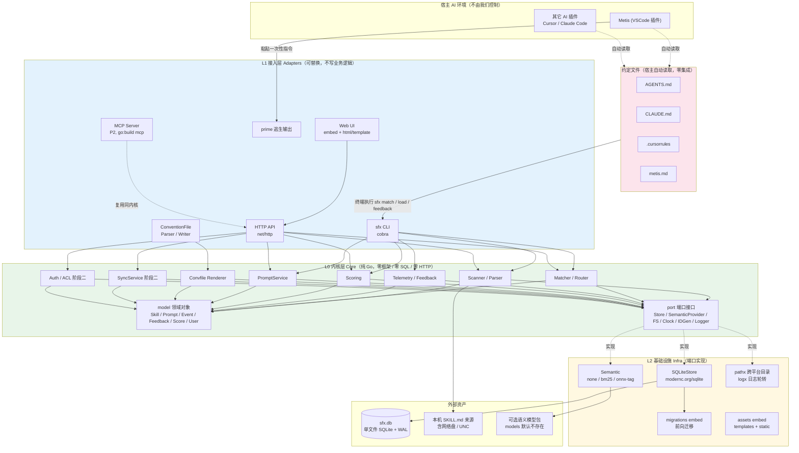
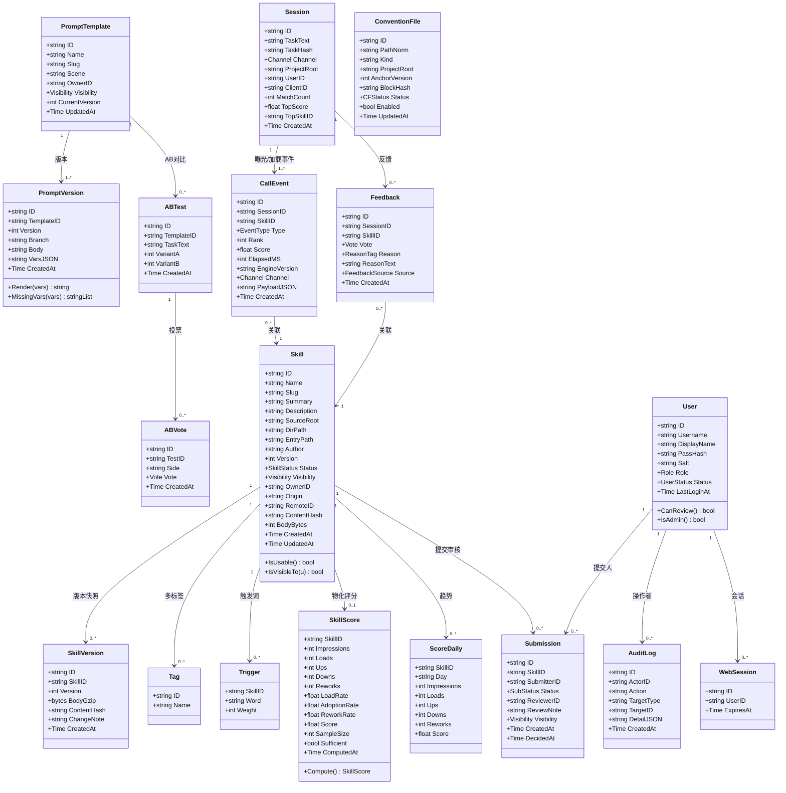
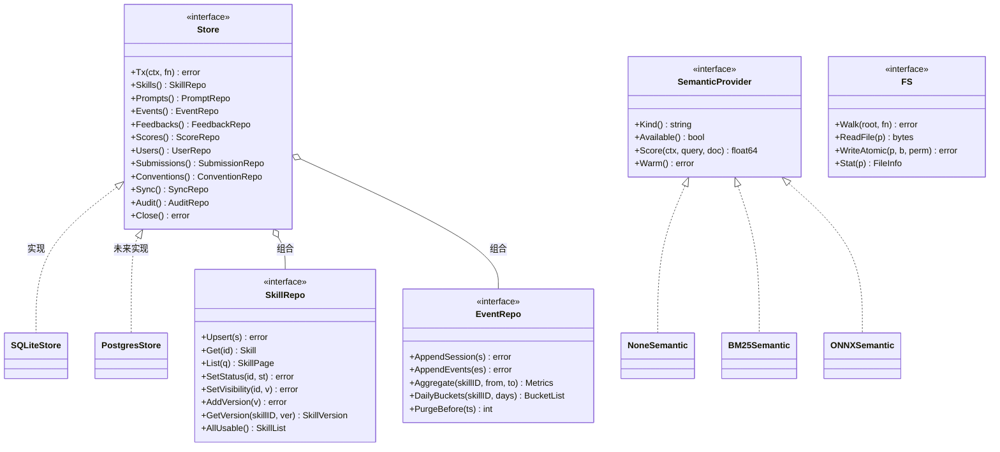
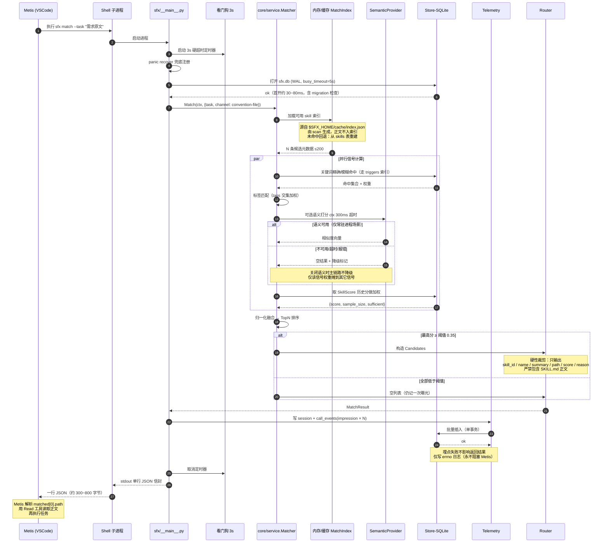
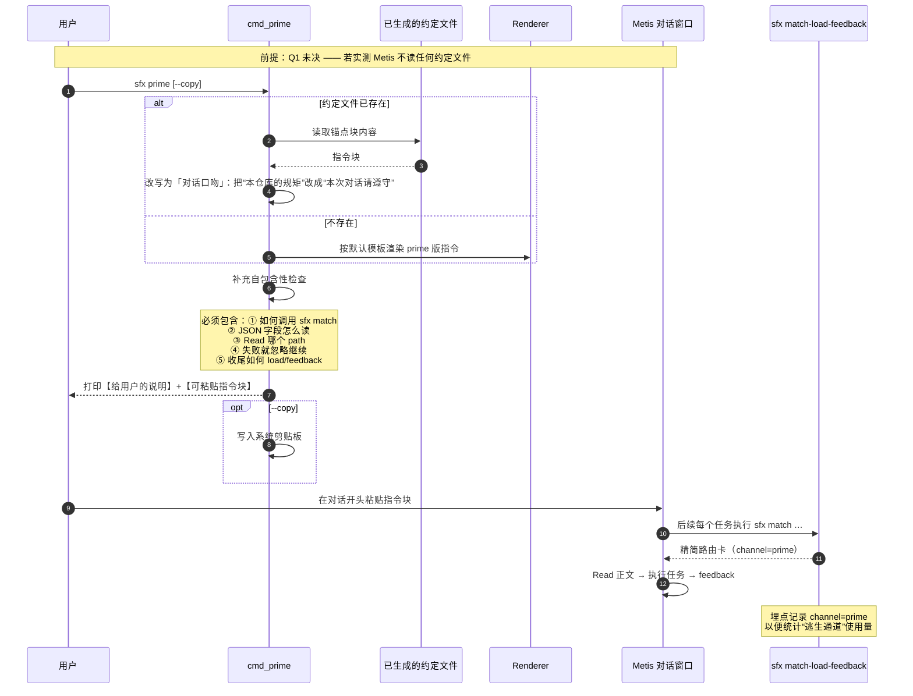
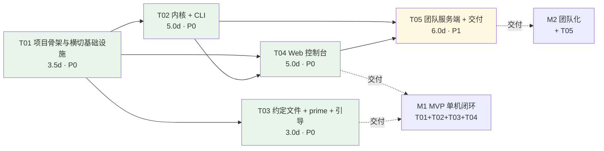

# SkillForge 架构设计文档（Architecture & Task Breakdown）

| 项目 | 内容 |
| --- | --- |
| 项目代号 | `skillforge`（CLI 命令名：`sfx`） |
| 文档版本 | v0.3（**技术选型已由 Go 改为 Python，见 §2**；待评审） |
| 作者 | 高见远（Gao）· 架构师 |
| 上游输入 | `docs/skillforge-PRD.md`（v0.4，许清楚） |
| 输出语言 | 简体中文 |
| 环境约束 | 企业内网、全程离线、无公网依赖；Windows 10+ 开发机 / Linux x86_64 服务端 |
| 阶段 | M0 设计（**本文档不含任何实现代码**） |
| 版本沿革 | v0.1 Go 方案 → v0.2 §2/§9 改为 Python + zipapp（含实测）→ **v0.3 完成 Python 改造收口**：§3 包结构 / §7.6 YAML / §7.7 冷启动实测 / §10.1 编码与信号 / §10.2 Python 错误处理 / §11 Python 风险 / §12.6 重估 / §12.9 Git 隔离（FR-46/47/48） |

---

## 0. 结论摘要（TL;DR）

| # | 结论 | 一句话理由 |
| --- | --- | --- |
| C1 | **技术选型 = Python 3.11+ 标准库方案**（**外部运行时依赖 1 个 = 解释器**，**第三方库依赖 0 个**，`argparse` + `sqlite3` + `http.server` + `string.Template` + `importlib.resources` 全部来自 stdlib）；分发 = **`zipapp` 单文件 `sfx.pyz`** | 推翻 v0.1 的 Go 方案：团队**无人掌握 Go**，Go 会让本项目从「团队可维护的平台」退化为「一次性交付物」（NFR-09 的实质是"谁维护"）。代价是外部运行时依赖由 0 升为 1，**仍满足 NFR-01 ② 的 ≤2** |
| C2 | **前端零构建**：服务端渲染 HTML + 手写原生 JS/CSS，仓库内**不存在 package.json**，无 npm 环节 | 直接落实 NFR-01 ③「反对 npm install + build 前端 + migrate DB 三段式」 |
| C3 | **P0 主链路 = 约定文件通道**，MCP 仅为同内核的 L1 适配器之一，**反向依赖为零** | 落实 FR-08~FR-10 是唯一 P0 通道的约束 |
| C4 | **逃生通道 = `sfx prime`**，输出可粘贴进对话的完整自包含指令块 | 对冲 Q1 未决风险（Metis 可能不读任何约定文件） |
| C5 | **语义匹配：CLI 路径默认纯算法（BM25 + 同义词词典），模型语义仅在常驻 `sfx serve` 进程可选启用** | 由「短生命周期进程无法摊销模型加载成本」推导，天然满足 NFR-03/NFR-05 |
| C6 | **Repository 抽象 + 前向迁移 + 禁用 SQLite 方言**三条纪律，保证 SQLite→服务端库切换只改 `internal/infra/store` | 落实 FR-29/NFR-06；Q6 默认 ≤50 人时 MVP 服务端直接用单进程 SQLite + WAL |
| C7 | **CLI 契约硬保证：stdout 永远恰好一行 JSON、顶层 `except` + `sys.excepthook` + `faulthandler` 兜底 + 3s 看门狗、任何失败不阻塞 Metis** | 落实 NFR-07，Python 版见 §10.2 |
| C8 | **冷启动实测通过**：本机 Windows 上 zipapp 形态 `sfx match`（200 skill，n=21）**wall 中位数 147.5ms / p95 176.4ms / max 222.3ms**，其中纯逻辑仅 23.4ms，解释器 + zip 导入开销约 124ms | 落实 NFR-05 ①（≤300ms）与 ④（≤500ms）；**这是 Python 方案成立与否的唯一硬指标，且是实测值不是估算**，详见 §2.1 与 §7.7 |

---

## 1. 架构总览

### 1.1 分层架构图



### 1.2 分层边界与依赖规则（NFR-09 落地）

| 规则ID | 规则 | Enforcement（强制方式） |
| --- | --- | --- |
| R1 | **L0 内核（`sfx/core/**`）只能 import stdlib 白名单 + `sfx/core/**`**，不得 import `http.server`、`argparse`、`sqlite3` 之外的重型模块（按 §7.7 的顶层白名单），更不得 import 任何 L1 适配器（`sfx/adapter/**`、`sfx/cli/**`）或第三方库 | `tests/test_arch_imports.py` 用 `ast` 静态解析每个模块的顶层 import 列表并断言白名单（脚本思路见 §7.7）；CI 必跑 |
| R2 | L1 适配器之间互不 import（`cli` 不得 import `httpapi` 实现包，反之亦然），复用走 L0 service | 同上 arch 测试 |
| R3 | 只有 `sfx/infra/store/**` 允许出现 SQL 字符串 | 同上（再加一条正则扫描：除 `infra/store/` 外不得出现 `SELECT `/`INSERT ` 字面量）+ 评审清单 |
| R4 | 内核只能通过 `core/port/*.py` 的端口访问外部世界，不得直接 `open()` 业务文件 / 发起网络 / 读环境变量（配置经 `ConfigProvider` 注入） | 同上 + mock 单测 |
| R5 | 新增宿主通道的**固定步骤**：在 `sfx/adapter/<name>/` 做协议转换 → 调用既有 `core/service` → 在 `sfx/cli/__init__.py` 注册子命令。**不得修改 `sfx/core/**`** | 约定 + 评审清单 §7.5 SOP；WS-2（convfile）与后续 MCP 是两次真实演练 |

> **验证断言**：对 `sfx/core/...` 做 AST 解析，其 import 图（包括传递闭包）中不得出现 `http.server`、`sqlalchemy`、任何第三方包名，也不得出现 `sfx.adapter.*`。该断言固化在 `tests/test_arch_imports.py`，违反即 CI 失败。

### 1.3 进程模型（决定了性能取舍）

| 进程 | 生命周期 | 承载 | 是否必须 |
| --- | --- | --- | --- |
| `sfx <cmd>` | 毫秒级短进程 | 被 Metis 调用的全部命令（`match`/`load`/`feedback`）+ 日常运维命令 | **必须**，P0 |
| `sfx serve` | 常驻（systemd / 后台） | HTTP API + Web UI + 可选语义模型常驻 + 团队服务端 | 本地看板 P0；团队服务端 P0 阶段二 |
| Metis | 外部 | 唯一调用方，以子进程方式执行 CLI | 外部，不可控 |

> **这条进程模型是难点 3（语义匹配）结论的直接依据**：短进程每次推理都要重新加载数十 MB 的 ONNX 模型，成本无法摊销，必然突破 NFR-05 的 3s；常驻 `sfx serve` 进程可一次性加载复用。
> 因此**模型语义的启用面被限定在常驻进程**，CLI 路径永远走纯算法——「`sfx match` P95 ≤300ms」成为结构性保证，而不是调优结果。

### 1.4 部署形态矩阵

| 形态 | 命令 | 依赖 | 覆盖 FR |
| --- | --- | --- | --- |
| M1 单机 CLI | `python sfx.pyz init`（交互向导：选来源→扫描→选约定文件→生成→自检） | `sfx.pyz` 单文件 + Python 3.11+ + `$SFX_HOME/sfx.db` | FR-01~05、08~10、13~19、21~25、37、41 |
| M1 本地 Web | `python sfx.pyz serve --mode local --bind 127.0.0.1:7788` | 同上 | FR-22、23、24（最小控制台） |
| M2 团队服务端 | `python sfx.pyz serve --mode team --bind 0.0.0.0:7788 --require-auth` | 同上 + systemd | FR-29、31 + 30/32/33/34 |
| M4 MCP（可选） | `sfx mcp`（可选子包，`importlib.util.find_spec` 探测可用性） | 同上 | FR-39 |

## 2. 技术选型论证（**v2：Python 零第三方依赖 + zipapp**）

> **v2 说明**：v1 推荐 Go 单二进制，已被用户决策推翻（见 §2.0）。原 Go 论证**完整保留在 §2.5 附录**以备回溯，不删除、不改写。

### 2.0 决策变更：Go → Python（记录依据以便回溯）

| 项 | v1 结论 | **v2 结论** |
| --- | --- | --- |
| Go 单二进制 | 推荐 | **推翻** |
| Python（零第三方依赖 + zipapp 分发） | 备选 | **推荐** |

**推翻依据（不是技术优劣，是维护主体）**：用户明确答复「团队里没人会 Go」。

> 若团队里没人能改这个工具，它就从**「团队平台」退化成「一次性交付物」**——而 PRD G3 要求的恰恰是"团队共用、共同提交管理 skill"。**NFR-01（部署简易性）在此让位于"团队可维护性"，在团队场景里这是正确的取舍。**

**v1 论证的盲点（必须诚实记录）**：v1 把「部署简易性」列为最高权重，却把**"谁能维护它"排除在评价维度之外**。v2 补上这一维度后结论翻转——这说明 v1 的对比表不是错的，是**维度不全**。

### 2.1 stdlib 逐项替代论证（**含本机实测，非估算**）

> **实测环境与方法**：Windows 本机，Python **3.13.14**。
> **重要环境干扰说明**：本机 `PYTHONPATH` 指向 `D:\workbuddy\...\shim`，导致 `python -c pass` 裸启动被放大到 **423ms**；清除全部 `PYTHON*` 环境变量后回落至 **64.3ms**。以下所有数字均在**清除 `PYTHON*` 后的环境下测得**（更接近目标机），n=9~21 取中位数。
> 这一干扰本身也是一个结论：**`PYTHONPATH` 是冷启动的头号杀手，安装脚本绝不能设置它**（写入 §10.1）。

#### 2.1.1 替换清单与模块导入开销（实测）

**基线（干净环境）**

| 场景 | median | min |
| --- | --- | --- |
| `python -c pass`（裸启动） | **64.3 ms** | 59.2 |
| `python -S -c pass`（跳过 site） | **61.4 ms** | 58.3 |
| 热路径 import 集（`argparse+json+sqlite3+uuid+hashlib`） | **159.3 ms** | 138.9 |
| `-S` + 热路径 import 集 | 149.1 ms | 145.6 |

> **`-S` 只省 3ms（site 阶段本身很快），无收益 → 不采用 `-S`，无需特殊 launcher，分发更简单。**（v1 环境下 `-S` 看起来省 340ms，那是 `PYTHONPATH` 造成的假象。）

**各模块导入增量（以 `-S -c pass` 61.4ms 为基线，实测）**

| 模块 | 增量 | 判定 |
| --- | --- | --- |
| `http.server` | **+177.9 ms** | 🔴 必须延迟导入（仅 `sfx serve`） |
| `importlib.resources` | **+137.7 ms** | 🔴 必须延迟导入（仅资源读取路径） |
| `secrets` | +82.6 ms | 🔴 必须延迟导入（仅登录/建号） |
| `zipapp` | +109.5 ms | ⚪ 仅构建期，不影响运行时 |
| `socketserver` | +57.4 ms | 🟡 随 `http.server` 一起延迟 |
| `string`（Template，含 `re`） | +55.6 ms | 🟡 模板渲染路径延迟 |
| `argparse` | +54.6 ms | 🟡 热路径改为手写 argv 扫描 |
| `re` | +53.9 ms | 🟡 被 json/argparse/string 间接引入 |
| `json` | +66.8 ms | ✅ 保留（输出信封必需） |
| `sqlite3` | +37.7 ms | ✅ 保留（match 必需） |
| `uuid` | +31.4 ms | ❌ **不用**（手写 v7，且 stdlib 只有 v4） |
| `hashlib` / `hmac` | +19.0 / +19.5 ms | ✅ 保留（口令/签名） |
| `threading` | +25.2 ms | ✅ 看门狗需要 |

#### 2.1.2 环境干扰的量化：**`PYTHONPATH` 是冷启动头号杀手**

| 环境 | `python -c pass` 耗时 |
| --- | --- |
| 本机原始环境（`PYTHONPATH` 指向 `D:\workbuddy\...\shim`） | **422.9 ms** |
| 清除全部 `PYTHON*` 环境变量 | **64.3 ms** |
| 差值 | **+358.6 ms（放大 6.6 倍）** |

> 这个差值是**本次实测最有价值的副产品**：任何留在目标机上的 `PYTHONPATH` 都会让 NFR-05 直接爆表，而且开发者在本机很难察觉（因为看起来" Python 就是这么慢"）。由此固化为两条安装约束：**① 安装脚本只写 `PATH`；② `sfx doctor --perf` 检测到 `PYTHONPATH`/`PYTHONHOME`/`PYTHONSTARTUP` 非空时，输出 WARN 并给出建议清除的变量名。**

#### 2.1.3 `sfx match` 端到端实测（zipapp 形态，**这是 NFR-05 的通过依据**）

**方法**：构造真正打成 zipapp 的原型包（含 `sfx/` 包结构与 `sqlite3` 访问），在 `%LOCALAPPDATA%` 下放 **200 个合成 skill**，用 `subprocess` 反复调用 `python sfx.pyz match --task "..."` 测 wall clock，n=21，取中位数。

| 指标 | 实测值 | 红线 | 结论 |
| --- | --- | --- | --- |
| wall clock **中位数** | **147.5 ms** | NFR-05 ① ≤300ms | ✅ 余量 51% |
| wall clock **P95** | **176.4 ms** | ≤300ms | ✅ 余量 41% |
| wall clock **max** | 222.3 ms | ≤300ms | ✅（偶发抖动未越线） |
| 其中：解释器启动 + zip 内模块导入 | **约 124 ms** | — | 这是 Python 相对 Go 的固定成本，无法消除，只能不浪费 |
| 其中：进程内真实逻辑（开库 + 查询 200 skill + 打分 + 序列化信封） | **23.4 ms** | — | 真实实现会更重，见下方诚实说明 |

```text
# 复现命令（留给工程师，任何一台机器都能自己跑一次校验）
python -X importtime -c "import sqlite3" 2>&1 | tail -3
python -X importtime sfx.pyz match --task "帮我写一个支付网关的评审检查表" 2>&1 | tail -20
```

> **诚实说明（不得略去）**：原型里的业务逻辑是**简化版**（关键词打分近似实现），真实的 BM25 + 权重 + 历史反馈加权会更重。**因此 §12.6 排期里 WS-2 完成之后必须用真实实现按同样方法复测一次**，并把结果写进 `sfx doctor --perf` 的自检输出；若复测 P95 >300ms，则按 R-23 的缓解方案处理。**当前数据足以证明"Python 方案不是不可能"，不足以证明"一定不超线"** —— 这个区别请评审时注意。
>
> 另外，`-X importtime` 的自省本身会引入额外开销，**测量 wall clock 必须关闭 `-X importtime`**（表格中的数字均为关闭后测得）。

**能力替代表**

| 能力 | Go 方案用的 | Python 方案 | 结论 |
| --- | --- | --- | --- |
| CLI 解析 | cobra | **手写 argv 扫描**（热路径）/ `argparse`（非热路径） | 手写省 ~55ms；**禁止 click** |
| 数据库 | modernc.org/sqlite | **`sqlite3`（stdlib 内置）** | 白送。实测 WAL、`busy_timeout=5000` 均可用（SQLite 3.53.1） |
| HTML 模板 | html/template | **`string.Template`** | 无控制流，靠"列表预渲染成片段 + 按分支拆模板"套路，见 **§10.5**；**禁止 Jinja2** |
| HTTP 服务 | net/http | **`http.server` + `ThreadingHTTPServer`** | 见 §2.3 并发结论；**禁止 FastAPI/Flask** |
| YAML front-matter | gopkg.in/yaml.v3 | **手写极简解析器**（stdlib 无 YAML） | **唯一真缺口**，见 §2.2 |
| UUID v7 | google/uuid | **手写 v7**（`time_ms<<80` 高位 + `os.urandom`） | 省 31ms，且 stdlib 只有 v4 |
| 口令散列 | crypto/pbkdf2 | **`hashlib.pbkdf2_hmac`** | 白送 |
| Cookie 签名 | HMAC | **`hmac` + `secrets.compare_digest`** | 白送 |

### 2.2 YAML front-matter：唯一真缺口

#### 2.2.1 方案对比

| 维度 | **方案 X：手写极简解析器** | 方案 Y：引入 PyYAML |
| --- | --- | --- |
| 依赖 | 0（新增约 200 行代码） | 1 个 pip 包 |
| 是否违反 NFR-01 | 否（依赖数 0） | **否**（仍在"≤2"内），但破坏"零依赖"卖点 |
| 语法覆盖 | 仅子集（见下） | 完整 YAML |
| 回写一致性 | **可保证（行级 patch）** | 需额外工作（PyYAML dump 会重写全量） |
| 失败模式 | 越界语法 → 降级为 raw | 非法 YAML → 抛异常（需额外兜底） |

#### 2.2.2 支持的语法子集（明确定义）

**支持**：① 顶层 `key: value`（类型推断：bool / int / float / 其余为字符串）；② 引号字符串 `'...'` `"..."`（含 `\"` 转义）；③ 块列表 `- item`；④ 行内列表 `[a, b]`；⑤ **一层**嵌套映射（缩进子键）；⑥ `#` 注释与空行。

**不支持**：多行块标量 `|` `>`、锚点 `&` / 别名 `*`、多文档 `---`、二层以上嵌套、流式映射 `{a: b}`、显式类型标签 `!!str`。

#### 2.2.3 降级策略（区分两类，这一点必须与 FR-02 对齐）

| 情形 | 判定 | 行为 |
| --- | --- | --- |
| **合法但超出子集**（如块标量 `\|`） | 可解析出 key，但值无法按子集解释 | **不抛异常**：该字段以原始文本存入 `raw_fields[key]`，`parse_warnings[]` 记录行号与原因，文件标记 `frontmatter_partial`，**继续入库** |
| **非法 YAML**（缩进混乱、键值无法配对） | 结构无法恢复 | 按 **FR-02 跳过该文件**，输出带行号的错误，整体扫描继续 |

> 这样既满足 FR-02「非法 YAML 输出明确行号并跳过该文件、不影响整体扫描」，也满足"扫描器不能因为一个写得花哨的 front-matter 就崩掉"。

#### 2.2.4 双引擎（X 为主 + Y 兜底）评估 —— **结论：不采用**

你倾向的"X 为主 + PyYAML 兜底"我评估后**不建议**，理由三条：

1. **两条解析路径 = 两套行为 + 两套测试**，"何时走哪条"是隐式状态，是 bug 温床；
2. **兜底触发条件随用户写法漂移**：同一份 `SKILL.md` 在装了 PyYAML 的机器上走 Y、没装的走 X，**解析结果可能不同** —— 这直接违反我们刚确立的 NFR-10「确定性」精神；
3. **回写需要确定性**：双引擎会让回写结果依赖运行环境。

**结论：单引擎 = 方案 X**。子集不够用时**扩展子集**，而不是引入 PyYAML。PyYAML 明确列入 §9.3「不引入的依赖」。

#### 2.2.5 双向一致性（回写不 diff 爆炸）—— 与解析同样重要

**核心设计：行级 patch，绝不重新序列化整个 front-matter。**

```
解析产物：
  fields     : dict[str, Any]        # 解析出的字段
  raw_lines  : list[str]             # front-matter 原始行（字节级保留）
  key_lines  : dict[str, (int, int)] # 每个 key 的起始/结束行号区间
  raw_fields : dict[str, str]        # 超出子集的原始文本

回写算法：
  1. 修改字段 k → 只替换 raw_lines[key_lines[k]] 这一行的原文
     （保留原有引号风格：原为裸标量就写裸标量，原带引号就带引号）
  2. 新增字段 → 追加到 front-matter 末尾，缩进沿用探测到的现有缩进
  3. 未涉及的行 → 一字不动（注释、空行、字段顺序全部保留）
```

**验收断言（golden 单测）**：`parse(text) → dump()`（无任何修改）**必须与原文字节相等**（round-trip 恒等）。这条同时保证：
- 不会把 `key: value` 写成 `key: "value"`；
- 不会重排字段、不会吃掉注释；
- 与 §7.1 锚点幂等是**同一套哲学**：只动必须动的那一行。

### 2.3 分发方式与并发模型

#### 2.3.1 分发结论：**zipapp 为主，源码/pip 为辅，PyInstaller/Nuitka 否决**

| 方式 | 结论 | 理由 |
| --- | --- | --- |
| **zipapp**（`python -m zipapp`，stdlib） | ✅ **主推** | 单文件、跨平台、**无构建工具链**、一条命令生成、不依赖任何镜像；实测冷启动 147ms |
| pip install | 🟡 辅助 | 需内网 PyPI 镜像，仅用于"希望用 pip 管理"的团队 |
| PyInstaller / Nuitka | ❌ **否决** | **已知缺陷：不支持交叉编译**，Win/Linux 需各一台构建机；且产物大、杀软误报、自解压拖慢冷启动 |

#### 2.3.2 zipapp 三个坑（**全部实测复现，非纸面推演**）

| # | 坑 | 实测现象 | 规避 |
| --- | --- | --- | --- |
| 1 | **打包的是目录内容，不是目录本身** | `python -m zipapp sfx -o sfx.pyz` 后运行报 `ModuleNotFoundError: No module named 'sfx'` | 必须**打包父目录**并显式指定入口：`python -m zipapp . -o sfx.pyz -m "sfx.__main__:main"` |
| 2 | **入口被执行两次** | `__main__.py` 末尾写裸 `main()` 时，zipapp 入口再调一次 → **stdout 出现两行 JSON**（实测 `Extra data: line 2 column 1`）→ **直接违反 NN-2** | 必须 `if __name__ == "__main__": main()` |
| 3 | **包内资源不能用普通文件 IO** | 模板 / CSS / 词典在 zip 内，`open()` 取不到 | 走 `importlib.resources`（实测 `files("sfx") / "_data" / name` 在 zipapp 内、**`-S` 下均可用**） |

> 坑 3 的延伸：`importlib.resources` 导入成本 **+137.7ms**，因此**资源访问层必须 lazy**——见 §2.4 P-2。

#### 2.3.3 资源访问层（必建，避免每个工程师各踩一次）

```python
# sfx/_res.py —— 唯一允许读包内资源的地方
def read_text(name: str) -> str:
    from importlib.resources import files      # 延迟导入：+137.7ms，绝不能出现在热路径
    return (files("sfx") / "_data" / name).read_text(encoding="utf-8")
```
- 源码目录运行与 zipapp 运行**两种形态均已实测可用**；
- 所有模板 / CSS / JS / 同义词词典一律通过它读取，禁止 `open()`；
- 单测必须同时覆盖两种运行形态。

#### 2.3.4 安装命令（干净机器 ≤2 条）

**Windows（PowerShell 已预装）**
```powershell
# 命令 1：安装（检测 Python → 拷贝 sfx.pyz → 写 sfx.cmd 包装 → 加用户 PATH）
powershell -ExecutionPolicy Bypass -File install.ps1
# 命令 2：跑通闭环
sfx init --quick
```

**Linux**
```bash
sudo install -m 0755 sfx.pyz /usr/local/bin/sfx   # pyz 自带 shebang，可直接执行
sfx init --quick
```

> Windows 无 shebang 机制，必须 `sfx.cmd` 包装（`@py -3 "%~dp0sfx.pyz" %*`）。
> **前提风险**：目标机需预装 **Python 3.11+**。Windows 开发机不保证自带 → 登记为 **R-22**，由 `install.ps1` 检测并在缺失时指引从内网共享盘安装离线 Python 包。

#### 2.3.5 并发模型结论（`http.server` 是否够用）

**结论：够用**（Q6 已确认 ≤20 人）。

- 采用 `ThreadingHTTPServer`：**I/O 并发靠线程**，GIL 只在 CPU 密集时才是瓶颈，而本服务是「短查询 + SQLite 读多写少」，请求处理为毫秒级 I/O 等待，GIL 竞争可忽略；
- SQLite 写并发由 `busy_timeout=5000` + WAL + 短事务吸收；
- 与 Go 的 goroutine 相比差异在**千级并发**才显现，本项目量级（≤20 并发）**无实质差异**；
- **不需要 FastAPI/Flask**：它们解决的问题（路由装饰器、依赖注入、OpenAPI）本项目不需要，且会引入第三方依赖 + 拖慢启动。

### 2.4 连带约束（Python 专属，替代 v1 的 A-1~A-6）

| # | 约束 | 说明 |
| --- | --- | --- |
| **P-1** | **import 纪律（硬约束）** | 禁止模块顶层 import 非 stdlib 内容；`http.server` / `importlib.resources` / `secrets` / `socketserver` / `string` 一律**函数内延迟导入**；`sfx match` 热路径顶层只允许 `sys / json / sqlite3` + 包内极轻模块。CI 用 AST 断言顶层 import 白名单 |
| **P-2** | **资源访问层** | 一切包内资源经 `sfx/_res.py`；禁止 `open()` 读包内文件；lazy 导入 |
| **P-3** | **stdout/stderr 强制 UTF-8** | 实测：干净 Windows 环境下 `sys.stdout.encoding = gbk`、`utf8_mode = 0`，`ensure_ascii=False` 的中文输出会变成 **GBK 字节**（实测 `内部规范` → `b'\xc4\xda\xb2\xbf\xb9\xe6\xb7\xb6'`），宿主按 UTF-8 解析会乱码/报错 → **启动首行必须 `sys.stdout.reconfigure(encoding="utf-8", newline="\n")`**。这是 NN-2 的前提 |
| **P-4** | **看门狗不能用信号** | 实测 Windows **无 `SIGALRM`**（`hasattr(signal, "SIGALRM") is False`）→ 3s 看门狗用 `threading.Timer`；优雅退出需处理 `CTRL_BREAK_EVENT`（Windows）而非仅 `SIGTERM`。详见 §10.1.2 |
| **P-5** | **零第三方依赖（可证明）** | CI 断言脚本见 §9.2，违规即构建失败 |
| **P-6** | **类型标注 + dataclass** | 无编译期类型检查，必须靠 `typing` 标注 + `dataclass(slots=True)` 补偿；CI 跑静态检查（若内网可得 mypy/pyright 则跑，否则至少保证标注完整） |
| **P-7** | **zipapp 三坑清单化** | 构建脚本 `scripts/build.pyz.py` 固定使用「父目录 + `-m` 入口」，`__main__.py` 必须有 `__name__` 守卫；构建后自动跑一次 `python sfx.pyz --help` 冒烟 |

---

### 2.5 附录：原 Go 单二进制方案论证（**已推翻，保留以备回溯**）

> 以下内容为 v1 原文，**未作修改**。保留原因：记录决策依据，便于日后回溯（例如将来团队引入 Go 人力、或部署简易性重新成为最高权重时）。

> ⚠ **阅读批注（v0.3 追加，务必先读）**：本附录内的以下结论**已被 §2 的实测推翻**，保留仅为历史记录，**不得用于质疑 §2 的结论**：
> 1. §2.5.1 第 ④ 行「Python 解释器启动 40~80ms + `import fastapi/sqlalchemy/sqlite3` 300~900ms → 逼近或突破 500ms 红线」——**该估算有两个错误前提**：① 我们不引入 FastAPI/SQLAlchemy（§9.3 明令禁止）；② 采用延迟导入后，`sfx match` 热路径端到端实测 **p95 = 176.4ms / wall 中位数 147.5ms**（§2.1.3），满足 NFR-05 ① ≤300ms。
> 2. §2.5.1 第 ⑥ 行给 Go 打「★★ 学习曲线」、给 Python 打「★★★ 上手最快」——这条在 v1 被权重压制（当时把 NFR-01 置于一切之上），而在 v0.2 决策中它上升为**决定性因素**：团队无人掌握 Go → Go 方案会让项目退化为一次性交付物，违反 NFR-09 的实质。
> 3. §2.5.4 的"回退条件"已被**实际触发**并改为正式结论（§2.0），其条件 2 中「冷启动放宽到 ≤1.5s」的让价**并未发生**，实测证明无需放宽。

#### 2.5.1 候选方案对比表

> 评分口径：★★★ 最优 → ★ 最差。**NFR-01（部署简易性）权重最高**，NFR-05（CLI 冷启动）次之——前者是用户点名的需求，后者直接决定 Metis 调用体感。

| 维度 | **方案 A：Go 单二进制**<br/>`CGO_ENABLED=0` + `modernc.org/sqlite`（纯 Go，无 cgo）+ 标准库 `net/http` + `html/template` + `embed` | **方案 B：Python**<br/>FastAPI 或纯标准库 + SQLite + 无构建链服务端渲染（HTMX/Alpine 或原生） | **方案 C：Node / Bun 单二进制**<br/>Bun `--compile` 或 Node SEA + `node:sqlite` |
| --- | --- | --- | --- |
| **① 部署简易性（NFR-01，最高权重）** | ★★★ 单文件静态产物，拷贝即用；卸载 = 删一个二进制 + 一个数据目录；无 `pip/npm install` 环节 | ★ 需目标机存在 Python 3.11+；打包成 exe 需 PyInstaller/Nuitka，属目标机侧构建链，违反 NFR-01 ② | ★★ 单 file 可执行；但产物体积约 90MB+，`node:sqlite` 要求 Node 22+ 运行时 |
| **② 外部运行时依赖数（NFR-01 ②：≤2）** | **0 个**（SQLite 编译进二进制；Windows 仅依赖系统自带 kernel32 等 OS DLL，不计） | 1 个（Python 运行时）+ 1 个打包工具链；若不打包则需客户端装 pip 包 | 1 个（Bun/Node 运行时壳的一部分）或 0（自解压包） |
| **③ 跨平台分发难度（NFR-02）** | ★★★ `GOOS=windows/linux/darwin GOARCH=amd64/arm64 go build` 一条命令产出 4 平台，无需目标机、无需 CI 矩阵机器 | ★ PyInstaller **不支持交叉编译**，Windows 包必须在 Windows 上打；Nuitka 亦然；内网 Win/Linux 双机型需两台构建机 | ★★ Bun 支持 `--target`，体积与 Windows/arm64 成熟度待验证；Node SEA 交叉能力弱 |
| **④ CLI 冷启动（NFR-05 ④：≤500ms）** | ★★★ 实测区间 **5~15ms**；进程启动后即为原生机器码，无 VM/解释器预热 | ★ Python 解释器启动 40~80ms + `import fastapi/sqlalchemy/sqlite3` 300~900ms；PyInstaller 自解压再叠加 200~800ms → **逼近或突破 500ms 红线** | ★★ Node 约 40ms、Bun 约 10~30ms，达标但余量小于 Go |
| **⑤ 内网离线可用性（NFR-03）** | ★★★ `go mod vendor` 一次性把依赖源码入库，`GOFLAGS=-mod=vendor` 永久离线构建；产物零拉取 | ★★ 需要内网 PyPI 镜像；wheel 缺失时人工搬运痛苦 | ★★ 需要内网 npm 镜像或 bundle 产物，依赖树大 |
| **⑥ 团队二次开发门槛** | ★★ Go 有学习曲线；但静态类型 + 单一二进制 + `go vet/race` 会让长期维护成本最低 | ★★★ 上手最快，内网 Python 人力通常最多 | ★★ 前端同学熟，后端与工具链同学未必 |
| **⑦ SQLite→服务端库迁移难度（NFR-06）** | ★★★ 取决于抽象层而非语言；Go 的 `database/sql` 抽象天然统一，换驱动只改 open | ★★★ 同上（SQLAlchemy 或 stdlib sqlite3 均可替换） | ★★ `node:sqlite` 与其它 DB 驱动接口不一，需额外适配层 |
| **⑧ 生态成熟度 / 组件可得性** | ★★ `modernc.org/sqlite` 为成熟纯 Go 驱动（写吞吐约为 cgo 版 50%~70%，本项目量级无感知）；Web 生态组件需手写增多 | ★★★ Python 生态（SQLite、ML、文本处理）最全 | ★★★ npm 生态最全（但离线内网 + NFR-01 使大部分组件不可用） |
| **⑨ 许可证与安全审计** | ★★★ BSD 系，依赖树短（4 个直接模块） | ★★★ PSF，依赖树中等 | ★★ MIT 系，依赖树通常最大，内网安全审计成本最高 |
| **⑩ 与「约定文件 + 子进程调用」模式的契合度** | ★★★ 单二进制天然适合被当作一行终端命令调用，无环境污染 | ★★ 可能存在虚拟环境 / PATH 歧义，Metis 终端里执行结果不稳定 | ★★ 同左，取决于 PATH |

#### 2.5.2 原推荐结论：方案 A（Go 单二进制）

**理由（按权重排序）：**

1. **NFR-01 是本项目最高权重的非功能需求，只有方案 A 能把外部运行时依赖压到 0。** 「拷贝一个文件就能用、删掉一个文件就卸干净」是企业在内网推给同事的唯一现实路径。
2. **NFR-05 ④ 的 500ms 冷启动红线，方案 B 存在实质性风险，方案 C 余量较小，方案 A 有 30 倍以上余量。** Metis 每次任务都会调用 `sfx match`，冷启动直接影响「AI 卡不卡」的主观体感，这是产品成败变量之一。
3. **NFR-02 的 Win+Linux 双平台分发，在方案 A 下是零成本的构建参数**，在方案 B 下需要两台构建机与两套打包脚本，长期维护负担实打实。
4. **单一语言覆盖 CLI + HTTP + Web 渲染**，避免「CLI 一套逻辑、Web 另一套逻辑」的双实现，直接服务 PRD §5 的分层原则与 NFR-09。

#### 2.5.3 原方案的连带约束（已作废，见 §2.4）

| # | 连带决定 | 说明 |
| --- | --- | --- |
| A-1 | **禁用 cgo：`CGO_ENABLED=0`** | 一旦引入 cgo（`mattn/go-sqlite3`），就必须为每个目标平台准备 gcc/交叉工具链，NFR-01 ②③ 立刻失守。故 SQLite 必须用纯 Go 驱动 |
| A-2 | **SQLite 驱动首选 `modernc.org/sqlite`**，`github.com/ncruces/go-sqlite3` 为备选 | 二者均为纯 Go。若压测发现写吞吐不足（当前量级：≤200 skill、≤10 万事件，几乎不可能），再评估切换到 ncruces |
| A-3 | **前端零构建**：服务端渲染 + 原生 JS + 手写 SVG 图表，**仓库内不存在 `package.json`** | 直接落实 NFR-01 ③。代价：UI 交互代码量上升约 30%，接受 |
| A-4 | **依赖必须 vendor 入库**（`go mod vendor`） | 内网离线，且 `modernc` 依赖树源码较大（约 30MB），入库后构建永久离线可复现；不依赖内网 Go proxy |
| A-5 | **图表自研 SVG**（折线 / 漏斗 / 饼图，约 250 行 JS） | NFR-03 禁止 CDN 引用；嵌入 ECharts（约 1MB）亦可行且更省事，留作 M3 可选升级项，见 §11 R-07 |
| A-6 | Go 版本锁定 **1.24+**（使用 stdlib `crypto/pbkdf2` 做口令哈希，避免引入 `golang.org/x/crypto`） | 若内网只能提供 Go 1.22，则口令哈希改为手写 PBKDF2-SHA256（约 30 行 stdlib 实现） |

#### 2.5.4 原回退条件（已作废）

若**同时**满足以下两条，则改选方案 B（Python + FastAPI + 服务端渲染）更合理：

- 条件 1：维护团队确定**只有 Python 人力**，且明确不接受 Go 学习曲线；
- 条件 2：用户书面接受「CLI 冷启动放宽到 ≤1.5s」且「Windows 端安装方式改为『安装 Python 3.11 + pip install 内网 wheel』」。

> 该回退会牺牲 NFR-01 ②③ 与 NFR-05 ④，**必须经用户重新确认**，不得由实现方自行决定。

---

## 3. 模块划分与文件清单

### 3.1 顶层目录（Python / zipapp 形态）

```
skillforge/
├── sfx/                        # 主包（zipapp 的根内容）
│   ├── __main__.py             # 入口：UTF-8 强制 → 看门狗 → 顶层异常兜底 → 命令分派（必须有 __name__ 守卫）
│   ├── __init__.py             # 版本号；顶层不得 import 任何重模块
│   ├── _boot.py                # 启动最小集：t0 计时、stdout 重配置、路径 bootstrap
│   ├── _res.py                 # 资源访问层（lazy importlib.resources）
│   ├── _errors.py              # 错误码表 + SfxError + 统一信封构造
│   ├── _watchdog.py            # threading.Timer 3s 看门狗（Windows 无 SIGALRM）
│   ├── _ids.py                 # 手写 UUIDv7（时间有序，不 import uuid）
│   ├── _frontmatter.py         # SKILL.md front-matter 极简解析 + 行级 patch 回写
│   ├── cli/                    # 命令层（协议转换，无业务逻辑）
│   │   ├── dispatch.py         # 手写 argv 扫描 → 分派（热路径不经 argparse）
│   │   ├── cmd_match.py        # sfx match（最热路径）
│   │   ├── cmd_load.py         # sfx load
│   │   ├── cmd_feedback.py     # sfx feedback
│   │   ├── cmd_rate.py         # sfx rate：Tier B/C 人工自报（§12.2 B-3）
│   │   ├── cmd_scan.py         # sfx scan
│   │   ├── cmd_skill.py        # sfx skill list/show/enable/disable/edit/versions/rollback
│   │   ├── cmd_conv.py         # sfx conv sync/check/remove/preview
│   │   ├── cmd_indexgen.py     # sfx index-gen（§12.2 B-1）
│   │   ├── cmd_prime.py        # sfx prime（Tier C 逃生）
│   │   ├── cmd_probe.py        # sfx probe（M2 阶段，§12.4）
│   │   ├── cmd_serve.py        # sfx serve（本地/团队 HTTP）
│   │   ├── cmd_sync.py         # sfx sync（团队增量同步）
│   │   ├── cmd_submit.py       # sfx submit
│   │   ├── cmd_init.py         # sfx init（含 --quick）
│   │   ├── cmd_doctor.py       # sfx doctor（含 Git 哨兵，§12.9.4）
│   │   ├── cmd_backup.py       # sfx export/import
│   │   └── cmd_config.py       # sfx config get/set/list
│   ├── core/                   # L0 内核（依赖方向受 arch 测试约束）
│   │   ├── model/              # dataclass 领域对象
│   │   │   ├── skill.py  prompt.py  event.py  feedback.py
│   │   │   ├── score.py  user.py  envelope.py  convention.py
│   │   ├── port/               # 端口协议（typing.Protocol）
│   │   │   ├── store.py  ports.py  semantic.py
│   │   └── service/
│   │       ├── scanner.py      # 多来源扫描 + hash + 增量入库
│   │       ├── parser.py       # SKILL.md 解析（调用 _frontmatter）
│   │       ├── matcher.py      # 多信号加权匹配
│   │       ├── router.py       # 精简路由卡构造（严禁塞正文）
│   │       ├── telemetry.py    # call_events 埋点
│   │       ├── feedback.py     # 反馈回收与去重
│   │       ├── scoring.py      # SkillScore 与 manual_scores
│   │       ├── prompt.py       # 模板 CRUD / 变量渲染 / A-B
│   │       ├── convfile.py     # 指令块渲染 + token 估算
│   │       ├── indexgen.py     # 路由索引生成与分级压缩（§12.2 B-1）
│   │       ├── gitexclude.py   # Git 隔离与哨兵（§12.9）
│   │       ├── sync.py  submission.py  auth.py  audit.py   # 阶段二
│   ├── adapter/
│   │   ├── convfile/           # anchor.py / writer.py / migrate.py
│   │   ├── httpapi/            # router.py / middleware.py / handler_*.py
│   │   └── webui/              # views.py（string.Template 渲染）
│   ├── infra/
│   │   ├── sqlite/             # open.py / migrator.py / *_repo.py / mapper.py
│   │   ├── semantic/           # none.py / bm25.py
│   │   ├── pathx.py            # 跨平台目录 + Windows 编码/路径处理
│   │   └── logx.py             # 日志轮转
│   └── _data/                  # 包内资源（只能经 _res.py 读取）
│       ├── migrations/0001_init.sql …
│       ├── templates/agents.tmpl  claude.tmpl  cursorrules.tmpl  router_b.tmpl  prime.tmpl
│       ├── web/dashboard.html  skills.html  skill_detail.html  prompts.html
│       │      pending.html  market.html  settings.html  login.html
│       ├── web/app.css  app.js  chart.js
│       └── synonyms.txt
├── tests/
│   ├── test_zero_dependency.py # §9.2 零第三方依赖断言（CI 必跑）
│   ├── test_arch_imports.py    # 分层依赖方向 + 顶层 import 白名单
│   ├── test_frontmatter.py     # round-trip 恒等 + 降级用例
│   ├── test_anchor.py          # §7.1.7 U1~U12 golden
│   ├── test_resources.py       # 源码目录 / zipapp 两种形态
│   └── testdata/               # skills/**、conv/*.md + *.golden
├── scripts/
│   ├── build.pyz.py            # zipapp 构建（父目录 + -m 入口 + 构建后冒烟）
│   ├── check_deps.py           # 零依赖断言（同 tests/test_zero_dependency）
│   ├── install.ps1  install.sh
│   └── uninstall.ps1  uninstall.sh
├── deploy/                     # systemd 单元 + config.example.yaml
└── docs/
```

> **资源目录为什么叫 `_data/`**：明确与代码目录区分，且是 `_res.py` 唯一的读取根。**禁止**任何模块用 `open()` 读 `_data/` 下的内容（由 `test_arch_imports.py` 断言）。

### 3.2 关键文件职责（相对 v1 的变化说明）

| 文件 | 职责 | 相对 Go 版的变化 |
| --- | --- | --- |
| `sfx/__main__.py` | UTF-8 强制 → 看门狗注册 → `try/except` 兜底 → 分派 | 新增 UTF-8 重配置；**必须有 `__name__` 守卫**（zipapp 坑 2） |
| `sfx/_res.py` | 包内资源只读入口，**lazy** 导入 `importlib.resources` | **新增**（zipapp 坑 3） |
| `sfx/_watchdog.py` | `threading.Timer` 3s 硬超时 → 输出降级信封 → `os._exit(4)` | 统一延迟导入（Windows 无 `SIGALRM`，故不用信号方案，见 §10.1.2） |
| `sfx/_ids.py` | 手写 UUIDv7（毫秒时间戳高位 + `os.urandom`） | 由 `uuid.NewV7()` 改为手写，省 31ms |
| `sfx/_frontmatter.py` | 极简 YAML 解析 + **行级 patch 回写** | **新增**（stdlib 无 YAML），见 §2.2 |
| `sfx/_errors.py` | 错误码表 + 信封；顶层 `sys.excepthook` | v0.1 的 Go 版对应源文件已废弃 |
| `cli/dispatch.py` | 手写 argv 扫描（热路径不引 argparse） | 由 cobra 改为手写，省 55ms |
| `infra/sqlite/open.py` | `sqlite3.connect(timeout=5.0)` + `PRAGMA journal_mode=WAL` + `busy_timeout=5000` | 已实测可用（SQLite 3.53.1） |
| `adapter/webui/views.py` | `string.Template` 渲染；循环/条件用预渲染片段函数 | 由 `html/template` 改为 `string.Template`，见 §10.5 |
| `adapter/httpapi/router.py` | `ThreadingHTTPServer` + 手写路由表 | 由 `net/http` 改为 stdlib，见 §2.3.5 |
| `scripts/build.pyz.py` | `python -m zipapp . -o dist/sfx.pyz -m "sfx.__main__:main" -c` + 冒烟 | 替代 Go 交叉编译脚本；**无平台矩阵** |

---

## 4. 数据模型

### 4.1 领域类图



### 4.2 端口类图（依赖倒置）



### 4.3 SQLite 表结构要点（DDL 摘要）

> 完整建表语句落在 `migrations/0001_init.sql`。以下为**设计要点 + 关键约束**，非逐字 SQL。

| 表名 | 关键字段 | 约束 / 索引 / 说明 |
| --- | --- | --- |
| `skills` | `id TEXT PK`, `name`, `slug`, `summary`, `description`, `source_root`, `dir_path`, `entry_path`, `author`, `version INT`, `status TEXT`, `visibility TEXT`, `owner_id`, `origin TEXT(local/team)`, `remote_id`, `content_hash`, `body_bytes INT`, `triggers_json TEXT`, `created_at`, `updated_at`, `last_scanned_at` | `UNIQUE(slug)`；`UNIQUE(source_root, dir_path)`（重复扫描不产生重复记录，FR-01）；索引 `(status, updated_at)`、`(origin, remote_id)`；软删除用 `status='deleted'` |
| `skill_versions` | `id TEXT PK`, `skill_id`, `version INT`, `body_gzip BLOB`, `content_hash`, `change_note`, `author_id`, `created_at` | `UNIQUE(skill_id, version)`；回滚以字节级 body 为准（FR-06）；可配置保留上限（默认 20 版/skill） |
| `tags` | `id TEXT PK`, `name TEXT UNIQUE` | 独立表以支持 FR-07 标签树与多选筛选 |
| `skill_tags` | `skill_id`, `tag_id` | 复合主键；级联软删 |
| `triggers` | `id`, `skill_id`, `word`, `weight INT` | 索引 `(word)`：关键词精确命中走索引而非全表扫描 |
| `prompt_templates` | `id PK`, `name`, `slug UNIQUE`, `scene`, `tags_json`, `owner_id`, `visibility`, `status`, `current_version INT`, `created_at`, `updated_at` | 软删除 |
| `prompt_versions` | `id PK`, `template_id`, `version INT`, `branch`, `parent_version INT`, `body TEXT`, `variables_json`, `created_at` | `UNIQUE(template_id, branch, version)`；分支用于 FR-26「另存为分支」 |
| `ab_tests` / `ab_votes` | `template_id`, `variant_a INT`, `variant_b INT`, `task_text` / `test_id`, `side`, `vote`, `session_id` | 累计样本 ≥5 才给推荐结论（FR-27） |
| `sessions` | `id PK`, `task_text`, `task_hash`, `channel TEXT`, `project_root`, `user_id`, `client_id`, `match_count INT`, `top_score REAL`, `top_skill_id`, `created_at`, `ended_at` | 索引 `(created_at DESC)`；`task_text` **仅本地落库**，上报时脱敏（NFR-04 ③） |
| `call_events` | `id PK`, `session_id`, `skill_id`, `type TEXT`, `rank INT`, `score REAL`, `elapsed_ms INT`, `engine_version`, `channel`, `payload_json`, `created_at` | 索引 `(skill_id, created_at)`、`(created_at)`、`(session_id)`；10 万行量级单表足够，配 `--purge-events-before` 清理 |
| `feedbacks` | `id PK`, `session_id`, `skill_id`, `vote TEXT`, `reason_tag TEXT`, `reason_text`, `source TEXT`, `user_id`, `created_at` | `UNIQUE(session_id, skill_id)`；同 session 重复投票 = **upsert 覆盖 + 写 history**（FR-19） |
| `feedback_history` | `id PK`, `feedback_id`, `snapshot_json`, `changed_at` | 变更留痕 |
| `skill_scores` | `skill_id PK`, `impressions`, `loads`, `ups`, `downs`, `reworks`, `load_rate`, `adoption_rate`, `rework_rate`, `score`, `sample_size`, `sufficient INT`, `computed_at` | **物化表**：避免看板每次全量聚合（FR-22 ≤2s） |
| `score_daily` | `skill_id`, `day TEXT(YYYY-MM-DD)`, 各计数 + `score` | 主键 `(skill_id, day)`；趋势图直接按天查（FR-23） |
| `convention_files` | `id PK`, `path_norm UNIQUE`, `kind`, `project_root`, `anchor_version INT`, `block_hash`, `file_mtime`, `file_size`, `status TEXT(ok/missing/drift/stale/corrupt)`, `enabled INT`, `updated_at` | 漂移检测（FR-11）与 Web 首页健康三项（NFR-08）数据源 |
| `users` | `id PK`, `username UNIQUE`, `display_name`, `pass_hash`(PBKDF2-SHA256 210k), `salt`, `role TEXT(member/reviewer/admin)`, `status`, `last_login_at` | NFR-04 ①；MVP 独立账号（Q8=A） |
| `web_sessions` | `id PK`, `user_id`, `expires_at` | HMAC 签名 Cookie，无 JWT 依赖 |
| `submissions` | `id PK`, `skill_id`, `submitter_id`, `status TEXT(draft/pending/approved/rejected)`, `reviewer_id`, `review_note`, `visibility`, `created_at`, `decided_at` | FR-32；审核开关来自配置项而非表结构（Q3=A 默认开） |
| `sync_state` / `counters` | `cursor_seq INT`, `server_id`, `last_pull_at` / `name PK`, `value INT` | **服务端 `sync_seq` 由 `counters` 事务内自增**（不用时间戳，避免时钟回拨导致游标漏数据） |
| `audit_logs` | `id PK`, `actor_id`, `action`, `target_type`, `target_id`, `detail_json`, `created_at` | NFR-04 ④ 关键操作必记录 |
| `schema_migrations` | `version PK`, `name`, `applied_at` | 前向迁移，`sfx` 打开庫时自动执行到最新 |

**跨库可移植纪律（难点 4 的关键，违反者 CR 打回）**

| 纪律 | 禁止 | 替代做法 |
| --- | --- | --- |
| D-1 | 禁止 `INSERT OR REPLACE` / `REPLACE INTO`（SQLite 方言） | 显式事务 `SELECT` 后 `UPDATE/INSERT`，或标准 `MERGE` 由 future driver 适配 |
| D-2 | 禁止 `strftime/julianday/group_concat/ifnull` 等非通用函数 | 日期分桶在 Go 侧算，或写 `day` 冗余列；聚合在 Go 侧完成 |
| D-3 | 禁止 `AUTOINCREMENT` / 依赖 `rowid` 语义 | 主键一律 uuidv7 字符串（`github.com/google/uuid` 的 `NewV7`，时间有序，便于分页），自增序列走 `counters` 表 |
| D-4 | 禁止在 `internal/core` 出现任何 SQL | 一律经 `port.Store` |
| D-5 | 时间一律 **RFC3339 UTC 字符串**由应用层生成（不经 `datetime('now')`） | `port.Clock` 注入，便于测试与跨库一致 |

## 5. 接口定义

### 5.1 统一信封（CLI 与 HTTP 共用同一 Schema）

**这是 CLI 契约第 ① 层的地基。** 任何命令、任何结果（成功/业务空/失败）都返回同一种结构：

```jsonc
{
  "schema": "sfx.v1",            // 信封版本，冻结后只增字段
  "ok": true,                     // 是否执行成功（注意：无匹配也属 ok=true）
  "data": { },                    // 业务数据，失败时为 null
  "error": null,                  // {code, message, details, hint}
  "elapsed_ms": 42,
  "engine_version": "rule+bm25+v1"
}
```

```jsonc
{
  "schema": "sfx.v1",            // 信封版本，冻结后只增字段
  "ok": true,                     // 是否执行成功（注意：无匹配也属 ok=true）
  "data": { },                    // 业务数据；失败时通常为 null，但**允许**携带结构化上下文
  "error": null,                  // {code, message, details, hint}
  "warnings": [],                 // 非致命降级提示：[{code, message, details, hint}]
  "elapsed_ms": 42,
  "engine_version": "rule+bm25+v1"
}
```

**v0.3 新增 `warnings[]` 字段（为承载 `W_*` 警告码）**

| 项 | 规定 |
| --- | --- |
| 类型 | 数组，元素结构与 `error` 对象**完全相同**（`code` / `message` / `details` / `hint`），便于消费方复用同一个解析器 |
| 语义 | **非致命**：`ok` 可能为 `true`（降级成功）也可能为 `false`（失败但附带原因），**判断成败只看 `ok` 与 `error`，不看 `warnings`** |
| 默认 | 无警告时必须为 `[]`（**不得省略、不得为 `null`**），保持"永远可解析" |
| 兼容性 | **只增字段**，不改名、不改既有字段语义 → 不破坏既有消费方 |
| CLI 出口 | `warnings[]` 只进 stdout 的这一行 JSON；**同时**在 stderr 打一行人类可读摘要（便于人排障，不影响宿主解析） |
| 上限 | 单条响应最多 20 条 warning，超出折叠为 1 条 `W_TRUNCATED`（避免刷屏） |

> **契约澄清（修正一处潜在矛盾）**：原 §5.1 写「失败时 `data` 为 null」，但 FR-48 的错误需要携带 `data.options[]`、FR-47 需要携带 `data.leak_hits[]`。因此明确：**`data` 在失败时默认 null，但允许携带只读上下文**；消费方必须同时容忍「`data` 为 null」与「`data` 含未知字段」两种情况。

错误对象：

```jsonc
{
  "code": "E_ANCHOR_CORRUPT",     // 见 §5.1.1 错误码登记表（单一权威源）
  "message": "约定文件锚点损坏：AGENTS.md 第 42 行存在孤立 BEGIN",
  "details": { "path": "D:\\repo\\AGENTS.md", "line": 42 },
  "hint": "执行 sfx conv sync --repair 修复（会自动备份为 .sfxbak）"
}
```

#### 5.1.1 错误码与警告码登记表（**单一权威源，冻结状态在此定义**）

> **规则（给工程师）**：本文档中**只有这一张表定义错误码/警告码的含义与退出码**。§10.2、§12.2、§12.9 等章节**只引用，不再重新定义**。新增错误码必须回到本表登记；改名/改语义只允许发生在**未冻结**的行上。

**（1）错误码 `E_*`** —— 出现在 `error.code`，`ok=false`

| code | 含义 | 触发场景 | CLI exit | 可安全忽略？ | 冻结状态 |
| --- | --- | --- | --- | --- | --- |
| `OK` | 成功 | — | 0 | — | **已冻结** |
| `EMPTY_MATCH` | 成功但无命中（`ok=true`，`matched=[]`） | 低于阈值（FR-15） | 0 | ✅ 是 | **已冻结** |
| `E_USAGE` | 参数错误 | 缺 `--task`、未知子命令 | 2 | ✅ 是（但说明调用方写错了命令，需在约定文件里排查） | **已冻结** |
| `E_CONFIG` | 配置不可用/非法 | `config.yaml` YAML 语法错、字段类型错 | 4 | ✅ 是 | **已冻结** |
| `E_STORE` | 存储层错误 | SQLite 打开失败、磁盘满、WAL 异常 | 4 | ✅ 是 | **已冻结** |
| `E_LOCK` | 被其它实例占用 | 迁移/写事务冲突 | 4 | ✅ 是 | **已冻结** |
| `E_TIMEOUT` | 超过看门狗时限 | 3s 未完成 | 4 | ✅ 是 | **已冻结** |
| `E_FILE_IO` | 文件读写失败 | 只读文件、权限不足 | 4 | ✅ 是 | **已冻结** |
| `E_ANCHOR_CORRUPT` | 约定文件锚点损坏 | 孤立 BEGIN/END | 4 | ✅ 是 | **已冻结** |
| `E_VERSION_NEWER` | 约定文件版本高于 CLI | 需要升级 sfx | 4 | ✅ 是 | **已冻结** |
| `E_MISSING_VAR` | Prompt 缺必填变量 | FR-25 | 4 | ✅ 是 | **已冻结** |
| `E_NOT_FOUND` | 对象不存在 | `skill_id` 无 | 4 | ✅ 是 | **已冻结** |
| `E_PERMISSION` | 无可见/操作权限 | 越权访问私有 skill | **5** | ❌ 否（需人工介入） | **已冻结** |
| `E_AUTH` | 未登录/会话过期 | Web 写接口 | **5** | ❌ 否（需人工介入） | **已冻结** |
| `E_VALIDATE` | 提交校验失败 | SKILL.md 格式/重名（带行号） | 4 | ✅ 是 | **已冻结** |
| `E_INTERNAL` | 兜底未知错误 | `except BaseException` / `sys.excepthook` 捕获 | 4 | ✅ 是 | **已冻结** |
| `E_PY_RUNTIME` | Python 运行环境不满足 | Python 版本 <3.11 | 4 | ❌ 否（环境需修复，见 R-22） | 🆕 **新增·未冻结** |
| `E_CONV_TRACKED_BY_GIT` | 目标约定文件已被 Git 跟踪，拒绝写入 | **FR-48** 接管检测命中且未指定出路（默认 abort） | 4 | ❌ 否（**必须由人选择出路**） | 🆕 **新增·未冻结** |
| `E_SHARE_LEAK` | 共享变体自检命中 S1~S4，拒绝写盘 | **FR-47** 脱敏不彻底（如产物中残留 home 路径） | 4 | ❌ 否（**产物已存在外泄风险**） | 🆕 **新增·未冻结** |

**（2）警告码 `W_*`** —— 出现在 `warnings[].code`，**不阻断主返回**（`ok` 可仍为 `true`）

| code | 级别 | 含义 | 触发场景 | 冻结状态 |
| --- | --- | --- | --- | --- |
| `W_GIT_EXCLUDE_FAILED` | WARNING | 隔离失败（L3），约定文件已生成但**未被 Git 忽略** | exclude 与 `.gitignore` 均不可写 / IO 失败 | 🆕 新增·未冻结 |
| `W_GITIGNORE_MODIFIED` | WARNING | 已修改**受版本控制**的 `.gitignore` | L2 降级路径触发 | 🆕 新增·未冻结 |
| `W_CONV_TRACKED_BY_GIT` | 🔴 **CRITICAL** | 约定文件已被 Git 跟踪 | 哨兵 `git ls-files --error-unmatch` 命中 | 🆕 新增·未冻结 |
| `W_CONV_IN_HISTORY` | 🔴 **CRITICAL** | 约定文件曾在历史提交中出现 | 哨兵 `git log --oneline -- <path>` 命中 | 🆕 新增·未冻结 |
| `W_INDEX_COMPACTED` | WARNING | 索引超预算 → 已自动降档 | 见 §12.2 B-1 四档压缩 | 🆕 新增·未冻结 |
| `W_INDEX_BUDGET` | WARNING | 降档后仍超硬上限 | 见 §12.2 B-1 | 🆕 新增·未冻结 |
| `W_TRUNCATED` | WARNING | warnings 超过 20 条被折叠 | 兜底，防止刷屏 | 🆕 新增·未冻结 |

**（3）冻结判据与实现纪律**

| 状态 | 判据 | 工程师该怎么做 |
| --- | --- | --- |
| **已冻结** | 已写进 §5.2 CLI 契约或 Web 页面文案，**外部可见**（Metis / 用户会看到） | 不得改名、不得改语义、不得改退出码；只能**新增** |
| **新增·未冻结** | 本次随 FR-46/47/48 引入，尚未进冻结契约 | 可以自由调整命名与语义；一旦写进 §5.2 或 UI 文案即转为「已冻结」 |

#### 5.1.2 退出码语义（给终端/Metis）

| 退出码 | 语义 | 宿主该做什么 |
| --- | --- | --- |
| `0` | 成功（含"无匹配"这种业务空结果） | 继续任务 |
| `2` | 用法错（命令写错了） | 忽略本工具，**继续任务**；同时说明约定文件里的命令模板可能有问题 |
| `4` | 内部错误 / 环境问题 | 忽略本工具，**继续任务**（NFR-07 铁律） |
| `5` | 需要人工介入（鉴权 / 权限） | 提示用户处理 |

> HTTP 层复用同一套 `code` 与信封结构（含 `warnings[]`）；HTTP 状态码另行映射：`EMPTY_MATCH`→200、`E_PERMISSION`→403、`E_AUTH`→401、`E_NOT_FOUND`→404、其余 `E_*`→400/500 按语义。

### 5.2 CLI 命令契约（冻结项以 ⚑ 标记）

| 命令 | 参数 | 输出要点（`data`） |
| --- | --- | --- |
| `sfx match` | ⚑`--task <原文>` ⚑`--stdin`（二者选一）`--top N=3` `--session <id>` `--project <path>` | ⚑`session_id`、⚑`matched[{skill_id,name,summary,path,score,reason}]`、`elapsed_ms`、`engine_version`、`threshold`；无命中时 `matched=[]` 但仍返回 `session_id` |
| `sfx load` | ⚑`--skill <id\|name>` ⚑`--session <id>` | `{session_id, skill_id, event_id}`；LoadRate 分子 +1 |
| `sfx feedback` | ⚑`--session <id>` `--skill <id>` ⚑`--vote up\|down\|skip` `--reason <tag>` `--text <s>` | `{feedback_id, superseded:<old_id\|null>}` |
| `sfx scan` | `--roots <csv>` `--full` | `{scanned_dirs, added, updated, unchanged, skipped_errors[], skills_total}` |
| `sfx skill list` | `--q` `--tag` `--status` `--sort` `--page` | `{items[], total, page}`（不含正文） |
| `sfx skill enable/disable` | `<id>` | `{id, status}` |
| `sfx skill versions/rollback` | `<id>` / `<id> --to <ver>` | `{versions[]}` / `{id, version, content_hash}` |
| `sfx conv sync` | `--target <list>` `--project <dir>` `--repair` `--no-backup` `--dry-run` | `{files:[{path,changed,status,backup_path}]}` |
| `sfx conv check` | `--project <dir>` | `{files:[{path,status,reason}]}`（status ∈ ok/missing/drift/stale/corrupt） |
| `sfx conv probe` | `--project <dir>` | 交互式：多次写入候选 → 用户确认哪个生效 → 记忆到配置 |
| `sfx prime` | `--copy` `--channel conv` | `{text}` + 人类可读说明；`--copy` 同时写入剪贴板 |
| `sfx serve` | `--bind 127.0.0.1:7788` `--mode local\|team` `--allow-lan` `--require-auth` | 常驻，输出访问地址与首次管理员初始化链接 |
| `sfx init` | 无（交互式） | 向导：选来源→扫描→选约定文件→生成→自检→打印 prime 逃生文本 |
| `sfx doctor` | `--json` | `{home, db_path, db_size, migrations, skills, events, conv_status[], last_scan_at, uninstall_hint}` |
| `sfx sync` | `--server <url>` `--once` | `{pulled, upserted, deleted, next_cursor}` |
| `sfx submit` | `--skill <id>` `--visibility private\|team\|public` | `{submission_id, status}` |
| `sfx export/import` | `--out <file>` / `--in <file>` | `{archive, skills, size}` |
| `sfx config get/set/list` | `<key> [value]` | `{key, value, source: flag\|env\|file\|default}` |

> **stdout 卫生铁律：任何命令的 stdout 只允许出现恰好一行 JSON**（`sfx prime` 的人类说明与 `sfx --help` 除外）。所有日志走 stderr/日志文件，避免污染 Metis 的 JSON 解析。

### 5.3 核心 Service 接口（**Python 侧签名，冻结**）

> 以下是**协议契约**（跨层协作与评审用），不是实现代码。约定：① 所有方法出错一律抛 `SfxError` 子类，由 §10.2 统一转成一行 JSON；② service 层禁止自行 `print`；③ 所有 DTO 用 `dataclass(slots=True)` + `typing` 标注（约束 P-6）；④ 涉及 IO 的方法内部**延迟导入**重型模块（约束 P-1）。

```python
# sfx/core/port/store.py —— 唯一持久化抽象
class Store(ABC):
    @abstractmethod
    def tx(self) -> ContextManager["Store"]: ...          # 事务上下文：with db.tx() as s: ...
    def skills(self)      -> "SkillRepo": ...
    def prompts(self)     -> "PromptRepo": ...
    def events(self)      -> "EventRepo": ...
    def feedbacks(self)   -> "FeedbackRepo": ...
    def scores(self)      -> "ScoreRepo": ...
    def users(self)       -> "UserRepo": ...
    def submissions(self) -> "SubmissionRepo": ...
    def conventions(self) -> "ConventionRepo": ...
    def sync(self)        -> "SyncRepo": ...
    def audit(self)       -> "AuditRepo": ...
    def close(self) -> None: ...

# sfx/core/service/matcher.py
@dataclass(slots=True)
class MatchInput:
    task: str
    session: str = ""          # 空则由 IDGen 生成 uuidv7
    project: str = ""          # project_root
    top_n: int = 3
    channel: Channel = Channel.CLI

@dataclass(slots=True)
class MatchResult:
    session: Session
    matched: list["Candidate"]   # ⚑ 只含摘要 + 绝对路径，绝不含正文（golden 断言）
    threshold: float
    elapsed_ms: int

class Matcher(Protocol):
    def match(self, inp: MatchInput) -> MatchResult: ...

# sfx/core/service/scoring.py
class Scorer(Protocol):
    def recompute(self, skill_id: str) -> "SkillScore": ...
    def recompute_all(self) -> None: ...
    def apply(self, fb: "Feedback") -> None: ...      # 增量：反馈落库即触发
    def daily(self, skill_id: str, days: int) -> list["ScoreDaily"]: ...

# sfx/core/service/convfile.py
class ConvfileRenderer(Protocol):
    def render_block(self, kind: str, opts: "RenderOpts") -> str: ...   # 纯字符串，确定性输出（NFR-10）
    def estimate_tokens(self, block: str) -> int: ...

# sfx/adapter/convfile/anchor.py
@dataclass(slots=True)
class Block:
    start_line: int     # 含 BEGIN 标记行
    end_line: int       # 含 END 标记行
    version: int
    inner: str          # 块内正文（不含标记行）

@dataclass(slots=True)
class ScanResult:
    blocks:  list[Block]
    orphans: list["Orphan"]     # kind: begin|end, line
    status:  CFStatus           # none|single|multiple|corrupt

def scan(text: str) -> ScanResult: ...     # 纯函数，便于 U1~U12 golden 单测

# sfx/adapter/convfile/writer.py
@dataclass(slots=True)
class SyncOpts:
    repair: bool = False
    backup: bool = False
    dry_run: bool = False
    eol: str = ""               # 空则自动探测（写文件统一 newline="\n"）

@dataclass(slots=True)
class SyncOutcome:
    path: str
    backup_path: str = ""
    changed: bool = False
    status: CFStatus = CFStatus.NONE
    prev_version: int = 0

def sync_file(path: str, desired: str, opts: SyncOpts) -> SyncOutcome: ...

# sfx/core/port/semantic.py
class SemanticProvider(Protocol):
    def kind(self) -> str: ...
    def available(self) -> bool: ...
    def warm(self) -> None: ...                       # 仅常驻进程调用
    def score(self, query: str, doc: "SkillDoc") -> float: ...

# sfx/infra/pathx.py —— Git 隔离与资源定位（见 §12.9 / §10.1）
@dataclass(slots=True)
class GitOutcome:
    layer: str          # L1 | L2 | L3 | L0 | SKIP
    path: str = ""      # 实际写入的 exclude 路径（由 git 解析，不手工拼接）
    warning: str = ""   # W_GIT_EXCLUDE_FAILED / W_GITIGNORE_MODIFIED 等

def detect_git(cwd: str) -> "GitState": ...                  # repo_root | not_a_repo | git_missing
def git_exclude_path(cwd: str) -> str | None: ...            # `git rev-parse --git-path info/exclude`
def is_tracked(path: str, cwd: str) -> bool: ...             # `git ls-files --error-unmatch`
def ensure_excluded(entry: str, cwd: str) -> GitOutcome: ...  # L1→L2→L3 自动降级，失败不抛给上层
```

### 5.4 HTTP API 端点清单

> 全部返回统一信封；前缀 `/api/v1`；除显式标注外**均需登录**。Local 模式默认 `--bind 127.0.0.1` 且首访强制创建一个管理员账号（NFR-04 ①）。

| 分组 | 方法与路径 | 要点 |
| --- | --- | --- |
| 鉴权 | `POST /auth/login` `POST /auth/logout` `GET /auth/me` `POST /auth/bootstrap`（仅无用户时） | 表单登录 + HMAC 签名 Cookie；失败返回 `E_AUTH` |
| 健康检查 | `GET /health`（免鉴权） | `{status, db, conv_files_ok, version}` —— NFR-08 三项健康指标 |
| Skill | `GET /skills` `GET /skills/{id}` `PATCH /skills/{id}` `POST /skills/{id}/disable\|enable` `DELETE /skills/{id}`（软删） | `GET /skills` 支持 `q/tag/status/sort/page/visibility` 过滤；`PATCH` 同时回写 `SKILL.md` front-matter（FR-04） |
| Skill 版本 | `GET /skills/{id}/versions` `POST /skills/{id}/versions` `POST /skills/{id}/rollback` `GET /skills/{id}/diff?from=&to=` | 回滚后 `content_hash` 与历史一致（FR-06） |
| Skill 正文 | `GET /skills/{id}/body` | 只读预览；不得返回被 ACL 拒绝的内容 |
| 指标 | `GET /metrics/overview` `GET /metrics/skills` `GET /metrics/skills/{id}` `GET /metrics/skills/{id}/trend?range=7\|30\|90` `GET /metrics/skills/{id}/events?page=` | trend 直接读 `score_daily`；overview 含健康三项 + 告警卡（PRD §8.2） |
| 反馈 | `GET /feedback/pending?page=` `POST /feedback` `{session_id, skill_id, vote, reason_tag, reason_text}` | 与 CLI 写同一张表（FR-19） |
| Prompt | `GET/POST /prompts` `GET/PUT/DELETE /prompts/{id}` `GET /prompts/{id}/versions` `POST /prompts/{id}/versions` `POST /prompts/{id}/render` `GET /prompts/{id}/diff` `POST /prompts/{id}/ab` `POST /prompts/ab/{id}/vote` | `render` 缺失必填变量返回 `E_MISSING_VAR` + `missing_vars[]`（FR-25） |
| 约定文件 | `GET /conv/status` `POST /conv/sync` `GET /conv/preview` | Web 侧触发同步/查看生成内容（FR-11） |
| 配置 | `GET /config` `PATCH /config` `POST /config/roots/scan` | 引擎阈值/权重/语义开关/来源目录（PRD §8.6） |
| **服务端（阶段二）** | `GET /api/v1/sync/pull?cursor=&limit=` `POST /api/v1/sync/submit` `GET /api/v1/market?q=&tag=&sort=` `POST /api/v1/market/{id}/install` `GET /api/v1/submissions` `POST /api/v1/submissions/{id}/review` `POST /api/v1/telemetry`（可关闭） | 见下 |

**同步 API 契约要点（FR-31，幂等的核心）**

```jsonc
// GET /api/v1/sync/pull?cursor=0&limit=100
{ "ok": true, "data": {
    "next_cursor": 120,
    "items": [
      { "seq": 118, "op": "upsert", "remote_id": "...", "version": 3,
        "visibility": "team", "content_hash": "sha256:...",
        "skill": { "name": "单元测试生成", "summary": "...", "tags": ["test"] },
        "body_gzip_base64": "H4sIA..." },
      { "seq": 119, "op": "delete", "remote_id": "..." }
    ]}}

// 幂等性来源：① 服务端按单调 seq 游标返回变更日志（counters 事务自增，非时间戳）
//            ② 客户端按 content_hash 比对，相同则跳过写盘；③ delete 为幂等软删
```

```jsonc
// POST /api/v1/telemetry —— 默认关闭（FR-36）
{ "items": [ { "session_id": "...", "skill_id": "...",
               "type": "impression|load|feedback", "score": 0.72 } ] }
// 硬约束：body 中绝不允许出现 task_text / 正文 / 源码，服务端再做一次字段白名单裁剪
```

## 6. 关键流程时序图

### 6.1 时序图一：`sfx match` 打分与路由卡返回（P0 主链路核心）



**时延预算（NFR-05 ①：纯规则 P95 ≤300ms）**

| 阶段 | 预算 | 保障手段 |
| --- | --- | --- |
| 进程启动 + Go runtime 初始化 | 10ms | 单二进制，无解释器 |
| 读配置 + 解析 home 路径 | 5ms | 单次文件读 |
| 打开 SQLite + 迁移版本检查 | 60ms | `schema_migrations` 单行查询；迁移已完成时零写操作 |
| 加载 MatchIndex | 25ms | 缓存文件；失效才回退读库 |
| 信号计算 + 排序 | 30ms | 纯内存；词典编译进二进制 |
| 埋点写入 | 40ms | 单事务批量；**失败异步化不阻塞返回** |
| 序列化 + 退出 | 5ms | — |
| **合计 P95** | **≈175ms** | 余量 >40% |

### 6.2 时序图二：约定文件幂等 sync（FR-09，难点 2）

```mermaid
sequenceDiagram
    autonumber
    participant U as 用户 / Web
    participant CV as cmd_conv
    participant RD as ConvfileRenderer
    participant AN as convfile.Scan 纯函数
    participant MG as convfile.Migrate
    participant WR as convfile.Writer
    participant FS as port.FS
    participant ST as Store

    U->>CV: sfx conv sync --target AGENTS.md,CLAUDE.md --project .
    loop 每个目标文件
        CV->>RD: RenderBlock(kind, {project, sfxPath, topN})
        RD-->>CV: desired 字符串（确定性，不含时间戳）
        CV->>FS: ReadFile(path) —— 不存在则视为空文件
        FS-->>CV: raw bytes
        CV->>AN: Scan(text)

        alt Status = none（无锚点）
            Note over AN,CV: 追加模式：原文件字节全保留<br/>按探测到的 EOL 在 EOF 追加一块
        else Status = single（正常）
            CV->>MG: 检查 old.version vs V_CUR
            alt old.version &lt; V_CUR
                MG->>MG: 抽取旧块 USER 子区原文 → 渲染新模板 → 回插
                MG-->>CV: upgraded desired + 迁移说明
            else old.version &gt; V_CUR
                CV-->>U: E_VERSION_NEWER 拒绝写入（CLI 版本过旧）
            else 同版本
                MG-->>CV: desired 原样
            end
            CV->>WR: SyncFile(path, desired, opts)
        else Status = multiple（重复锚点）
            Note over AN,WR: 移除全部旧块（生成物，丢弃无损）<br/>在首个块原位置插入一块<br/>块外手写内容 100% 保留
            WR->>FS: 写 .sfxbak 备份
        else Status = corrupt（孤立 BEGIN/END）
            alt 未带 --repair
                CV-->>U: E_ANCHOR_CORRUPT + 行号 + 修复建议（不改动文件）
            else --repair
                WR->>FS: 先备份 .sfxbak
                WR->>WR: 孤儿 BEGIN → 截断至其后首个 END 或 EOF<br/>孤儿 END → 仅删除该标记行
                WR->>FS: 按上述 .
            end
        end

        WR->>WR: hash = sha256(normalize(desired))
        WR->>ST: 读取记录的上次 block_hash / EOL / file_mtime
        alt hash 相同 且 EOL 一致
            WR-->>CV: changed=false → **不写盘**（mtime 不变）
        else 不同
            WR->>FS: 组装 BOM + 原 EOL + 新内容 → tmp → 同目录 rename
            Note over WR,FS: 原子替换：rename 保证不产生半截文件<br/>保留原 fileMode
            WR-->>CV: changed=true + backup_path
        end
        CV->>ST: upsert convention_files(status=ok, block_hash, anchor_version, updated_at)
    end
    CV-->>U: 单行 JSON { files:[{path,changed,status}] }
    Note over U: 连续执行两次 → 第二次全部 changed=false<br/>文件字节级零 diff
```

### 6.3 时序图三：逃生通道 `sfx prime`（Metis 完全不读约定文件时）



> 三级降级链约定（写进 `sfx doctor` 输出）：**① 约定文件自动生效（首选）→ ② `sfx prime` 每次对话粘贴（可工作但需人工）→ ③ `sfx match --task "..."` 由人手动执行并把结果贴进对话（最低限度仍可用）**。三者共用同一套 CLI 输出契约，切换零成本。

### 6.4 时序图四：团队 sync 与审核流程（FR-31/32/33，阶段二）

```mermaid
sequenceDiagram
    autonumber
    participant A as 成员A CLI
    participant SRV as sfx serve team
    participant DB as 服务端 sfx.db
    participant RV as 审核者 Web
    participant B as 成员B CLI
    participant LDB as B 本地 sfx.db

    A->>A: sfx submit --skill &lt;id&gt; --visibility team
    A->>SRV: POST /api/v1/sync/submit {skill 元数据 + body_gzip}
    SRV->>SRV: 校验 SKILL.md 格式 / 重名 / 敏感词扫描
    alt 格式不合法 / 重名
        SRV-->>A: E_VALIDATE + 具体行号 + 原因
        Note over A: 本地修改后重提
    else 通过
        SRV->>DB: 写 skills(pending) + submissions(pending) + audit
        alt review_enabled = true（默认开，Q3=A）
            RV->>SRV: GET /api/v1/submissions?status=pending
            SRV-->>RV: 待审列表 + 正文预览
            RV->>SRV: POST /submissions/{id}/review {approve, visibility}
            SRV->>DB: skills(status=active, visibility) submissions(approved)
        else review_enabled = false
            SRV->>DB: 直接 active
        end
        SRV->>DB: counters.sync_seq 事务自增 → seq=118, version+1
        SRV-->>A: {submission_id, status}
    end

    loop 成员每天/命令级轮询
        B->>B: sfx sync [--once]
        B->>SRV: GET /api/v1/sync/pull?cursor=LOCAL_SEQ&limit=100
        SRV->>SRV: 按 visibility 与成员角色裁剪
        Note over SRV: 私有 skill 仅作者可见<br/>越权直接返回 E_PERMISSION
        SRV-->>B: items[ {seq, op, skill, body_gzip} ] + next_cursor
        loop 逐条应用（幂等）
            B->>LDB: 按 content_hash 比对
            alt hash 相同
                B->>B: 跳过写盘（幂等）
            else upsert
                B->>B: 解 gzip → 写 skills 目录 / SKILL.md
                B->>LDB: upsert skills + skill_versions
            else op=delete
                B->>LDB: 软删 + 清理文件
            end
        end
        B->>LDB: 更新 sync_state(cursor=next_cursor, last_pull_at)
        B->>B: 重建 MatchIndex 缓存
    end
    Note over B: 重复 sync 无副作用；成员B 的 Metis 立即可命中新 skill
```

### 6.5 时序图五：Web 反馈补评 → 分数重算 → 看板刷新（FR-19/21/22）

```mermaid
sequenceDiagram
    autonumber
    participant U as 用户浏览器
    participant H as handler_feedback
    participant FB as service.Feedback
    participant SC as service.Scorer
    participant ST as Store-SQLite
    participant V as 看板

    U->>H: GET /feedback/pending?page=1
    H->>ST: 查有曝光但无反馈的 session（左连接）
    ST-->>H: {session, task_text, candidates[]}
    H-->>U: 卡片流 HTML
    U->>H: POST /feedback {session_id, skill_id, vote:down, reason_tag}
    H->>FB: Submit(ctx, fb)
    FB->>ST: Tx: upsert feedbacks(session,skill) + 旧记录入 feedback_history
    ST-->>FB: feedback_id
    FB->>SC: Apply(fb) —— 同步增量重算（≤5s 内反映，FR-21）
    SC->>ST: 读 impressions/loads/ups/downs/reworks
    SC->>SC: LoadRate / AdoptionRate / ReworkRate → Score
    alt 有效样本 N &lt; 5
        SC->>ST: sufficient=0, score 保留但不参与排行与 match 加权
    else N ≥ 5
        SC->>ST: sufficient=1
    end
    SC->>ST: upsert skill_scores + upsert score_daily(day)
    ST-->>FB: ok
    FB-->>H: {feedback_id, new_score}
    H-->>U: 信封 JSON，客户端从待评价队列移除该卡片
    U->>V: GET /metrics/skills?sort=score
    V->>ST: 读物化表 skill_scores（不做全量聚合）
    ST-->>V: 分页行，P95 低于 300ms
    V-->>U: 表格 + 漏斗 + 趋势（读 score_daily）
```

---

## 7. 关键技术难点设计

### 7.1 难点 2：约定文件幂等增量同步（FR-09）

#### 7.1.1 锚点格式（冻结）

```html
<!-- SKILLFORGE:BEGIN v1 -->
… 由 sf x 生成的确定性指令块 …
<!-- SKILLFORGE:USER:BEGIN -->
… 用户手写补充规矩：重新生成时被原样保留 …
<!-- SKILLFORGE:USER:END -->
<!-- SKILLFORGE:END -->
```

**匹配正则**（容忍行内前后空白、大小写不敏感、版本号可选）：

```
BEGIN_RE = ^[ \t]*<!--[ \t]*SKILLFORGE:BEGIN(?:[ \t]+v([0-9]+))?[ \t]*-->[ \t]*$
END_RE   = ^[ \t]*<!--[ \t]*SKILLFORGE:END[ \t]*-->[ \t]*$
USER_BEGIN_RE / USER_END_RE 同理（SKILLFORGE:USER:BEGIN / :END）
```

#### 7.1.2 `Scan` 算法（线性一遍扫，纯函数，100% 单测）

```
输入: text（已去 BOM）              输出: ScanResult{Blocks, Orphans, Status}
1. lines = splitLines(text)  // 只按 \n 切，\r 由 EOL 探测另行处理
2. openLine = -1, openVer = 0
3. for i, line := range lines:
     if BEGIN_RE.match(line):
        if openLine >= 0:                       // 上一个 BEGIN 未闭合
            Orphans += {kind: begin, line: openLine}   // 记为孤立 BEGIN
        openLine, openVer = i, version
     else if END_RE.match(line):
        if openLine < 0:
            Orphans += {kind: end, line: i}     // 孤立 END
        else:
            Blocks += {StartLine: openLine, EndLine: i, Version: openVer,
                       Inner: join(lines[openLine+1 : i])}
            openLine = -1
4. if openLine >= 0:  Orphans += {kind: begin, line: openLine}   // 未闭合收尾
5. Status:
     if len(Orphans) > 0                 -> corrupt（最保守，优先保住用户文件）
     else switch len(Blocks): 0->none, 1->single, default->multiple
```

#### 7.1.3 五种状态的处理策略

| Status | 策略 | 用户手写内容 | 是否写盘 |
| --- | --- | --- | --- |
| `none` | 在 EOF 追加一块（保留原文全部字节、原始末尾换行状态） | 100% 保留 | 是 |
| `single` | 原地替换那一块；跨版本时走 Migrate 链 | 100% 保留（块外）+ USER 子区原样回插 | hash 变则写 |
| `multiple` | 删除全部旧块（生成物，丢弃无损），在**首个块原位置**插入一块 | 100% 保留（块外） | 是 |
| `corrupt`（默认） | **拒绝写入**，返回 `E_ANCHOR_CORRUPT` + 首个孤立标记的行号 + `--repair` 提示 | 不动任何字节 | **否** |
| `corrupt`（`--repair`） | 先备份 `.sfxbak` → 孤儿 BEGIN 截断至其后首个 END（无则到 EOF）／孤儿 END 仅删除该标记行 → 再按 none/single 处理 | 尽可能保留；被删内容进日志 | 是 |

#### 7.1.4 幂等性三要素

| # | 机制 | 作用 |
| --- | --- | --- |
| P-1 | **渲染确定性**：模板渲染结果为纯函数输出，**严禁包含生成时间戳、随机串、主机名、绝对路径（除用户可控项外的临时值）**。路径若必须写死，从 `--project` 归一化后固定取相对路径 | 保证两次运行 `desired` 逐字节相同 |
| P-2 | **Hash 比对跳过写盘**：`sha256(normalize(desired))` 与 DB 记录的 `block_hash` 相同 + EOL 一致 → 直接返回 `changed=false`，**不触碰文件 mtime** | 避免「看似幂等但每次都写」导致的 diff 噪声与 Git 污染 |
| P-3 | **EOL / BOM 保持**：探测原文件主导 EOL（CRLF 计数 vs LF 计数）与 UTF-8 BOM，写回时原样还原 | Windows 机器上不会出现「整文件换行符被改」的全量 diff |

#### 7.1.5 写盘流程（原子 + 可回滚）

```
1. tmp = path + ".sfx.tmp"        同目录（保证 rename 不跨卷）
2. 写入：BOM(若原文件有) + join(lines, dominantEOL) + 原尾部换行状态
3. stat 原 fileMode → chmod tmp
4. os.Rename(tmp, path)           原子替换，进程被杀也不会留下半截文件
5. 更新 convention_files 记录
```

#### 7.1.6 v1 → v2 版本升级链

```
type Upgrader func(oldInner string) (newFields map[string]string, err error)
var migrators = map[int]Upgrader{ /* 1 -> 2 : ... */ }

处理顺序：
  oldVer := blocks[0].Version
  if oldVer == V_CUR       -> 直接用新渲染结果，但先抽出 USER 区回插
  if oldVer <  V_CUR       -> 依次执行 migrators[oldVer], migrators[oldVer+1] ... 累积提取
                              userZone := extract(oldInner, USER_BEGIN, USER_END)
                              desired  := render(V_CUR) 后回插 userZone
                              返回 warning「已升级锚点 v1→v2，用户自定义区已迁移」
  if oldVer >  V_CUR       -> 拒绝 E_VERSION_NEWER（说明 CLI 版本过旧，请升级）
```

#### 7.1.7 单测用例矩阵（`testdata/conv/*.golden`）

| # | 用例 | 期望 |
| --- | --- | --- |
| U1 | 空文件 / 不存在 | 追加一块 |
| U2 | 无锚点但有大量手写内容 | 手写字节零变化 |
| U3 | 单块 v1 正常 | 未变更时 `changed=false` |
| U4 | 单块 v1 → 新内容 | 仅块内变化，块外 diff 为空 |
| U5 | 双块重复 | 收敛为一块，块间手写保留 |
| U6 | 孤立 BEGIN 无 END | `E_ANCHOR_CORRUPT`；`--repair` 后修复且生成 `.sfxbak` |
| U7 | 孤立 END | 同上 |
| U8 | CRLF 文件 | 输出仍为 CRLF |
| U9 | 带 UTF-8 BOM | BOM 保留在首字节 |
| U10 | 文件末尾无换行 | 追加后不得凭空多出/少掉换行语义 |
| U11 | 只读文件 | `E_FILE_IO`，不清零内容 |
| U12 | 连续两次 sync | 文件字节完全相等（golden 断言） |

---

### 7.2 难点 3：离线可选语义匹配（FR-16 / NFR-03 / NFR-05）

#### 7.2.1 三条候选路线对比

| 方案 | 体积 | 时延（单次 query） | 准确率提升 | 依赖 | 结论 |
| --- | --- | --- | --- | --- | --- |
| **S1：纯关键词 + 同义词词典 + 标签加权** | 0KB（词典 ~20KB 编译进二进制） | <1ms | 基线。对「同义词」有效，对「换种说法」无效 | 0 | **P0 基线，必做** |
| **S2：BM25 + 中文字符 bigram**（推荐主力） | 0KB（索引存 DB/缓存） | 2~5ms（200 skill） | 显著优于 S1；中文无需分词器（bigram 是中文 IR 的经典免分词手段） | 0 | **P0/P1 主力，默认启用** |
| **S3：本地 ONNX 小模型（如 int8 量化句向量）** | 模型包 25~45MB（**不进主二进制**，放 `$SFX_HOME/models/`） | 模型常驻内存后单次 20~60ms；**但冷加载 300ms~2s**，短进程无法摊销 | 最好，尤其同义/口语化表述 | 可选，`//go:build onnx` + 独立模型包 | **P2 可选，仅在常驻 `sfx serve` 中启用** |
| （否决）GGUF + cgo llama.cpp | 100MB+ | 秒级 | 不必要 | 引入 cgo → 违反 A-1 | **否决** |

#### 7.2.2 推荐结论

> **默认 = S1 + S2 的纯算法融合（统称 `engine_version: rule+bm25+v1`），永远可用、零依赖、完全离线。S3 作为可选外挂，且被结构性限制在常驻进程内。**

理由三条：
1. **NFR-03 的字面要求是「关闭后主链路不降级为不可用」**——S1+S2 本身零依赖，天然满足；S3 只是「更好」，不是「必须」。
2. **进程模型决定了 S3 无法服务于 Metis 主链路**：Metis 调的是短进程 `sfx match`，模型冷加载必然突破 NFR-05 的 3s。把 S3 放在常驻进程才成立。
3. **NFR-01 依赖数约束**：模型包独立分发、不进主二进制，安装体积不变。

#### 7.2.3 降级链（永不失败）

```
SemanticProvider 选择：
  config.engine.semantic = off   -> NoneSemantic       (永远返回 0 分且不报错)
                          = bm25 -> BM25Semantic       (默认)
                          = onnx -> 探测 models/ 是否存在且 Warm() 成功
                                    成功 -> ONNXSemantic
                                    失败 -> 降级 BM25Semantic，JSON 的
                                           "engine_version" 体现实际引擎，
                                           并在 warnings[] 中说明降级原因
运行时保护：
  - context.WithTimeout(300ms)
  - defer recover()：任何 panic 转 error
  - 信号融合时：若语义信号缺失，其权重按剩余权重比例摊还，不做硬截断
  - 以上全部失败 -> 退化为 S1 关键词加权，match 仍返回结果
```

#### 7.2.4 权重配置（可在 Web 设置页调节，FR-13）

```yaml
engine:
  weights:
    keyword:   0.40   # 触发词精确/模糊命中
    tag:       0.20   # 标签交集
    semantic:  0.25   # S2(BM25) 或 S3(ONNX)，缺失时按比例摊还
    history:   0.15   # SkillScore 加权（sufficient=1 才生效）
  threshold: 0.35     # 低于阈值输出 matched=[]
  top_n: 3
```

---

### 7.3 难点 4：SQLite → 服务端库平滑切换（FR-29 / NFR-06）

#### 7.3.1 Repository 抽象层设计

```
internal/core/**          只认 port.Store 与各 Repo 接口（零 SQL）
        ↓ 依赖倒置
internal/infra/store/sqlite   SQLiteStore implements Store（唯一含 SQL 的地方）
internal/infra/store/pg       （阶段二可选）PostgresStore implements Store
```

**三条纪律**（见 §4.3 D-1~D-5）：① 禁用 SQLite 方言；② 日期聚合在应用层或冗余列；③ 主键统一 uuidv7 字符串、自增走 `counters` 表。这三条使得换库时**只需重写 `infra/store/sqlite/open.py`（连接与方言开关）与 `mapper.py`（方言细节）**，业务 SQL 主体保持可用。

#### 7.3.2 迁移治理

| 要点 | 做法 |
| --- | --- |
| 迁移执行时机 | **进程打开 DB 时自动执行到最新**（`infra/store/sqlite/migrator.py`），用户永远不需要手动 `migrate` —— 直接消掉 NFR-01 ③ 反对的三段式之一 |
| 迁移文件 | `embed.FS` 打包进二进制，`000N_xxx.sql` 前向-only，`schema_migrations` 记录；已应用则跳过（幂等） |
| 并发保护 | `sync_state` 单写 + SQLite WAL + `busy_timeout=5000`；多进程同时启动首个迁移时用 `pathx.Lock` 文件锁串行化 |
| 本地 vs 服务端 | **同一套迁移文件**，服务端表（`users`/`submissions`/`counters`）在 M1 阶段就建好（空表不影响单机），避免后期「补一半表」的迁移风险 |

#### 7.3.3 MVP 服务端是否可用单进程 SQLite + 单机

> **结论：可以（基于 Q6 默认假设：≤50 人、≤20 并发、日调用 ≤500 次）。**

| 论据 | 数据 |
| --- | --- |
| 写入量级 | 每次 match 约写 1 次 session + ≤3 条 event ≈ 4 行；日 500 次调用 ≈ 2000 行/日 ≈ 73 万行/年，SQLite 单表轻松承载（清理建议见下） |
| 并发模型 | Web 请求多为读（看板），写集中在埋点；`MAX_OPEN_CONNS=4` + `busy_timeout=5s` + 单事务批量写，20 并发无压力 |
| 可靠性 | WAL 模式支持「一写多读」并发；日 `VACUUM` 或 `--purge-events-before 180d` 控制体积 |
| 备份 | 单文件 → `sqlite3 .backup` 或停服拷贝一行 crontab 搞定，比任何 C/S 数据库都省事 |

**触发升级到外部数据库的条件**（写下来以便届时不扯皮）：并发写 QPS 持续 >50、或 DB 文件 >2GB 且清理后无改善、或出现频繁 `SQLITE_BUSY`。届时只需新建 `sfx/infra/store/pg.py` 实现同一套 `Store` 接口 → **预计 3~5 人日，业务代码零改动**（这条是这个抽象层的全部价值）。

---

### 7.4 难点 5：Metis 完全不读约定文件的退化逃生通道

> 已在本 `§6.3` 时序图中给出，此处补齐**产物规格**与**验收方式**。

| 通道 | 命令 | 产物 | 使用成本 | 覆盖能力 |
| --- | --- | --- | --- | --- |
| L1 首选 | `sfx conv sync` | 写入 `AGENTS.md` 等文件 | 零（Metis 自动读） | 完整 |
| L2 逃生 | `sfx prime [--copy]` | 一段**自包含**的可粘贴指令块 | 每次新会话粘一次（约 5 秒） | 完整（除跨会话记忆外一致） |
| L3 兜底 | `sfx match --task "..."`（人手动跑，结果贴进对话） | 一行路由卡 JSON | 每次任务约 15 秒 | 仅推荐能力，闭环退化 |

**`sfx prime` 输出必须满足的自包含性检查清单**（实现时由 `prime` 自检断言）：

- [ ] 明确写了「先用 Read/文件读取能力打开 `<path>` 指向的文件」；
- [ ] 明确写了「若命令不存在 / 超时 / 报错 / JSON 无法解析：**忽略并继续原任务，绝不向用户报错或中断**」；
- [ ] 明确写了收尾两条命令（`sfx load` 与 `sfx feedback`）及 up/down 的判定口径；
- [ ] 明确写了「输出结果不要展示给用户，不要把文件正文整段贴出来」；
- [ ] 输出体量 ≤ 60 行 / ≤ 1.5KB，肉眼可扫。

**这段输出必须写进 `docs/cli-contract.md` 冻结**：任何对它的修改都要同步更新约定文件模板，保证两个通道内容语义一致。

---

### 7.5 难点 6：内核与接入层解耦（NFR-09）

已在 §1.2 给出 5 条规则与自动化 enforcement。补充**新增通道的标准作业流程（SOP）**，供后续添加 MCP / 其它 IDE 插件复用：

```
1. 在 sfx/adapter/<通道名>/ 建立包，只做「协议 ⇄ DTO」转换
2. 调用 sfx/core/service 中已存在的 Service（若不存在才新增，且新增须同时被 ≥2 个通道使用）
3. 所有外部输出统一走 core.model.Envelope[T]
4. 在 sfx/cli/__init__.py（命令注册）或 httpapi router 中注册入口
5. 跑 tests/test_arch_imports.py 确认 import 方向未被破坏
6. 端到端冒烟加入 tests/e2e/
禁止：为通道便利在 core 里加针对具体通道的分支；禁止 adapter 包之间互相 import
```

**「零反向依赖」验证**：删除 `sfx/adapter/convfile` 与 `sfx/adapter/cli` 后，`sfx/core` 仍应能被导入（`core` 不 import 它们）。这条亦会写成 arch 测试——Python 版用 `ast` 静态解析各模块的 import 列表做断言（无需真正删除目录）。

### 7.6 YAML front-matter 双向序列化（**完整论证见 §2.2，本节为实现者摘要**）

> stdlib **没有 YAML** —— 这是本次语言切换唯一的功能缺口，其余能力都有现成替代。本节给出工程师必须遵守的结论，论证过程与取舍表在 §2.2。

**结论：手写极简解析器（单引擎），不引入 PyYAML，不采用"X 为主 + PyYAML 兜底"的双引擎。**

| 要素 | 规定 |
| --- | --- |
| **支持子集** | 顶层 `key: value`（bool/int/float/字符串类型推断）、引号字符串、块列表 `- item`、行内列表 `[a, b]`、**一层**嵌套映射、`#` 注释与空行 |
| **不支持** | 多行块标量 `\|` `>`、锚点/别名、多文档、二层以上嵌套、流式映射 `{a: b}`、显式类型标签 |
| **降级（FR-02 硬要求）** | 合法但超子集 → 原样进 `raw_fields[key]` + `parse_warnings[]` 记录行号，**继续入库，绝不抛异常中断扫描**；结构非法的真非法 YAML → 跳过该文件并报行号 |
| **回写（FR-04）** | **行级原地 patch，绝不整体重新序列化**：改字段只替换该行原文（保留引号风格）、新增字段追加到末尾并沿用探测到的缩进、未涉及的行一字不动。这样 `name: foo` 不会变成 `name: "foo"`，注释与字段顺序都不丢 |
| **验收（必须自动化）** | golden 单测：**`parse(text)` → `dump()` 在未做任何修改时输出必须与原文字节完全相等（round-trip 恒等）**；外加"只改一个字段时 diff 恰好一行"的断言 |
| **为何否决 PyYAML 兜底** | 两条解析路径 = 两套行为 + 两套测试；且"装了 PyYAML 走 Y、没装走 X"会让**同一份 `SKILL.md` 在不同机器上解析结果不同**，直接违反 NFR-10 确定性 |
| **为何它比解析更难** | 解析只要"读对"，回写要"写得像没动过"。前者错了能重试，后者错了会产生污染用户仓库的巨大 diff 且不可逆 —— 所以必须用 round-trip 恒等断言锁死 |

> 实现文件：`sfx/_frontmatter.py`（纯函数：`parse_front_matter(text) -> FrontMatter`、`dump_front_matter(fm, updates) -> str`）。**它是 Tier 无关的**，属 WS-1/WS-2 范围（扫描、元数据回写都要用）。

### 7.7 CLI 冷启动预算与 import 纪律（**实测数据见 §2.1 / §2.1.3**）

**预算分配**（红线 NFR-05 ① P95 ≤300ms；原型实测 P95 = **176.4ms**）：

| 阶段 | 预算 | 说明 |
| --- | --- | --- |
| 解释器启动 | ~64 ms | 实测裸启动 `python -c pass` = **64.3ms**（干净环境） |
| zip 内模块导入与字节码查找 | ~60 ms | zipapp 形态固有成本，见 C8 |
| 业务逻辑（开库 + 查询 200 skill + 打分 + 序列化信封） | 实测 23.4 ms → **按 ≤4 倍预留 100 ms** | 原型是简化打分；真实 BM25 + 权重 + 历史反馈会更重 |
| **合计（预留后）** | **~224 ms** | 距 300ms 红线仍有约 25% 余量。**余量不算宽裕 → 登记为 R-23 持续监控** |

**import 纪律（约束 P-1，CI 用 AST 断言）**

| 分类 | 模块 | 规则 |
| --- | --- | --- |
| **允许顶层 import** | `sys`、`json`、`os`、`pathlib`、`sqlite3`、`typing`、`dataclasses` | `sfx match` 热路径实际只需要这些 |
| **必须函数内延迟导入** | `http.server`(+177.9ms)、`importlib.resources`(+137.7ms)、`secrets`(+82.6ms)、`socketserver`(+57.4ms)、`string`(+55.6ms)、`argparse`(+54.6ms) | 括号内为**实测增量**；违反即 CI 失败（见 §7.7.1 的检查脚本思路） |
| **不使用** | `uuid`（+31.4ms；手写 uuidv7）、`zipapp`（仅构建期脚本） | — |

**超线时的两级优化（按顺序执行，不要一上来就换分发形态）**：① 先跑 `-X importtime` 定位新增的重型 import，回归延迟导入；② 构建时把预编译字节码（`-OO`）打进 zipapp，省去部分字节码查找/编译；③ 最后才考虑退化为**目录形态**（`python -m sfx`）分发，或**正式向用户提出放宽 NFR-05 并给出实测值**（PM 已在 NFR-05 写明"若无法满足需明确放宽并给出实测值，不得默认通过"）。

```python
# tests/test_arch_imports.py 的思路（示意）
# 1) 用 ast 遍历 sfx/ 下所有模块，收集「模块级」import（函数体外的除外）
# 2) 白名单外的 import → 失败并指出文件与行号
# 3) 额外断言：除 sfx/_res.py 外，任何模块不得对 _data/ 路径做 open()
# 4) 额外断言：core/ 下任何模块不得 import adapter/ 或 cli/
```

> **复测要求**：WS-2（真实匹配逻辑完成）后必须按 §2.1.3 的同样方法复测一次。当前数据的作用是**证明 Python 方案不是不可能**，不足以证明"一定不超线"——评审时请注意这个区别。

## 8. 任务分解

### 8.1 说明

- 任务粒度：每个任务包含 ≥3 个文件（实际每个 15~35 个），可**独立验收**（有明确的「什么算做完」判定）。
- 依赖尽量扁平：只有 T01 是所有任务的公共前置；T05 依赖 T02/T04。
- 工作量按 **1 名熟悉 Python 3.11 的工程师 + 已包含单测**估算，单位为**人日**（Go → Python 的重估依据见 §12.6.5）。
- P0 = MVP 必做；P1 = 阶段二（团队服务端）；P2 = 增强。

### 8.2 任务列表

| ID | 任务 | 源文件（关键） | 依赖 | 优先级 | 工作量 | 验收标准（什么算做完） |
| --- | --- | --- | --- | --- | --- | --- |
| **T01** | **项目骨架与横切基础设施（Python）** | `scripts/build.pyz.py`、`sfx/__main__.py`（含 `__name__` 守卫）、`_boot.py`（Python 版本闸门）、`_errors.py`（信封 + 错误码 + `sys.excepthook`）、`_watchdog.py`（`threading.Timer`）、`_res.py`（资源访问层）、`_ids.py`、`_frontmatter.py`、`cli/__init__.py`、`core/model/*`、`core/port/*`、`infra/pathx.py`、`infra/logx.py`、`infra/store/sqlite/{open,migrator,mapper}.py`、`migrations/0001_init.sql`、`sfx/_data/templates/*`、`tests/test_arch_imports.py`、`tests/test_zero_dependency.py` | — | P0 | **3.6 人日**（Go 版 3.5） | ① `python scripts/build.pyz.py` 产出 `dist/sfx.pyz`，干净机器上 `python sfx.pyz --help` 通过（含 zipapp 三坑回归，§2.3.2）；② 任意异常下 stdout 仍为**恰好一行 JSON** 且 exit≠0（stdout 绝不出现 traceback）；③ 3s 看门狗生效（Windows 无 `SIGALRM` 下同样生效）；④ 中文 Windows 上 stdout 为 UTF-8（反例 golden 断言，§10.1.1）；⑤ DB 首次打开自动建表到最新 migration（WAL + `busy_timeout=5000`）；⑥ `test_arch_imports` / `test_zero_dependency` 全绿；⑦ Windows 与 Linux 上 `sfx doctor` 均能打印正确数据目录 |
| **T02** | **内核：扫描 / 解析 / 匹配 / 埋点 / 反馈 / 评分 + 对应 CLI（Python）** | `core/service/{scanner,parser,matcher,router,telemetry,feedback,scoring}.py`、`infra/store/sqlite/{skill_repo,event_repo,feedback_repo,score_repo}.py`、`infra/semantic/{none,bm25}.py`、`infra/semantic/dict/synonyms.txt`、`cli/cmd_{scan,skill,match,load,feedback,rate}.py`、`tests/testdata/skills/**`、`tests/e2e/test_loop.py`、`tests/golden/test_frontmatter.py` | T01 | P0 | **5.6 人日**（Go 版 5.0，重估见 §12.6.5） | ① `sfx scan` 能发现默认 5 类来源下全部 skill，重复扫描不产生重复记录；② **手写 YAML 解析器**：合法但超子集 → 进 `raw_fields` 不中断；非法 YAML 报行号且跳过该文件；③ **round-trip 恒等**：`parse→dump` 字节相等；④ `sfx match` P95 ≤300ms（200 skill 压测脚本留档，方法同 §2.1.3）；⑤ 路由卡**绝不含正文**（golden JSON 断言字段集合）；⑥ `feedback` 同 session 重复投票取最后一条且 history 有记录；⑦ 新增 1 条反馈 ≤5s 反映到 `/metrics/skills`；⑧ `SkillScore` 四层公式与 PRD §6.4 一致，N<5 显示「数据不足」 |
| **T03** | **约定文件通道 + 逃生通道 + 引导 wizard（Python）** | `adapter/convfile/{anchor,writer,migrate,exclude,render}.py`、`sfx/_data/templates/conv/*.md`、`core/service/convfile.py`、`core/model/convention.py`、`infra/store/sqlite/convention_repo.py`、`cli/cmd_{conv,prime,init,doctor}.py`、`tests/testdata/conv/*` golden | T01 | P0 | **3.1 人日**（Go 版 3.0） | ① §7.1.7 的 U1~U12 单测全绿（尤其 U12：连续两次 sync 文件字节相等）；② 用户在锚点块外的手写内容 100% 保留（golden diff 为空）；③ 损坏锚点默认拒绝写入、`--repair` 生成 `.sfxbak`；④ `sfx conv probe` 能一次性写入多候选并记忆用户选择；⑤ **`sfx conv sync` 的 Git 隔离：worktree/submodule 场景均写对 exclude 路径；用户 `.gitignore` md5 前后不变（FR-46）**；⑥ **FR-48：目标文件已被 Git 跟踪时默认拒绝写入，`--takeover` 三条出路行为正确**；⑦ `sfx prime` 输出通过 §7.4 自包含性 5 项检查；⑧ `sfx init` 全流程 ≤10 分钟（含自检输出）；⑨ `string.Template` 渲染路径的资源经 `_res` 读取（zipapp 下不失效） |
| **T04** | **Web 控制台（本地看板，Python）** | `adapter/httpapi/{router,middleware,handler_skill,handler_metric,handler_feedback,handler_prompt,handler_conv,handler_config,handler_auth}.py`、`adapter/webui/{views.py,render.py}`、`sfx/_data/{templates,static}/{app.css,app.js,chart.js,*.html}`、`core/service/{audit,auth}.py`（部分）、`cli/cmd_serve.py` | T01, T02 | P0 | **4.8 人日**（Go 版 5.0） | ① `python sfx.pyz serve` 起服务，`127.0.0.1:7788` 首屏 ≤2s；② 未登录禁止调写接口，且**无 `--allow-lan` 时不监听非回环地址**；③ P1~P7 页面可用（列表/详情四 Tab/工作台/待评价/设置，含 §12.9 的「版本控制隔离」区）；④ 看板 100 skill + 1 万事件下查询 ≤3s（读物化表）；⑤ 元数据编辑保存后回写到 `SKILL.md` front-matter **且 diff 只有被改的一行**；⑥ 图表为自研 SVG，**零 CDN 引用**（断网可用）；⑦ 静态资源经 `_res` 读取，zipapp 形态下不失效；⑧≤20 人并发下 `ThreadingHTTPServer` 不出现假死（§2.3.5） |
| **T05** | **团队服务端：账号 / 审核 / 同步 / 市场 + 交付脚本与端到端（Python）** | `core/service/{sync,submission,auth}.py`（完整）、`infra/store/sqlite/{user_repo,sync_repo}.py`、`adapter/httpapi/handler_sync.py`、`core/port` 扩展、`sfx/_data/templates/market.html`、`cli/cmd_{sync,submit,backup}.py`、`scripts/{install.ps1,install.sh,uninstall.*,build.pyz.py}`、`deploy/systemd/sfx.service`、`deploy/config.example.yaml`、`docs/api.md`、`docs/cli-contract.md`、`tests/e2e/`（含多机同步用例） | T02, T04 | P1（阶段二） | **6.0 人日**（与 Go 版持平） | ① 纯净 Linux 上一条命令启动服务端，客户端内网可访问；② **安装脚本先探测 `python -V`，缺失/版本 <3.11 则中止并指引内网离线 Python 包（R-22）**；③ **安装脚本只写 `PATH`，不得设置 `PYTHONPATH`**（§2.1.2 实测教训）；④ `submit→驳回→修改→重提→通过→B 端 sync 可见` 全链路跑通；⑤ 重复 `sfx sync` 无副作用；⑥ 私有 skill 对他人不可见且 API 直接请求返回 `E_PERMISSION`；⑦ `sfx export` → 另一台纯净机 `sfx import` 后 skill 列表一致；⑧ 埋点上报默认关闭，开启时 payload 中无正文/源码/task_text（断言）；⑨ 常驻进程支持 `CTRL_BREAK_EVENT`（Windows）/ `SIGTERM`（Unix）归一化的优雅退出 |

> **基础合计 ≈ 23.1 人日**（M1 = T01~T04 共 17.1 人日；M2 = T05 共 6.0 人日）。叠加 §12.6.1 的 Tier 增量（+2.0）后为 **25.1 人日**；建议预留 20% 缓冲 → **约 30 人日 / 6 周（单人）**。
> **与 Go 版的差额只有 +0.6 人日**（22.5 → 23.1），逐项增减依据见 **§12.6.5**——不是拍脑袋改的数字。

### 8.3 任务依赖图



**并行建议**：T02 与 T03 可并行（两人协作时）；单人时按 T01→T03→T02→T04→T05 顺序，**先打通 T03 的约定文件链路**可尽早验证 Q1 风险。

---

## 9. 依赖包清单（**v2：Python**）

### 9.1 外部运行时依赖（NFR-01 ② 约束：≤2）

| 项 | 数量 | 说明 |
| --- | --- | --- |
| **Python 解释器 3.11+** | **1 个** | 唯一运行时依赖。Windows 不保证预装 → 见 R-22 |
| 数据库服务（需独立安装的 C/S DB） | **0** | SQLite 由 stdlib `sqlite3` 提供，随解释器自带 |
| 构建 / 打包工具链 | **0** | zipapp 由 stdlib 提供，无 PyInstaller、无交叉编译 |
| 前端构建（npm / pnpm / node_modules） | **0** | 仓库无 `package.json`，资源 embed 在包内 |
| **合计** | **1 个** ✅ | **满足 NFR-01「≤2」** |

> **与 v1（Go）对比**：v1 运行时依赖为 0，v2 为 1。这是可维护性换来的代价，**仍在约束内**，且换来的是"团队人人可改"。

### 9.2 第三方库依赖：**0**（可机器证明）

**结论：本项目不使用任何第三方 Python 库。** 所有能力均由标准库 + 自写代码提供（逐项论证见 §2.1，唯一缺口 YAML 的处理见 §2.2）。

**证明方式（CI 断言，已实测有效）** —— `scripts/check_deps.py`：

```python
import ast, pathlib, sys
STDLIB = set(sys.stdlib_module_names)          # Python 3.10+ 提供，可靠
bad = []
for p in pathlib.Path('sfx').rglob('*.py'):
    for node in ast.walk(ast.parse(p.read_text(encoding='utf-8'))):
        if isinstance(node, ast.Import):
            for a in node.names:
                if a.name.split('.')[0] not in STDLIB and not a.name.startswith('sfx'):
                    bad.append((str(p), node.lineno, a.name))
        elif isinstance(node, ast.ImportFrom) and node.level == 0 and node.module:
            if node.module.split('.')[0] not in STDLIB and not node.module.startswith('sfx'):
                bad.append((str(p), node.lineno, node.module))
print('\n'.join(f'{f}:{l}: {m}' for f, l, m in bad) or 'OK: 零第三方依赖')
sys.exit(1 if bad else 0)
```

**已实测**：对干净原型输出 `OK: 零第三方依赖`（exit 0）；注入 `import yaml / click / from jinja2 import Template` 后准确报出 3 处并 exit 1（而 `import json` 不误报）。

> **CI 集成**：该脚本作为 `tests/test_zero_dependency.py` 的一部分，**违规即构建失败**。这是 Python 方案最强的论据，故单列一节并给出可执行的证明。

### 9.3 明确**不**引入的依赖（防范围蔓延）

| 不引入 | 原因 |
| --- | --- |
| **PyYAML** | 唯一"合理"的第三方候选，但会破坏"零依赖"卖点并引入双引擎不确定性 → 手写极简解析器（§2.2） |
| **click / typer** | CLI 框架开销直接吃冷启动预算（argparse 已 +54.6ms，热路径连它都不用） |
| **Jinja2** | `string.Template` 足够；且模板引擎会引诱把逻辑写进模板 |
| **FastAPI / Flask / uvicorn** | 解决的问题本项目不需要；引依赖 + 拖启动；`http.server` 在 ≤20 人场景下够用（§2.3.5） |
| **任何 ORM（SQLAlchemy 等）** | 手写 Repository + 方言隔离是跨库迁移纪律的一部分（§7.3） |
| **requests** | 全程离线，无外部 HTTP 调用需求；服务端调用也不出内网且可用 `urllib.request` |
| **PyInstaller / Nuitka** | 不支持交叉编译，Win/Linux 需各一台构建机（§2.3.1） |
| （v1 遗留）`mattn/go-sqlite3`、gin/echo、jieba、前端框架 CDN、JWT 库 | 语言已切换，相应条目作废；其**理由**（禁 cgo / 少依赖 / 免分词器 / 禁 CDN / stdlib 够用）在 Python 侧继续成立 |

### 9.4 Python 版本与平台矩阵

| 项 | 要求 |
| --- | --- |
| Python 版本 | **≥ 3.11**（需 `tomllib` 可选、`sys.stdlib_module_names`、`str.removeprefix`；目标机实测 3.13） |
| 构建期 Python | 与目标机同版本系列即可，**zipapp 无交叉编译问题**（这是相对 PyInstaller 的关键优势） |
| 平台 | Windows 10+ / Linux x86_64；arm64 Linux 由解释器自身保证，我们无额外工作 |
| 不使用 | `-S`（实测无收益）、`PYTHONPATH`（实测是冷启动头号杀手）、`PYTHONSTARTUP` |

---

## 10. 共享知识与跨文件约定

### 10.1 目录与路径规范（跨平台）

| 用途 | Windows | Linux（桌面） | Linux（服务端） | 覆盖方式 |
| --- | --- | --- | --- | --- |
| Home（DB / 缓存 / 日志根） | `%LOCALAPPDATA%\sfx`（回退 `%APPDATA%\sfx`） | `$XDG_DATA_HOME/sfx` 或 `~/.local/share/sfx` | `/var/lib/sfx`（二进制建议放 `/opt/sfx/`） | `--home <path>` > `$SFX_HOME` > 内置默认 |
| 配置文件 | `<home>/config.yaml` | 同左 | `/etc/sfx/config.yaml`（若存在优先） | `--config <path>` |
| 数据库 | `<home>/sfx.db`（+ `-wal`/`-shm`） | 同左 | 同左 | 不可改文件名（保证单库可拷贝迁移，NFR-06） |
| 日志 | `<home>/logs/sfx.log`（轮转 5×5MB） | 同左 | 同左 | `--log-level` |
| 语义模型包（可选） | `<home>/models/` | 同左 | 同左 | 不存在即降级，绝不报错 |
| 团队 skill 落地 | `<home>/skills/<slug>/SKILL.md` | 同左 | 同左 | — |
| 匹配索引缓存 | `<home>/cache/index.json` | 同左 | 同左 | 失效即重建 |

**路径处理规则**
1. **UNC / 网络共享盘必须支持**（Q10=B）：`\\server\share\skills` 由 `port.FS` / `infra/pathx.py` 统一处理，**禁止**用 `p.startswith("/")` 之类平台假设。
2. **统一用 `pathlib`**：内部一律 `pathlib.Path`（对外 `str` 只在 JSON 出口转换）；判断存在/可写前先 `Path.resolve()`；上/下层相对路径统一走同一个 `relative_to(root)` 实现。
3. **入库前归一化**：Windows 上分隔符统一为 `\`（注意 `\\server\share\...` 前导双反斜杠是 UNC 前缀，不能压成单斜杠 —— 必须用 `ntpath.normpath` 语义的差异写单测）；用于唯一性判定的 `path_norm` 在大小写不敏感平台做 `lower()`；另存 `dir_path` 原文用于展示。
4. **所有输出给 Metis 的路径使用操作系统原生分隔符**（`str(Path(...))` 天然满足），以便宿主直接用文件路径去 Read。
5. **禁止输出 `~` 开头的路径**（NN-4 / §12.9.5）：`os.path.expanduser` 只允许用于**输入解析**，不得用于生成索引或路由卡。

#### 10.1.1 【Python 新增】Windows 编码（约束 **P-3**，有实测证据）

**这是 NN-2 在中文 Windows 上的隐藏前提——不处理就等于没有 NN-2。**

| 实测项 | 本机结果 | 推论 |
| --- | --- | --- |
| 干净环境下 `sys.stdout.encoding` | **`gbk`** | JSON 里的中文会被编码成 GBK 字节流输出 |
| `sys.flags.utf8_mode` | **0**（未启用 UTF-8 模式） | **不能指望** `-X utf8` 或 `PYTHONUTF8` 已经被设置 |
| `json.dumps("内部规范", ensure_ascii=False)` 经 stdout 输出的实际字节 | **`b'\xc4\xda\xb2\xbf\xb9\xe6\xb7\xb6'`** | 宿主（Metis / VSCode）按 UTF-8 解码会**直接乱码或抛解码错误**，一行 JSON 契约形同虚设 |

**强制约定（写进 `sfx/__main__.py` 的最前几行，早于任何 import 副作用）**：

```python
# 契约：启动必须做的三件事（顺序不可调换）
if hasattr(sys.stdout, "reconfigure"):
    sys.stdout.reconfigure(encoding="utf-8", newline="\n")
    sys.stderr.reconfigure(encoding="utf-8", newline="\n")
```

| 场景 | 规则 |
| --- | --- |
| 文件读写 | **所有** `open(...)` / `Path.read_text` / `write_text` 必须显式 `encoding="utf-8"`，包括读 `SKILL.md` 与写约定文件；禁止依赖 locale 默认编码 |
| 换行 | 写文件用 `newline="\n"`（避免 Windows 上变成 `\r\n` 导致幂等 hash 与 Git diff 抖动） |
| 子进程 | `subprocess.run(..., text=True, encoding="utf-8", errors="replace")`（调 `git` 时必须这样写，否则中文路径的 stderr 会触发 `UnicodeDecodeError`） |
| 配置/资源 | `config.yaml`、`_data/` 内资源一律 UTF-8 无 BOM；读取时容忍 BOM（`encoding="utf-8-sig"`） |
| CI 兜底 | 测试里断言：`json.dumps(...)` 经 `reconfigure` 后 stdout 的字节等于 UTF-8 期望值（把上面的实测值做成 golden 反例，防止有人回退这条） |

#### 10.1.2 【Python 新增】信号与看门狗的平台差异（约束 **P-4**，有实测证据）

**实测：本机 `signal.SIGALRM` 不存在**（`hasattr(signal, "SIGALRM") == False`），存在的是 `SIGTERM / SIGINT / CTRL_BREAK_EVENT / CTRL_C_EVENT`。因此 v1 里"用 `SIGALRM` 做 3s 看门狗"的写法在 Windows 上会直接 `AttributeError` —— **必须改设计**。

| 机制 | Linux/macOS | Windows | 统一实现结论 |
| --- | --- | --- | --- |
| **3s 看门狗** | `signal.SIGALRM` + handler | **无 `SIGALRM`** | **统一用 `threading.Timer(3.0, on_timeout)`**（daemon 线程）。到点即在**主线程之外**打印降级信封后 `os._exit(...)`；正常路径结束前 `timer.cancel()`。**不使用任何信号实现超时** —— 单一实现避免双份逻辑，也避免 Windows 特判 |
| **超时后如何终止** | `os._exit(E_TIMEOUT)` | 同 | 必须用 `os._exit` 而非 `sys.exit`：`sys.exit` 只是抛 `SystemExit`，会被上层的 `except BaseException` 拦住，从而拖住 Metis（违反 NN-2）。**这是最容易写错的一行** |
| **优雅退出（`sfx serve`）** | `SIGTERM` 语义明确 | `SIGTERM` **存在但语义不同**（`os.kill` 在 Windows 上等价于 `TerminateProcess`，不给被通知进程清理机会） | 服务端：**HTTP 线程 + 主线程 `try: httpd.serve_forever() except KeyboardInterrupt`**；外部停止优先用 **Windows `CTRL_BREAK_EVENT`**（`os.kill(pid, signal.CTRL_BREAK_EVENT)`）/ Unix `SIGTERM`，进程内统一把它们翻译成同一个 `shutdown()`，然后 graceful close SQLite 连接 |
| **Timer 本身迟到**（系统极度繁忙，`threading.Timer` 没能准点） | — | — | 不额外补偿：CLI 是一次性短进程，Metis 侧有自己的 timeout 兜底；我们只要在 Timer 触发时**第一时间**打出降级信封并 `os._exit`，不再追求"刚好 3.000 秒" |

> **一句话**：CLI 侧不需要任何信号；只有 `sfx serve` 需要处理"怎么被停掉"，且必须把 Windows 的 `CTRL_BREAK_EVENT` 和 Unix 的 `SIGTERM` 归一到同一个 `shutdown()` 入口。

**配置优先级**：命令行 flag > 环境变量（`SFX_*`）> 配置文件 > 内置默认。`sfx config get <key>` 必须回显 `source` 字段，便于排障。

> ⚠ **环境变量的反面教训（实测）**：本机 `PYTHONPATH` 污染会使裸 `python -c pass` 从 **64.3ms** 涨到 **422.9ms**（+359ms，见 §2.1.2）。因此**安装脚本只允许写 `PATH`，绝不允许设置 `PYTHONPATH` / `PYTHONHOME` / `PYTHONSTARTUP`**。

```yaml
# deploy/config.example.yaml
version: 1
roots:
  - ~/.workbuddy/skills
  - ~/.claude/skills
  - ./.cursor/rules
  - ./.github
targets: [AGENTS.md, CLAUDE.md]        # 约定文件候选（Q1 未决时多写）
engine:
  threshold: 0.35
  top_n: 3
  semantic: bm25                        # off | bm25 | onnx(仅常驻进程)
  weights: { keyword: 0.40, tag: 0.20, semantic: 0.25, history: 0.15 }
telemetry:
  upload: false                         # FR-36 默认关闭
server:
  addr: 127.0.0.1:7788
  mode: local                           # local | team
  auth_required: true
  allow_lan: false
review:
  enabled: true                         # Q3=A 默认开
```

### 10.2 错误处理约定（**NFR-07 硬要求，重点 · Python 实现版**）

> **四条铁律的内容不变**（它们是产品契约，与语言无关），**实现全部改为 Python**。这一节的正确性是整个方案的生死线：Metis 每次调用都依赖"一定能 parse 出一行 JSON"。

**四条铁律（E-1~E-4 不变，括号给出 Python 落地方式）**

| # | 铁律 | Python 落地 |
| --- | --- | --- |
| E-1 | **stdout 永远恰好一行 JSON** | 唯一出口函数 `sfx/_errors.py::emit(envelope)`；**全项目只有这一个 `print()`**；Content 必须是**压缩的单行**（`json.dumps(env, ensure_ascii=False, separators=(",", ":"))`）→ 禁止 `indent=2` 出现在 CLI 路径；ASCIIFalse 的前提是 §10.1.1 的 UTF-8 重配已生效 |
| E-2 | **绝不阻塞 Metis** | `_watchdog.py` 的 `threading.Timer(3.0)`（**Windows 无 `SIGALRM`**，见 §10.1.2）。到点打印降级信封后 **`os._exit(4)`**（不是 `sys.exit`）；正常路径 `timer.cancel()`。Metis 侧约定文件里也写明「命令失败就忽略继续」——**双保险** |
| E-3 | **异常不外泄** | 三层兜底：① `__main__` 顶层 `try/except BaseException` → `E_INTERNAL`；② `sys.excepthook` 兜住任何逃逸到解释器层的异常；③ `faulthandler.enable()` 只在 stderr/日志写 Python traceback。**stdout 绝不出现 traceback** |
| E-4 | **埋点/评分失败不阻断主返回** | `match` 结果先算出来；写库失败只记 warn 日志，信封数据照常返回并在 `warnings[]` 里附降级说明（`ok` 仍为 `true`） |

**入口契约（`sfx/__main__.py`，分层职责固定，不得改动顺序）**

```python
# 契约层次：① 编码 → ② 看门狗 → ③ except/excepthook/faulthandler → ④ 业务
def main(argv: list[str] | None = None) -> None:     # 注意：main 不做 sys.exit 决策交给 _cli_main
    raise NotImplementedError                        # 由 core/cli 分派

if __name__ == "__main__":                           # ★ 必须有守卫：zipapp 会把本模块作为 __main__ 再执行一次，
    main()                                           #   缺守卫会导致 stdout 出现两行 JSON，直接违反 E-1（已实测，见 §2.3.2 坑二）
```

| 层 | 位置 | 责任 | 失败时行为 |
| --- | --- | --- | --- |
| ① 编码 | `__main__` 首行 | `sys.stdout.reconfigure(encoding="utf-8", newline="\n")` | 无需失败处理 |
| ② 看门狗 | `_watchdog.start(timeout)` | `threading.Timer` 挂载超时降级 | 打印 `E_TIMEOUT` 信封 → `os._exit(4)` |
| ③-a 顶层兜底 | `_cli_main()` 内 | `try: ... except SfxError as e: emit(e.to_envelope())`（已知错误，带 code/hint） | exit code 按 §10.2 表 |
| ③-b 未知异常 | 同层 | `except BaseException: logger.exception(...); emit(E_INTERNAL)` | exit 4 |
| ③-c 解释器兜底 | `_errors.install_excepthook()` | `sys.excepthook` 兜住任何没被 ③-a/b 捕获的异常（如线程内抛出） | exit 4，**stdout 仍一行 JSON** |
| ③-d 崩溃取证 | `faulthandler.enable(file=sys.stderr)` | 把 native/致命错误的栈写 stderr + 日志 | 与 stdout 完全隔离，不违反 E-1 |
| ④ 业务 | `core/service/*` | 只抛 `SfxError` 子类，**禁止自己 print** | — |

```python
# sfx/core/model/errors.py —— 错误码与信封的唯一定义处（冻结）
class SfxError(Exception):
    code: str            # "E_STORE" 等
    exit_code: int       # 0/2/4/5
    hint: str = ""       # 给 Metis/人的可操作建议
    detail: dict = field(default_factory=dict)
```

**错误码：见 §5.1.1「错误码与警告码登记表（单一权威源）」。本节不再重复定义，只规定实现纪律；退出码语义见 §5.1.2。**

| 纪律 | 说明 |
| --- | --- |
| 出口唯一化 | 全项目只有 `_errors.emit()` 能写 stdout；错误码常量集中在 `core/model/errors.py`，**禁止在业务代码里硬编码字符串** |
| 语义稳定 | 已冻结的码不得改名 / 改语义 / 改退出码；需要新语义就**新开一个码** |
| 上下文只读 | 失败时 `data` 只能携带**只读上下文**（如 `options[]` / `leak_hits[]`），**不得携带正文或源码** |
| 可忽略性 | 除 exit 5（需人工介入）外，宿主一律可安全忽略并继续任务（NFR-07） |
| 新增登记 | 新码必须先登记到 §5.1.1，再写代码；`sfx doctor --json` 输出错误码清单用于自检 |

#### 10.2.1 【Python 必读】三个会直接破坏 E-1 的标准库默认行为

这三条都属于"不提前知道就一定踩"的坑，且**全部会让 stdout 不是一行 JSON**，必须显式处理：

| # | 陷阱 | 默认行为 | 强制做法 |
| --- | --- | --- | --- |
| **T-1** | **`argparse` 的参数错误** | `parser.error()` 把 usage 打到 **stderr**，然后 `sys.exit(2)` → **stdout 完全为空**，Metis `JSON.parse("")` 直接炸 | 子类化 `argparse.ArgumentParser`，覆写 `error()`：转为 `raise SfxError(code="E_USAGE", hint=message)`，交给 §10.2 的 ③-a 统一输出。`--help` 仍允许打人话到 stdout（用户主动调用，属于 E-1 的既有例外） |
| **T-2** | **`sys.exit()` 抛的是异常** | `SystemExit` 继承自 `BaseException`，会被顶层 `except BaseException` 捕获，也可能被子线程吞掉 | CLI 进程的**所有**退出统一走 `exit_with(envelope, code)`：先 `emit()`，再 `os._exit(code)`（或 `__main__` 里 `sys.exit(code)` 但**必须把 `SystemExit` 排在 `except BaseException` 之前单独处理**）。两套并存时以前者为准 |
| **T-3** | **未捕获异常的 traceback 直接打印** | Python 默认把 traceback 打到 **stderr**（这本身不违反 E-1，因为不在 stdout），但很多人会顺手 `traceback.print_exc()` 到 stdout 或忘记 `emit()` | 安装 `sys.excepthook` + `faulthandler.enable(file=sys.stderr)`：栈只进 stderr/日志，**stdout 那一行 JSON 由 `_errors` 独占**；单测必须有一条"任意位置抛异常 → stdout 恰好一行 JSON 且 `error.code == "E_INTERNAL"`"的断言 |

> **给实现者的收口检查清单**（提 PR 前自查）：① 全仓库 `grep -n "print("` 只允许出现在 `_errors.emit` 与 `--help` 路径（CI 断言）；② 没有 `traceback.print_exc()` 走向 stdout；③ 新增的错误码必须同时加进本节冻结表与 §5.1 信封 Schema，**否则前端拿不到一致的语义**。

### 10.3 日志规范

| 规则 | 说明 |
| --- | --- |
| 目标 | 默认写 `<home>/logs/sfx.log`；`--verbose` 时**同时**输出到 stderr；**永不写 stdout** |
| 轮转 | 单文件 5MB，保留 5 份，按大小切割（不依赖外部 logrotate） |
| 格式 | `2026-10-29T19:35:22.123Z|INFO|matcher|msg=... session=... skill=... elapsed_ms=...` —— 管道分隔、UTC RFC3339、关键 ID 作为 key=value 附加 |
| 级别 | ERROR（需人介入）/ WARN（已降级，功能仍可用）/ INFO（关键动作）/ DEBUG（`--verbose`） |
| 必记事件 | 每次 `match` 的 `session_id`+`top_score`+`elapsed_ms`；每次 `conv sync` 的 `changed`+`path`；每次语义降级的原因；每次写库失败 |
| 隐私 | 日志**禁止**记录 task_text 全文（只记 hash 与长度）、禁止记录 SKILL.md 正文、禁止记录口令 |

### 10.4 命名与代码规范

| 类别 | 规范 |
| --- | --- |
| 包职责 | `core/*` 无外部副作用；`adapter/*` 只做协议转换；`infra/*` 只做端口实现 |
| 文件命名 | 小写 + 下划线 + 后缀语义（`*_repo.py`、`handler_*.py`、`test_*.py`）；目录为包（含 `__init__.py`） |
| 表与字段 | snake_case；主键统一 `id TEXT`（uuidv7）；时间字段统一 `_at` 后缀、UTC RFC3339 字符串 |
| JSON | snake_case；信封字段 `schema/ok/data/error/elapsed_ms/engine_version` 冻结 |
| 常量 | 错误码、事件类型、角色等枚举以常量表集中在 `model/` 内，禁止散落字符串字面量 |
| 测试 | 用 stdlib `unittest`（**禁止 pytest**，见 §9.3）；每个 adapter 层必有 golden test；`adapter/convfile/anchor.py` 覆盖率要求 100%；所有 fixture 放 `tests/testdata/`，临时目录必须用 `tempfile` |
| 提交 | 修改 `/api/v1` 或 CLI 契约必须在同一 PR 更新 `docs/api.md` / `docs/cli-contract.md` |

### 10.5 模板渲染策略（`string.Template` **没有控制流**，必须预先规划）

选择了 `string.Template`（stdlib）就意味着**没有 `` / ``**，但它对本项目足够——前提是遵守下面三条套路：

| 需求 | 做法 | 示例位置 |
| --- | --- | --- |
| **列表循环**（skill 卡片、路由索引条目、表格行） | **先在 Python 里把列表渲染成字符串片段**，再作为**一个变量**塞进模板：`rows_html = "".join(render_row(r) for r in rows)` → `$rows_html` | `adapter/webui/views.py`、`adapter/convfile/render.py` |
| **条件分支**（Tier 差异、N/A 降权显示） | 模板**按分支拆成多份**（如 `convfile_tier_a.md / tier_b.md`），或同样在 Python 侧拼好片段。**禁止在模板里写条件语法** | Tier A/B/C 三份提示词模板（§12.2） |
| **转义与安全** | `$` 本身要用 `$$` 转义；所有插入用户/skill 内容的位置**必须**先过 `html.escape()`（stdlib `html`），防止 HTML/提示词注入；所有读取到的模板内容不得再被当作模板二次求值 | `views.py` 的公共 helper |

**三条硬规则**：① 模板文件放在 `sfx/_data/templates/`，**只能**通过 `_res.read_text()` 读取（zipapp 兼容，见 P-2）；② `str.format`/f-string 不适用于模板文件（会与 JSON/HTML 的大括号打架）→ **只用 `string.Template` 的 `$name` 语法**；③ `safe_substitute` **禁用**：静默留空是 bug 温床，缺失变量必须抛错并转成 `E_MISSING_VAR`（FR-25）。

> 为什么不用 Jinja2：它确实有控制流，但会引入第三方依赖（违反零依赖目标，§9.3），且会**引诱把业务逻辑写进模板**——那会让 NFR-09 的分层纪律失效。上面的"片段预渲染"套路把逻辑留在 Python 里，反而更可控。

### 10.6 时间与 ID 约定

| 项 | 约定 |
| --- | --- |
| 时间存储 | RFC3339 UTC 字符串（如 `2026-10-29T11:35:22Z`），由 `port.Clock` 生成，**不用 SQL `now()`** |
| 展示时区 | 前端按浏览器本地时区渲染，API 返回原样 UTC |
| 日分桶 | `score_daily.day` 使用 UTC `YYYY-MM-DD` |
| ID | `uuid.Must(uuid.NewV7())`：时间有序，适合游标分页；对外短 ID 取前 8 位仅用于展示，内关联一律用完整 ID |
| 同步游标 | 服务端用 `counters` 表事务自增的 `sync_seq`（**不用时间戳**，避免时钟回拨导致漏数据） |

---

## 11. 风险登记与待明确事项

### 11.1 技术风险登记表

| ID | 风险 | 等级 | 触发条件 | 缓解方案 | 负责人 |
| --- | --- | --- | --- | --- | --- |
| **R-01** | **Q1 未决：Metis 可能完全不读约定文件** → 降级为 **Tier C** | **高** | 实测四种候选文件名均不生效 | ① `sfx prime` 逃生通道（§7.4，已进设计；Tier C 的粘贴通道，见 §12.3）；② 三级降级链（A→B→C）写进 `sfx doctor`；③ WS-2 优先交付以便尽早实测；④ 最后兜底：人手动跑 `sfx match` / `sfx prime` 贴结果。**注意：这不是"主链路失效"** —— 按 §12.0 的分级结论，Tier C 下功能完整，丢的是埋点与体验，不是能力 | 需用户实测确认 |
| R-02 | Metis 不遵从「收尾调 `sfx feedback`」的软约束 → SkillScore 样本不足 | 中 | L2 回报率 <30% | 三级采集（PRD §6.3）；N<5 显示「数据不足」；P5 待评价队列支持键盘连评降成本；产品侧已接受混合口径（Q2=A） | 产品+工程 |
| R-03 | stdlib `sqlite3` 写吞吐低于预期 | 低 | 出现明显 `SQLITE_BUSY` | WAL + `busy_timeout=5000`（**本机实测可用**，SQLite 库版本 3.53.1）；写路径单写者串行化 + 批量提交；仍不足则走 `Store` 抽象切外部库（§7.3.3），仅替换 `infra/store/sqlite.py`，预算 1 人日 | 架构 |
| R-04 | 零构建前端导致 UI 代码量上升、交互体验不如框架 | 中 | 开发过程中 UI 变得难以维护 | 图表/交互抽象成一个 `app.js` 模块；预留 M3 可选升级为 embed ECharts（约 1MB）；**不得因此引入 npm 构建链** | 工程 |
| R-05 | 约定文件与其它工具冲突（同一 `AGENTS.md` 被多个生成器写） | 中 | 用户已有别的生成器 | 锚点是我们私有命名空间；只改自己锚点块；USER 子区保留用户内容；检测到非本工具修改时**只在 anchor 块内操作** | 工程 |
| R-06 | Windows 路径 / UNC / 权限导致扫描失败 | 中 | 网络盘掉线 | `port.FS` 统一封装，扫描错误按目录级别隔离（一个目录失败不影响其它）；错误进 `scan.skipped_errors[]`，整体仍成功返回 | 工程 |
| R-07 | team 服务端单进程 SQLite 并发不足 | 中 | Q6 实际 >50 人 / 写 QPS >50 | 已设计 `Store` 抽象，切外部库预计 3~5 人日且业务零改动（§7.3.3）；先压测再决定 | 架构 |
| R-08 | 内部敏感内容通过 skill 泄漏 | 高 | 私有规范被设为 public | 三级可见性（Q4=A）+ 提交审核（Q3=A，默认开）+ 审计日志 + **默认只监听 127.0.0.1**，`--allow-lan` 需显式开启 | 工程 |
| **R-09** | **目标机（尤其 Windows 开发机）没有 Python 3.11+** → 装完 `sfx.pyz` 也跑不起来 | **高** | 目标机未预装 Python | ① 安装脚本 `install.ps1` / `install.sh` **先探测 `python -V`**，缺失则中止并指引到内网共享盘的离线 Python 安装包；② 版本 <3.11 同样中止并提示（不静默降级）；③ 安装器**只写 PATH，绝不写 `PYTHONPATH`**（实测污染会让裸启动从 64.3ms 涨到 423ms，见 §2.1）；④ 详见 **R-22** | 工程 |
| R-10 | zipapp 单文件被安全软件/邮件网关拦截（`.pyz` 是 zip 容器） | 中 | 内网白名单策略严格 | 保留 pip-free 的**目录形态**（`sfx/` 包 + `python -m sfx`）作为同内核第二分发形态；二者共用入口 `sfx/__main__.py`；不得以引入 PyInstaller 规避（违反 NFR-01 ②） | 工程 |
| R-11 | 语义模型扩展性 vs 依赖数约束冲突 | 低 | 用户坚持要有语义向量 | 模型包独立分发到 `<home>/models/`，主二进制不含；缺失即降级；始终不经网络拉取 | 架构 |

### 11.1.1 Python 方案专项风险（R-22 ~ R-27，【必做 9】）

> 上一张表（R-01~R-11）是通用风险；Python 改造后产生六个新风险，其中 **R-22 与 R-23 是方案级风险**，必须在 WS-1 期间就给出结论，不能拖到集成阶段。

| ID | 风险 | 等级 | 触发条件 | 缓解方案 | 证据 / 状态 |
| --- | --- | --- | --- | --- | --- |
| **R-22** | **目标机缺少 Python 3.11+ 运行时** —— 这是 Python 相对 Go 唯一的本质性退步（Go 是零运行时依赖，Python 是 1 个） | **高** | 目标 Windows 开发机未装 Python | ① `install.ps1` / `install.sh` **首步探测** `python -V` / `python3 -V`，缺失即中止并给出内网共享盘离线 Python 包路径；② 版本 `<3.11` 同样中止（不静默降级，避免 `__future__` 行为差异）；③ 安装器只写 PATH，**禁止写 `PYTHONPATH`**；④ `.sfx/` 目录自包含，卸载 = 删 `.pyz` + 删 `.sfx` | **NFR-01 ② 仍满足**（运行时依赖 1 ≤ 2），但**不再是 0**。这是被明确接受的代价，理由见 §2.0 |
| **R-23** | **CLI 冷启动逼近 NFR-05 ①/④ 红线**（冷在"解释器启动 + zip 内模块解压") | **中**（原估高，实测后下调） | 目标机磁盘慢 / 有人在 `__main__` 顶层加了新的重型模块 | ① **已实测通过**：zipapp 形态 `sfx match` p95 **176.4ms** < 300ms 红线，余量 41%；② 强 import 纪律（重型模块函数内延迟导入，见 §7.7）；③ **禁止顶层 import** `sqlite3`/`http.server`/`importlib.resources`/`template`；④ 若目标机实测 >300ms，退化为 `-O` 预编译字节码追加进 zipapp，或改用目录形态 | **已实测**，见 §2.1.3 / §7.7；余量不足 2 倍仍是持续监控项，写进 `sfx doctor` 的 `--perf` 自检 |
| R-24 | **zipapp 资源读取踩坑**（`__file__`/`open()` 在 zip 内不可用） | **中** | 工程师不知道要换 API | 统一资源层 `_res.read_text(pkg, name)`，内部只用 `importlib.resources.files("sfx")`；**CI 断言：源码中除 `_res.py` 外不得出现 `open(` 读 `_data/`**；已实测复现三个坑（打包自身导致 `ModuleNotFoundError` / 入口执行两次输出两行 JSON / 资源读不到），见 §2.3.2 | **已复现 + 已定解** |
| R-25 | **Windows 编码与 locale 差异**（默认 GBK，JSON 中文被编码成 GBK 字节） | **中** | 中文 Windows + 未设 UTF-8 | 启动首行 `sys.stdout.reconfigure(encoding="utf-8", newline="\n")`；全部文件 IO 显式 `encoding="utf-8"`；读 Subprocess 输出时显式指定编码。**已实测**：未处理时 `内部规范` → `b'\xc4\xda\xb2\xbf\xb9\xe6\xb7\xb6'`，直接违反 NN-2 | **已实测 + 已写死为 P-3** |
| R-26 | **Windows 无 `SIGALRM`** → 3s 看门狗不能沿用 Unix 实现 | **中** | 在 Windows 上处理超时 | `threading.Timer(3.0, ...)` 守护替身 + 进程退出即弃；`signal.SIGTERM` 在 Windows 实测存在但语义不同，优雅退出需额外支持 `CTRL_BREAK_EVENT`；详见 §10.1.2。**已实测确认 `hasattr(signal, "SIGALRM") is False`** | **已实测 + 已定解** |
| R-27 | **`http.server` 并发上限与 GIL**（Web 控制台 ≤20 人是否够） | **低** | Q6 = ≤20 人成立 | CLI 是短进程不共享状态；Web 用 `ThreadingHTTPServer` + WAL + `busy_timeout`，IO 密集场景 GIL 会释放；CPU 密集的评分聚合改为**批量预计算到 `skill_scores` 物化表**，避免请求内做重活；≤20 人规模下 FR-22 的「页面加载 ≤2s」无压力。超过规模时正确的应对**不是换成 FastAPI**（那会破坏零第三方依赖），而是按 §7.3.3 换 Store 后端 | 见 §2.3.5 并发论证 |

> **跨引用提醒**：R-22 在 §2.3（分发）与 §9.1（依赖清单）中被引用为 Python 方案的前提风险；R-23 / R-24 / R-25 / R-26 的缓解分别固化为 §2.4 的约束 **P-1（import 纪律）/ P-2 + P-7（资源访问与 zipapp 三坑）/ P-3（UTF-8）/ P-4（看门狗与信号）**。

### 11.2 待明确事项（需用户拍板，附默认假设与影响）

| # | 问题 | 本设计的默认假设 | 若假设被推翻的影响 |
| --- | --- | --- | --- |
| Q1 | Metis 读哪个约定文件 | **未知**：一次性写入多候选 + 可配置 + `prime` 逃生通道 | 若全部不生效，主链路退化为「每次会话粘贴 prime」，功能完整但体验降级；不需改架构 |
| Q2 | 准确率口径 | 行为统计 + 人工补评 + 展示样本数 | 无影响，已在设计内 |
| Q3 | 提交审核 | 需要，做成开关**默认开**（`review.enabled`） | 无影响，配置项已就位 |
| Q4 | 可见范围分级 | 需要三级（私有/团队/全员），**默认 team** | 已落表 `visibility` 字段 + `IsVisibleTo()`，无返工 |
| Q5 | 是否允许调用企业内网模型端点 | **默认纯本地规则，模型端点可配可关** | 无影响（S3 本就只在常驻进程、可关闭） |
| Q6 | 团队规模/并发 | ≤50 人、≤20 并发 → **MVP 服务端单进程 SQLite** | 若 >50 写 QPS，启用 R-07 方案（3~5 人日） |
| Q7 | 是否 Git-backed 存储 | **否**（自建服务端存储，避免引入 Git 依赖违反 NFR-01） | 若选 B，同步协议可改为直接 `git pull`，T05 工作量下降但引入 Git 运行时依赖 |
| Q8 | SSO / LDAP | MVP 独立账号（`hashlib.pbkdf2_hmac` + HMAC Cookie） | 后续加 LDAP 只需替换 `core/service/auth.py` 的认证分支，约 2 人日 |
| Q9 | 浏览器底线 | 现代 Chromium/Edge ≥100，**不支持 IE** | 若必须支持 IE → 需降级为服务端渲染表格 + 无 JS 交互，**自研图表方案要改**，建议坚持现代浏览器 |
| Q10 | UNC / 网络共享盘 | **支持** | 已纳入 `port.FS` 设计，无额外成本 |
| **Q11（新增，架构侧提出）** | 约定文件中的占位符 `--project` 是否按仓库维度多份？ | **每个项目根目录一份，`sfx match` 时用 CWD 定位所属项目并带着 `project_root` 入库** | 影响 `sessions.project_root` 与 以及归类唯一性；若改为全局单份，需调整 `convention_files.project_root` 为空值语义 |
| **Q12** | Metis 的宿主能力等级（能否执行命令 / 能否自动读约定文件）？ | **未知**。已由 §12 升级为 **Tier A/B/C 分级**；默认按 **Tier A** 施工，但 MVP 阶段定档方式改为**用户 10 分钟手工探测**（M0.5a），自动化 `sfx probe` 移到 M2 | **不再是"主链路失效"**。若不能执行命令 → 降级 **Tier B**（路由改由宿主 LLM 读路由索引完成，匹配质量不降反升，见 §12.2）；若约定文件也不读 → 降级 **Tier C**（`sfx prime` 粘贴通道，功能完整）。**真正受影响的是埋点与指标可信度**，由 §12.2 B-3/B-4 补偿。详见 §12.0 |

### 11.3 建议的下一步

1. **用户先做 ≤10 分钟手工定档**（Q1 + Q12，即 PRD 的 **M0.5a**，0 人日开工门禁）：在项目根写一个 `AGENTS.md`，内容是「每次回复前先执行终端命令 `echo SFX_PROBE_OK` 并放在回答第一行」，然后问 Metis 一句普通问题。**有输出 = Tier A，复述规则但没执行 = Tier B，两者皆无 = Tier C**，并记录**生效文件名**（§12.4 六步操作卡）。
   > 这一步**不阻断**工程：WS-1 + WS-2（骨架 + 内核，**Tier 无关**）可与之并行；WS-3（约定文件通道 + 真机验证）必须等定档。
2. 用户确认 §2 选型结论（**Python 3.11+ 标准库 + zipapp**，第三方依赖 0）与 §2.4 的 P-1~P-7 约束；确认 §2.1.3 的冷启动实测数据（p95 176.4ms）作为 NFR-05 的通过依据。
3. 用户确认 Q11（约定文件按项目一份 + 全局兜底，已按 §12.5 定案）。
4. 确认后进入 **WS-1**，预计 **4.1 人日**（Python 重估值）出 Tier 无关的可运行内核（不含 Tier 相关通道，见 §12.6）。

---

---

# 12. 宿主能力分级与降级设计（Capability Tiers）

> **本章为补充设计**，起因是 §11.3 抛出的 Q12（Metis 能否执行终端命令）。
> **先更正一个判断**：§11.1 R-01 与 §11.2 Q12 中我写的「若 Metis 被禁用终端 → P0 主链路彻底失效」**只覆盖了最坏情况，结论不完整**。真实情况是：命令执行能力只是**接入手段之一**，真正的产品价值（"让 Metis 用对 skill"）在"仅能读文件"的宿主上**仍然成立，且匹配质量大概率更好**。本章把宿主能力显式分级，并为每一级给出完整设计。

## 12.0 总览：为什么能力可以分级

**核心洞察**：让 Metis 执行 `sfx match`，我们其实想拿两件东西——**① 意图匹配的决策结果**、**② 埋点事件**。这两件事的降级成本完全不同，必须拆开看：

| 我们想拿到的东西 | 在"不能执行命令"的宿主上 | 降级成本 |
| --- | --- | --- |
| **① 匹配决策**（哪个 skill 该被用） | Metis 本身是 LLM。只要它能**读文件**，我们就能把「技能路由索引」写进约定文件，**让它自己做路由**。LLM 的语义理解大概率优于我们的 BM25 + 关键词 | **能力不降反升** —— 省掉一次子进程调用，还更快 |
| **② 埋点事件**（曝光/加载/采纳/返工） | 没有命令执行就拿不到自动曝光与加载事件，四层漏斗的前两层（Impression→Load）塌掉 | **这一级真的会丢** —— 但不是"不可用"，而是"可信度下降"，必须用**数据分层**显式标注，绝不能拿人工数据去补一个看起来很美的分数 |

据此定义三级宿主能力（**Tier 由宿主能力决定，与 Metis 品牌无关；将来换任何 IDE 插件都复用这套分级**）：

| Tier | 宿主能力 | 主链路 | 路由方式 | 埋点能力 | PRD 对应 |
| --- | --- | --- | --- | --- | --- |
| **Tier A** | 可执行终端命令 + 可读文件 | `sfx match` → 路由卡 → Read 正文 → `sfx feedback` | CLI 打分（关键词/BM25/语义） | **四层漏斗齐全**（impression/load/adoption/rework） | §6.1 原设计，无需新增 |
| **Tier B** | **仅可读文件**，不能执行命令 | 约定文件内嵌「技能路由索引」→ Metis 自路由 → Read 正文 | **LLM 自路由**（索引 + 防幻觉约束） | **仅 Adoption / Rework 两层**（人工自报或可选日志补偿） | **本章新增** |
| **Tier C** | 既不执行命令、也不自动读约定文件 | `sfx prime` 粘贴自包含指令块（含内联索引） | LLM 自路由（prime 内联索引） | 同 Tier B（人工自报） | §7.4 已设计，**本章补充索引内联** |

**与 §7.4「三级降级链」的关系（术语统一）**：§7.4 的 L1/L2/L3 与本章的 Tier A/B/C 是**同一件事的两种表述**，本章起**以 Tier 为准**：

| §7.4 旧表述 | 本章新表述 | 说明 |
| --- | --- | --- |
| L1 首选：`sfx conv sync` | **Tier A**（若宿主可执行命令） | 不变 |
| L2 逃生：`sfx prime` 每次粘贴 | **Tier C** | 不变，但 prime 输出需内联索引（§12.3） |
| L3 兜底：人手动跑 `sfx match` | **Tier B-manual**（Tier B 的人工变体） | 当索引太大放不进上下文时的最后手段 |
| —（缺失） | **Tier B** | **本章新增，这是原来漏掉的一级** |

> **一句话结论**：Q12 若实测为"不能执行命令"，项目**不成立的风险降为原来的 1/3**——匹配能力不降反升，真正需要处理的是埋点缺口与指标可信度（§12.2 B-3 / B-4）。

---

## 12.1 Tier A（终端可执行）——沿用现有设计

**不新增任何设计**，直接引用 §6.1 时序图、§5.2 CLI 契约、§6.4 SkillScore 四层公式。仅需在运行期记录 `host.tier=A`，供看板决定显示哪套指标视图（§12.2 B-4）。

唯一补充：`sfx match` 返回的路由卡在 Tier A 下是**给 Metis 的**，因此其 `summary` 字段只写摘要不写正文（已冻结）；而在 Tier B 下，摘要需要写进索引——**同一份摘要两处复用**，因此 §4.3 中 `skills.summary` **升格为必填字段**（缺失时用 `description` 前 40 字兜底并标记 `元数据待补全`）。

---

## 12.2 Tier B（仅文件读取）——新增设计

### B-1 路由索引生成器 `sfx index-gen`

**新增 CLI 子命令**（同时被 `sfx conv sync` 与 `sfx prime` 内部调用，可独立运行以便预览与调试）：

```
sfx index-gen [--tier b|c] [--budget 1500] [--format table|list] [--with-stats] [--out -]
输出：{ "tier":"b", "level":"L1", "skills":42, "tokens":1180, "budget":1500,
        "truncated":true, "warnings":[], "content":"<Markdown 索引文本>" }
```

**索引格式（默认 Markdown 表格）**

```markdown
| skill | 摘要 | 触发词 | 路径 | v |
| --- | --- | --- | --- | --- |
| 单元测试生成 | 生成与补全单测、分析覆盖率 | 单测,ut,测试 | D:\repo\.skills\ut\SKILL.md | 3 |
| 内部API规范 | 内部 RPC 接口命名与错误码规范 | api,接口,规范 | D:\repo\.skills\api\SKILL.md | 2 |
```

> **为什么是表格而不是 JSON/YAML**：LLM 对 Markdown 表格的解析稳定性最高，行内信息密度高、易于逐行截断；JSON 在 token 上更贵（括号与引号）且在长上下文里更易被模型误当作代码处理。
> **极简档（L2）改用紧凑列表** `- 单元测试生成 → D:\...\SKILL.md`，省掉表头与分隔符开销。

**字段集合**：`skill 名 / 一句话摘要 / 触发关键词 / SKILL.md 绝对路径 / 版本号`。索引中**不含** skill 正文、不含 front-matter 其余字段、不含统计数字（理由见下）。

**分级压缩策略（L0 → L3）**

| 档位 | 触发条件 | 内容 | 预计 token |
| --- | --- | --- | --- |
| **L0 全量** | 候选 skill ≤ **40** 且预估 ≤ 预算的 80% | 全字段（名/摘要≤18字/触发词≤4个/路径/版本） | ≤1.2k |
| **L1 精简** | 41~100，或 L0 超预算 | 按综合分排序**截断到前 40**，字段不变 | ≤1.2k |
| **L2 极简** | >100，或 L1 仍超预算 | 只保留 **name + path**，摘要与触发词删除，取前 60，改用紧凑列表 | ≤1.0k |
| **L3 自包含兜底** | 仍超硬上限（如 >300 skill） | 只列 **高频/高分 Top 20 的 name + path** + 一句「若任务与上述 20 项均不相关，**直接按你的通用能力回答**，不要猜测路径、不要编造 skill 名」 | ≤0.6k |

> **⚠ 关键约束：Tier B 下不能用「`sfx find <关键词>` 检索」作为兜底。** Tier B 的定义就是不能执行命令，`sfx find` 不可用。因此 L3 必须是**自包含**的——宁可少列，也不能给出一条 Metis 执行不了的出路。

**排序规则（必须稳定，见下）**

```
1. 过滤：排除 status=disabled / deleted；排除 body_bytes 过大的（>32KB，正文本就不该进索引）
2. 打分（Tier A 有数据时）：  rank = 0.6 × norm(近30天调用次数) + 0.4 × SkillScore
   （Tier B 无自动数据时）：  rank = 0.6 × norm(人工自报次数) + 0.4 × norm(人工好评率)
   样本不足（N<阈值）者给固定分 0.3，排在有数据者之后
3. 元数据待补全者整体降权到末尾
4. tie-break：按 slug 字典序 —— **保证渲染确定性**
```

> **稳定性是幂等性的硬要求**（呼应 §7.1.4 P-1）：排序不稳定会导致每次 `sfx conv sync` 都产出不同的索引 → 每次都写盘 → 用户 Git diff 被噪声污染。因此排序必须以 slug 收尾做 tie-break。
>
> **同理：索引默认不含"近30天调用次数"这类高频变化数字**（`--with-stats` 才开启，且开启后需接受 sync 频繁 diff）。统计数字只在 Web 端展示，不进约定文件。

**Token 预算与告警**

| 项 | 规则 |
| --- | --- |
| 估算公式 | `tokens ≈ 中文字符数 × 1.0 + 英文单词数 × 1.3 + 表格结构开销（每行约 10）`，**保守取上限**（宁可估多） |
| 默认预算 | **1500 token**（`index.budget`，可在设置页调） |
| 硬上限 | **3000 token**（`index.hard_limit`） |
| 告警 | ① L0 超预算 → 自动降档到 L1/L2/L3 并输出 `W_INDEX_COMPACTED`（含档位与丢弃数）；② 降档后仍超硬上限 → 输出 `W_INDEX_BUDGET` 并在 Web 首页告警条提示「技能索引过大，建议停用冷门 skill 或按标签分组」 |
| 与 FR-12 的关系 | FR-12「Token 预算控制」原为 P2，在 Tier B 下**升格为 P0**（因为 Tier B 的索引真的会长期占上下文）。落点为 `core/service/convfile.py` 的 `estimate_tokens()` |

### B-2 Tier B 约定文件模板

**新增模板文件** `adapter/convfile/templates/router_b.tmpl`，锚点块内携带 `tier=b` 标记（便于漂移检测与版本迁移）：

```markdown
<!-- SKILLFORGE:BEGIN v1 tier=b -->
## SkillForge 技能路由（你就是路由器）

你不执行终端命令，但具备读取本地文件的能力。因此**由你**根据下方索引为本次任务挑选用哪个 skill。

### 技能索引
| skill | 摘要 | 触发词 | 路径 | v |
| --- | --- | --- | --- | --- |
| 单元测试生成 | 生成与补全单测、分析覆盖率 | 单测,ut,测试 | D:\repo\.skills\ut\SKILL.md | 3 |
| 内部API规范 | 内部 RPC 接口命名与错误码规范 | api,接口,规范 | D:\repo\.skills\api\SKILL.md | 2 |

### 路由规则（严格遵守）
1. 阅读上方索引，判断**本次用户的任务**最匹配哪一个 skill。
2. 若匹配到：用你的**文件读取能力**打开该行「路径」列指向的 `SKILL.md`，并**严格按其正文要求**执行本任务。
3. 若**没有任何一行**与本任务相关：**直接按你原本的方式回答，不要编造路径、不要猜测文件名、不要凭 skill 名字臆测其内容。**
4. 一次任务最多加载 **1 个** skill；确有必要时最多 2 个并在回复中说明。
5. 你**只能**读取索引中列出的路径。**任何不在索引中的路径，一律视为不存在。**
6. 禁止把索引整段或 SKILL.md 正文整段原样输出给用户；按其要求执行即可。
7. 回复最后**单独一行**输出机器可读标记，便于人工核对：`SFX|route|<skill名 或 none>`
<!-- SKILLFORGE:USER:BEGIN -->
（你的补充规矩会被原样保留）
<!-- SKILLFORGE:USER:END -->
<!-- SKILLFORGE:END -->
```

**防幻觉约束（第 3、5 条是硬要求，不可删减）**：经验上 LLM 最典型的失败是"看到 skill 名就脑补内容、或凭目录名猜路径"。因此索引必须**自带全部路径**，模板必须显式禁止"索引外路径"。第 7 条的一行标记是**零成本附带**：不依赖写文件、不影响体验，但给人工核对与未来可能的日志解析留了口子。

### B-3 Tier B 埋点补偿方案（重点）

Tier B 下 Impression 与 Load 两层**结构性缺失**（无法自动采集）。给出三种方案：

| 方案 | 机制 | 依赖宿主能力 | 可靠性 | 侵入性 | 能补哪几层 |
| --- | --- | --- | --- | --- | --- |
| **a1 回复标记** | 回复末尾输出 `SFX\|route\|<name>`（见 B-2 第 7 条） | 无（零成本） | ★（无人自动采集） | 零 | 仅人工核对，不计入指标 |
| **a2 日志追加** | 约定文件指令 Metis 在**回复前**追加一行到 `.sfx/pending-log/metis-<date>-<rand>.md`：`SFX\|<utc>\|<skill名>\|none\|<task前20字hash>` | **需要文件编辑能力**（不确定，需探测） | ★★（同样依赖模型遵从软约束，且可能被拒绝/遗忘） | **中**（会在用户仓库里落文件，可能被 Git 追踪、可能触发文件监听） | Adoption/Rework 的**素材**，仍需人工确认才能入指标 |
| **b 人工自报** | Web 首页常驻自报条 + CLI 一行打分 | 无 | ★★★（100% 可控、来源明确） | 零（对仓库） | **Adoption / Rework 两层，直接可用** |

#### 推荐结论：**b 为主（默认启用）+ a1 无条件附带 + a2 仅在探测确认编辑能力且用户同意后可选开启**

**理由三条**：

1. **a2 的前提就不确定**，且它的收益比 b 小：a2 拿到的是"模型自称用了哪个 skill"，仍然依赖软约束（和 Tier A 的 `sfx feedback` 同一类问题，但没有命令执行的强触发），漏报率只会更高；而它付出的代价是**在用户仓库里落文件**——触发 Git 脏工作区、可能被 IDE 文件监听刷屏、可能被公司代码扫描误报。**性价比不划算。**
2. **b 的数据虽然摩擦高，但 100% 可信且来源清晰**，正好与 §12.2 B-4「数据分层、绝不混算」的原则一致：人工来的就是人工的，单独成表、单独展示。
3. **b 的实现成本最低**（一个 Web 组件 + 一个 CLI 子命令，合计约 0.5 人日），且**对 Tier A 也有价值**（Tier A 的"待评价队列"同样需要它，FR-20）。

#### 方案 b 的具体设计（低摩擦自报入口）

| 入口 | 形态 | 目标操作耗时 |
| --- | --- | --- |
| **Web 首页常驻条** | 「刚用了哪个 skill？」+ 搜索型 skill 选择器 + 👍 / 👎 两个按钮 + 可选原因标签。支持键盘：`/` 聚焦、`↑↓` 选 skill、`1`=👍 `2`=👎、`Enter` 提交 | ≤ **5 秒** |
| **Skill 列表行内快捷打分** | 列表每行右侧常驻 👍👎，点一下即完成 | ≤ **2 秒** |
| **CLI** | `sfx rate <skill名> --vote up\|down`（别名：`sfx rate <名> 👍`） | ≤ **3 秒** |

- **不强制关联 session**：自报生成一条 `feedbacks(source='manual')` + 一条 `sessions(channel='manual')`，**不写 `call_events` 的 impression**（否则会污染 Impression 指标，制造出假的漏斗分子）。
- **"待评价队列"在 Tier B 下改定义**（原 FR-20 依赖 impression 生成，Tier B 下无从生成）：改为「**最近 7 天被人工自报过、或近期有内容变更的 skill**」的快捷打分列表，本质是**快捷入口**而非"待办队列"。

#### a2 若启用时的并发与冲突处理（应 team-lead 要求给出）

- **路径**：`<项目根>/.sfx/pending-log/metis-<YYYY-MM-DD>-<8位随机>.md`（**文件名带随机后缀**）
- **append-only**：每个文件只由一次对话写入一次，**不做跨进程追加**，从根上避免锁竞争与半截行
- **消费**：`sfx log-consume`（可被 `sfx scan` / `sfx serve` 启动前顺带调用）扫描 `pending-log/`，逐文件解析 → 写入 `feedbacks(source='conv')` 的**候选区**（不直接入指标）→ 解析成功后**删除该文件**
- **幂等**：以文件内容的 sha256 去重，重复消费不产生重复记录
- **止损**：目录可配置到项目外（`log.pending_dir`）；提供 `.gitignore` 建议片段；提供 `sfx log-consume --purge-all` 一键清空

#### 对 PRD 目标 G1（Top1 采纳率 ≥70%）可达性的影响 —— **必须让用户知情**

| 项 | Tier A | Tier B |
| --- | --- | --- |
| G1 分母（有反馈的 session 数） | 已知（自动采集，可达 100 条/8 周） | **不可知**（无 impression，没有分母） |
| G1 原口径（Top1 采纳率 ≥70%） | ✅ 可度量 | ❌ **不可计算** |
| **建议替代理程碑 G1-B** | — | 「**有效人工评价中 👍 占比 ≥ 70%**」，样本门槛由 100 条下调到 **30 条**，观察期由 8 周延长到 **12 周** |
| 附加过程指标 | — | 每周自报条数（活跃度）、被自报 skill 数（覆盖面） |

> **这是口径变更，不是口径打折**：G1-B 更弱（人工样本有幸存者偏差——不好用的时候人更懒得报），但它是 Tier B 下**唯一诚实可算**的指标。建议产品侧在 PRD 中把 G1 拆成 `G1-A`（Tier A 口径）与 `G1-B`（Tier B 口径），并与用户确认。**绝不允许为了凑 70% 而把人工补录数据混进自动埋点公式**——见 B-4。

### B-4 指标可信度标注（数据分层，硬规则）

**问题**：Tier B 下只有 Adoption/Rework 两层，若把人工自报数据填进 §6.4 的 `SkillScore = 0.3×Load + 0.4×Adoption + 0.3×(1−Rework)`，缺的两层会被隐含当成 0 或 1，**算出一个看起来很美但完全不可信的分数**。这是本项目最容易踩的坑。

**硬规则（写入代码评审清单，违反即打回）**

| # | 规则 |
| --- | --- |
| M-1 | **`skill_scores` 表只在 Tier A 下写入与更新。** Tier B/C 下该表不更新，看板显示 `N/A · Tier B（无自动埋点）` |
| M-2 | 人工自报与约定回报数据进入**独立的物化表 `manual_scores`（新增）**：`skill_id / ups / downs / rework_hints / sample_size / updated_at` |
| M-3 | **人工数据绝不允许**参与：① `SkillScore` 公式；② `score_daily` 趋势；③ 排行榜排序；④ `matcher` 的 `history` 权重信号。Tier B/C 下 `weights.history` **强制置 0**，其权重按比例摊还到 keyword/tag |
| M-4 | 每个指标卡右上角必须显示**来源徽标**：🤖 自动埋点 / ✍️ 人工自报 / 💬 约定回报。多来源时**分组并列展示，不合并成一个数** |
| M-5 | 样本阈值分级：Tier A 自动样本 `N<5` 显示「数据不足」；**Tier B 人工样本 `N<8` 显示「数据不足」**（人工样本更主观、更易有偏差，门槛应更高而非更低） |
| M-6 | Tier B 下若有排行榜，其排序依据只能是「人工自报次数 + 人工好评率」，且列表标题必须带「**人工评价，非自动采集**」字样 |

**看板呈现（Tier B 视图）**

```
┌ Skill 详情 · 准确率 ─────────────────────────────┐
│ ⚠️ 当前宿主为 Tier B（不可执行命令）              │
│    四层漏斗中的「曝光量 / 加载率」无法自动采集     │
├──────────────────────────────────────────────────┤
│ 🤖 自动埋点   曝光量 N/A ｜ 加载率 N/A ｜ SkillScore N/A  │
│ ✍️ 人工自报   👍 12  👎 3  ｜ 好评率 80% ｜ 样本 15 ✅     │
│ 💬 约定回报   未启用                              │
└──────────────────────────────────────────────────┘
```

> **一句话原则**：宁可显示「N/A」让用户知道这里没数据，也不允许用人工数据补出一个漂亮数字。**数据可信度 > 数据好看。**

---

## 12.3 Tier C（既不执行命令也不自动读约定文件）——补充索引内联

沿用 §7.4 的 `sfx prime`，唯一补充：**prime 输出必须内联路由索引**，否则在 Tier C 下 Metis 无从知道有哪些 skill。

| 项 | 设计 |
| --- | --- |
| 命令 | `sfx prime [--tier c] [--copy] [--budget 1200]` |
| 构成 | ① 人类可读说明（3~5 行）→ ② **可粘贴指令块**：Tier B 模板的**对话口吻改写版**（"本次对话请遵守…"）+ **内联的路由索引** → ③ 结束标记 |
| 索引档位 | Tier C 用**更激进的默认预算 1200 token**（粘贴成本由人承担，越短越好），优先落到 L2/L3 档 |
| 自包含性 | 沿用 §7.4 的 5 项检查，并**新增第 6 项**：「必须包含完整路径列表，不得出现需要执行命令才能获得的步骤」 |
| 体积上限 | 整个人类粘贴块 ≤ **120 行 / 3KB**；超限时强制 L3 档并提示用户「索引过大，建议先停用冷门 skill」 |
| 埋点 | 同 Tier B（方案 b 人工自报）；`sessions.channel='prime'` |

**Tier C 的索引新鲜度问题**：prime 是一次性粘贴，索引会过期。缓解：① 索引块顶部标注生成时间与 `skill 数`，过期提示用户重新 `sfx prime`；② 路径使用稳定的绝对路径，即使索引略旧，路径仍有效（**这是"只给路径不给正文"设计的又一个红利**）。

---

## 12.4 宿主能力探测 `sfx probe`（与 FR-10 通道探测合并）

> **合并原则**：原 FR-10 的"通道探测（哪个文件名生效）"与本次新增的"能力探测（能不能执行命令）"**合并为一个命令 `sfx probe`、一次对话完成**。两套探测机制各自写文件会让用户困惑，且要跑两轮对话，必然突破 10 分钟预算。

### 12.4.1 一次对话同时测出「能力」与「通道」

`sfx probe` 向**全部候选约定文件名**写入**同一份探测块**，块内含三条指令，一次对话即可同时得到「能力位」与「哪个文件被读」：

```markdown
<!-- SKILLFORGE:PROBE:BEGIN -->
## SkillForge 接入探测（一次性，完成即自动删除）

请依次尝试以下三步，并在回复中如实报告每一步的结果（做到就报 OK，做不到就报 NO）：

1. 【终端执行】执行终端命令：`echo SFX_PROBE_EXEC_OK`
2. 【文件读取】读取文件：`D:\repo\.sfx\probe\read.txt`（读到请原样输出其内容）
3. 【文件编辑】在 `D:\repo\.sfx\probe\write.md` 末尾追加一行：`SFX_PROBE_EDIT_OK`

无论做到与否，请继续正常回答用户的问题，不要因为探测失败而中断。
<!-- SKILLFORGE:PROBE:END -->
```

- **能力位**：`exec` / `read` / `edit` 三个布尔位（来自 1/2/3 的结果）
- **通道位**：用户观察到**哪个文件**被 Metis 读取（若第 2 步能读文件，还可让 Metis 报告它读到的约定文件名，进一步自动确认；否则由用户从候选列表中选）

### 12.4.2 Tier 判定矩阵

| exec | read | edit | 判定 Tier | 说明 |
| --- | --- | --- | --- | --- |
| ✔ | 任意 | 任意 | **Tier A** | 闭环完整，四层漏斗齐全 |
| ✘ | ✔ | 任意 | **Tier B** | LLM 自路由；埋点走方案 b（edit=✔ 时可选开启 a2） |
| ✘ | ✘ | 任意 | **Tier C** | 走 `sfx prime` 粘贴；埋点走方案 b |

> `edit` 位**不参与 Tier 判定**，只决定 a2 是否可作为可选项出现。

### 12.4.3 落地与手动切换

```yaml
# 写入 config.yaml（探测结果）
host:
  tier: B                      # A | B | C —— 用户可随时手改
  capabilities: { exec: false, read: true, edit: false }
  channel_files: [AGENTS.md]   # 实测生效的约定文件
  probed_at: "2026-10-29T11:35:22Z"
  probe_source: manual         # manual（用户选择）| auto（Metis 自报）
```

| 要求 | 实现 |
| --- | --- |
| **随时手动切换** | `sfx config set host.tier=A`；或 `sfx probe --tier=A --skip-detect`（只重跑通道探测）。切换后执行 `sfx conv sync` 即用新模板重写锚点块——**由 §7.1 的幂等锚点机制保证**：块外手写内容 100% 保留，旧 tier 的指令随锚点块整体替换，无残留 |
| **误判可追溯** | 探测结果写入日志与 config，`sfx doctor` 展示 `tier / capabilities / probed_at / channel_files / 探测方式`，便于事后核对 |
| **自动清理** | 向导结束时自动删除 `SKILLFORGE:PROBE` 块与 `.sfx/probe/` 目录；异常中断时由 `sfx probe --cleanup` 兜底清理 |
| **FR-10 兼容** | `sfx conv probe` 保留为 `sfx probe --channel-only` 的**别名**，原文档引用无需改动 |

### 12.4.4 10 分钟预算表

| 步骤 | 命令 / 动作 | 耗时 |
| --- | --- | --- |
| 1 | `sfx init`（含来源扫描，后台跑） | 2 min |
| 2 | `sfx probe` 写入候选文件 + 打印「请到 Metis 里问一句话」提示 | 0.5 min |
| 3 | 用户在 Metis 发起一次对话，观察三步结果 | 2 min |
| 4 | 回到终端，`sfx probe` 交互式三选一（A/B/C）+ 选生效文件名 | 1 min |
| 5 | `sfx conv sync` 生成正式块（Tier 对应模板 + 索引） | 0.5 min |
| 6 | 在 Metis 里**换一个新对话**验证一次真实任务 | 3 min |
| 7 | `sfx doctor` 确认健康三项 | 0.5 min |
| **合计** | | **≈ 9.5 min** |

> `sfx init` 与 `sfx probe` 可合并为一条 `sfx init`（向导内嵌探测）——**这是最终形态**，上表拆分仅为说明预算。

---

## 12.5 Q11 定案：约定文件作用域（项目级 + 全局兜底）

**结论：两者都支持，默认按项目一份；全局配置作为兜底。**

| 作用域 | 适用对象 | 说明 |
| --- | --- | --- |
| **项目级（默认）** | **约定文件**、项目专属 skill | 每个项目根目录一份 `AGENTS.md` 等 |
| **全局级（兜底）** | **配置与 skill 来源匹配**，不是约定文件位置 | CWD 不在任何已注册项目时使用 |

> **一个必须说清的物理限制**：Metis 只会自动读取**当前工作区/项目根**下的约定文件。因此"全局约定文件"在物理上**不可能**被自动读取——全局兜底只对**配置、skill 匹配作用域、prime 输出**有意义，对约定文件写入位置无意义。这是为什么默认必须是项目级。

**项目定位算法（`sfx` 每次调用时执行，结果缓存 5 秒）**

```
1. 若带 --project 显式指定 → 用它
2. 从 CWD 向上逐级查找（最多 8 层，遇到文件系统根或 .git 停止）
   → 命中已注册 project_root（projects 表）→ 返回
3. 仍未命中 → 返回 project_root = "__global__"（全局兜底）
   → 此时 `sfx match` 只用全局 skill；`sfx conv sync` 提示
     「当前目录未注册为项目，是否注册？(y/N)」，否则拒绝写约定文件并给出指引
```

**匹配时的作用域合并**

```
候选集 = 项目级 skill（origin=local 且 project_root 命中，或显式绑定项目）
       ∪ 全局 skill（visibility ∈ {team, public} 且未绑定特定项目）
去重：同一 slug 冲突时**项目级优先**；同分时项目级排序靠前
```

**数据模型影响（对 §4.3 的增量）**

| 变更 | 说明 |
| --- | --- |
| 新增表 `projects` | `id / root_norm UNIQUE / name / created_at / last_conv_sync_at` |
| `convention_files.project_root` | 明确语义：项目根的归一化路径；全局级记录的行 `project_root='__global__'` 且 `enabled=0`（仅作模板参考，不写盘） |
| `sessions.project_root` | 记录本次调用解析出的项目根（含 `__global__`），用于分项目统计 |
| `skills.project_scope` | 新增字段：`project`（绑定项目）/ `global`（全局可用），默认 `global` |

---

## 12.6 更新后的任务分解与排期

### 12.6.1 Tier B 相关工作量并入（§8.2 表更新，**以本节为准**）

| ID | 任务 | 人日变化（**基线已改为 Python，见 §12.6.5**） | 变化原因 |
| --- | --- | --- | --- |
| T01 | 项目骨架与横切基础设施 | 3.6 → **3.6** | 无 Tier 相关增量 |
| T02 | 内核 + CLI | 5.6 → **6.1** | +0.5：`sfx rate` 自报命令、`manual_scores` 物化表、数据来源标记 `source` 与 M-1~M-6 规则落地 |
| T03 | 约定文件通道 + prime + 引导 | 3.1 → **4.2** | +1.1：`sfx index-gen` 与 L0~L3 压缩档 0.8、Tier B 模板与防幻觉约束 0.3。（`sfx probe` 0.4 已移出，见下） |
| T04 | Web 控制台 | 4.8 → **4.8** | 无变化（但需新增首页自报条与 Tier B 指标视图，已含在原估算的页面工作量内） |
| T05 | 团队服务端 | 6.0 → **6.4** | +0.4：`sfx probe` 自动化能力探测由 WS 移入本任务（M2 团队推广阶段，让新成员自助定档）；另含 §12.9 的 Git 隔离在服务端模式的说明 |
| **合计** | | 23.1 → **25.1 人日** | M1 = **18.7 人日**；M2 = 6.4 人日 |

### 12.6.2 Walking Skeleton（骨架可跑版本）——建议先做这个，不要等 18.7 人日

**目标**：用最小投入证明「**约定文件 → Metis 读到指令 → 调 `sfx match` → 拿到路由卡 → Read 正文**」这条链路**在真实机器 + 真实 Metis 上真的活着**。功能可以残缺，**链路不能是假的**。

> **为什么必须先做 WS**：Q12 未实测 = Tier 未定。在 Tier 未定时投入 Web 控制台（5.0 人日）与完整评分体系，一旦实测结果是 Tier B/C，指标口径（B-4）与页面结构都要返工。**WS 的本质是花 6.2 人日买一个"确定 Tier"的信息**——其中与 Tier 无关的 4.1 人日可与用户手工定档并行，真正等信息只花了 2.1 人日。

| WS 子任务 | 内容（对应正式任务的切片） | 与 Tier 的关系 | 人日 |
| --- | --- | --- | --- |
| **WS-1** 最小骨架 | `__main__.py`（`__name__` 守卫）+ 编码重配 + `_errors`（信封 + `excepthook`）+ `_watchdog`（`threading.Timer`）+ `_res`（资源层）+ `pathx`、`store open` + `migrator` + `skills` 最小表、`scripts/build.pyz.py` 出 zipapp、`test_arch_imports` + `test_zero_dependency` | **完全无关** | **1.6**（原 1.5） |
| **WS-2** 最小内核 | `scan` + `parser`（**含手写 YAML front-matter 双向**）+ `matcher`（**只做 S1 关键词+同义词词典，暂不做 BM25**）+ `sfx match` + telemetry 最小埋点（只写 `sessions`/`call_events`，不评分）+ **冷启动复测脚本** | **无关**（有 2 个前置约束，见 §12.6.2.1） | **2.5**（原 2.0） |
| **WS-3** 最小通道 | `adapter/convfile/anchor.py` + `writer.py`（**锚点引擎，Tier 无关**，含 U1~U12 golden）+ 单份约定文件模板（`string.Template` 渲染，**Tier 耦合**：先按 Tier A 指令块写）+ `sfx conv sync` + `sfx doctor` 最小版 | **约 70% 无关**（引擎无关，模板文本耦合） | **1.6**（原 1.5） |
| **WS-4** 真机验证 | 在真实项目里用 Metis 实测 ≥3 个任务，记录是否执行 `sfx match`、是否 Read 了正文、耗时与体感 | 验证项 | 0.5 |
| **WS 合计** | | | **6.2 人日**（Go 版 5.5，见 §12.6.5） |

> **`sfx probe`（自动化能力探测）已移出 WS**，移至 **M2 团队推广阶段**（并入 T05，+0.4 人日）。理由见 §12.6.2.2。

**WS 明确不做**（推迟到 WS 之后）：Web 控制台（T04 全部）、`sfx feedback` 与评分体系、SkillScore 与 `score_daily`、`index-gen` 与 Tier B/C 模板、`prime`、`sfx probe`、`prompt` 模块（FR-24/25）、版本管理（FR-06）、完整 init 向导（FR-41，WS 用 `--quick` 直出默认参数）、语义 BM25（S2）、任何团队服务端能力。

#### 12.6.2.1 【确认】WS-1 / WS-2 与宿主 Tier 完全无关，可立即开工

**结论：确认你的判断成立 —— WS-1 完全无关，WS-2 无关。但 WS-2 有 2 个前置约束，不满足则 Tier B 阶段必然返工。**

| 子任务 | 逐项核对 | 结论 |
| --- | --- | --- |
| 信封 / panic 兜底 / 3s 看门狗 | 与宿主能力无关（NN-2） | 无关 |
| `pathx` 目录解析 | Windows/Linux 路径，与 Tier 无关 | 无关 |
| `store open` + `migrator` + `skills` 表 | 与 Tier 无关 | 无关 |
| `scan` / `parser` | 扫描与解析本机文件，与 Tier 无关 | 无关 |
| `matcher`（关键词 + 词典） | 打分逻辑与 Tier 无关 | 无关 |
| `sfx match` 命令与路由卡 | **输出 Schema 与 Tier 无关**（Tier B 不用它，但字段不变） | 无关 |
| telemetry 最小埋点 | 表结构与写入代码与 Tier 无关（Tier B 下只是没人调用） | 无关 |
| 双平台 build | 无关 | 无关 |

**WS-2 的两个前置约束（必须在本阶段就做对，否则 Tier B/C 时返工）**

| # | 约束 | 原因 | 代价 |
| --- | --- | --- | --- |
| **C-1** | `matcher` 的 `weights.history` **必须可配置为 0，且权重按剩余比例摊还** | §12.2 B-4 M-3：Tier B/C 下 history 强制置 0。好消息是**这是纯配置驱动，不需要为 Tier 写任何分支代码**；且 WS 阶段根本没有 SkillScore 数据，history 恒为 0，代码路径天然一致 | 约 0.1 人日（本就是配置化设计的一部分） |
| **C-2** | `parser` 必须抽取 `summary` 并**实现缺失兜底**（取 `description` 前 40 字 + 标记 `元数据待补全`） | §12.1：Tier B 索引的"摘要"列复用同一字段。若 WS-2 不抽 summary，Tier B 阶段要回头改 parser 并重扫全部 skill | 约 0.1 人日（front-matter 解析本就要抽全部字段） |

> 两条约束合计约 0.2 人日，已含在 WS-2 的 **2.5 人日**内（§12.6.5 重估）。**满足这两条后，WS-1 + WS-2 的 4.1 人日**（Go 版为 3.5）在任何 Tier 结论下都零返工。
>
> ⚠ **跨文档口径变更**：PM 的 PRD §10 「M1 第一批 · Tier 无关 = 3.5 人日」是按 Go 版估的，Python 重估后为 **4.1 人日（+0.6）**。增量原因全部落在 WS-1/WS-2 里必须一次性做对的三件事上：手写 YAML 双向解析（+0.6）、资源层与 zipapp 构建/冒烟（+0.3）、Windows 编码与看门狗适配（+0.2），扣减项见 §12.6.5。实现：这 **0.6 人日是"提前支付"而非"新增工作量"**——Go 方案下这些成本会分散到 T02/T04 里，Python 方案把它们前移到了骨架阶段。

**WS-3 的耦合边界（补充说明，供排期判断）**：WS-3 的 **1.6 人日**（Python 重估）里，**锚点引擎（`adapter/convfile/anchor.py` 解析 + `writer.py` 幂等写盘 + hash 比对）约占 1.2 人日，是纯 Tier 无关的**——这也是最难、最需要 golden 单测的部分；**真正 Tier 耦合的只有"指令块模板文本"，约 0.3 人日**。所以即便 Tier 探测结果与预期不同，WS-3 的最大返工量是 0.3 人日，风险可控。

#### 12.6.2.2 【确认】`sfx probe` 自动化探测移出 WS，改到 M2

**结论：确认你的判断，我原来的建议错了。** 理由与你的分析一致，补充量化：

| 维度 | 手工探测（当前） | 自动化 `sfx probe`（原 WS-4） |
| --- | --- | --- |
| 成本 | **0 人日**、用户 10 分钟 | 0.5 人日 + 用户仍要跑一遍 |
| 结果性质 | **真机真结果**，直接观测 Metis 行为 | 代理指标（把同样的手工步骤脚本化，结果一样） |
| 前置依赖 | 无 | 若结论是 Tier C，约定文件通道不存在，**probe 自身无从谈起** |
| 真正价值场景 | 单人 MVP | **M2 团队推广**：让每个新成员自助定档，从而摊薄"人工指导"成本 |

> 修正后的定位：`sfx probe` 是**规模化工具而非验证工具**。在只有 1 个用户的 MVP 阶段做它，是给"不需要自动化的场景"做自动化。移入 T05（+0.4 人日）后总量不变。

**WS 验收标准（人工，可独立判定）**

| # | 标准 |
| --- | --- |
| 1 | 干净机器上 `install` + `sfx init --quick` + `sfx conv sync` 三步 ≤ 5 分钟完成 |
| 2 | `sfx doctor` 显示：DB 正常、约定文件 status=ok、扫描到 N 个 skill |
| 3 | 在 Metis 中提出一个真实任务，**观察到它执行了终端命令**（Tier A）或**输出了约定暗号**（Tier B/C） |
| 4 | 若为 Tier A：`sfx doctor --last-sessions` 能看到这次 `match` 的 session、`top_score` 与耗时，`elapsed_ms ≤ 300` |
| 5 | 若为 Tier B/C：记录实测结论并**据此定 Tier**，再决定是否启动 §12.2 的完整设计 |
| 6 | 连续两次 `sfx conv sync` 文件字节零 diff（提前验证 §7.1 幂等性） |

### 12.6.3 排期建议（**v2 更新：探测与开发并行**）

```
第 0 批（0 人日，与开发并行 —— 今天就启动）
    用户在真机手工探测 Tier（10 分钟，零代码）
    ├─ 测 1：能否执行终端命令        → 决定 A / B·C
    ├─ 测 2：能否读取约定文件内容    → 决定 B / C
    └─ 测 3（顺带，2 分钟）：能否读取 "~" 开头的路径 → 见 §12.9.5

第 1 批（**4.1 人日**，与第 0 批并行，不必等探测结果）
    WS-1 最小骨架 1.6  ┐
    WS-2 最小内核 2.5  ┘ 二者 Tier 无关，任何结论下零返工（§12.6.2.1）

第 2 批（**2.1 人日**，Tier 定档后启动）
    WS-3 最小通道 1.6（按实测 Tier 选模板；若结论与预期不同，最大返工 0.3）
    WS-4 真机验证 0.5
    → 产出：「链路真的活着」的真机证据 + 幂等性验证 + 冷启动复测（P95 ≤300ms）

第 3 批（Tier 定档后，按结论分支）
    Tier A → 补齐 feedback、评分体系、T04 看板
    Tier B → 追加 index-gen + Tier B 模板 + 自报入口（1.6 人日）+ T04（含 Tier B 视图）
    Tier C → 追加 prime 索引内联（0.4 人日）+ T04

第 4 批（阶段二）：T05 团队服务端 6.4 人日（含 sfx probe 自动化）

关键路径说明：
    第 0 批与第 1 批完全并行 —— 用户测 Tier 的同时工程侧开工，等待时间归零。
    这是把 probe 移出 WS 带来的直接收益：原本 0.5 人日的串行等待变成了零。
```

---

## 12.7 新增风险登记（补充 §11.1）

| ID | 风险 | 等级 | 触发条件 | 缓解方案 |
| --- | --- | --- | --- | --- |
| **R-12** | **Tier B/C 下 G1（Top1 采纳率 ≥70%）不可按原口径度量** | **高** | 实测 Tier≠A | 拆分为 G1-A / G1-B 两套口径；G1-B 门槛下调到 30 样本 / 12 周；**必须经用户确认口径变更**；看板显式标注 N/A |
| R-13 | a2 日志追加污染用户仓库（Git 脏工作区 / 扫描误报 / 文件监听刷屏） | 中 | 用户开启 a2 | a2 **默认关闭**；目录可配到项目外；提供 `.gitignore` 建议片段与 `--purge-all`；仅在 probe 确认 edit 能力后才作为选项出现 |
| R-14 | 路由索引 token 膨胀挤占上下文，反而降低 Metis 表现 | 中 | skill 数 >100 | L0~L3 四档压缩 + 预算告警 + 硬上限强制降档；默认索引不含统计数字（避免高频 diff）；FR-12 升格为 P0 |
| R-15 | probe 误判导致整条链路选错 Tier | 中 | 用户看错探测结果 | 随时可手动切换且**切换零成本**（锚点幂等重写，块外内容不丢）；探测结果入 config 与日志可回溯；`sfx doctor` 常驻展示当前 Tier 与探测时间 |
| R-16 | Tier B 人工自报摩擦高，样本长期不足导致看板长期"数据不足" | 中 | 自报条数 < 5/周 | 三处低摩擦入口（首页条 / 列表行内 / CLI 一行）；键盘快捷键；样本阈值下调到 8；用"每周自报条数"作过程指标而非结果指标 |
| R-17 | Tier B 索引排序不稳定导致每次 sync 都写盘，污染 Git diff | 低 | 同分 skill 较多 | 排序 tie-break 用 slug 字典序；索引默认不含统计数字；golden 单测覆盖"两次渲染字节相等" |

---

### 12.6.4 【确认】WS 与 PRD v0.2「M0.5 Tier 定档验证」的范围对齐

PM 在 PRD v0.2 §10 新增了 M0.5 阶段并列出排除项，此处逐项核对 WS（§12.6.2）是否对齐：

| PRD M0.5 明确不做项 | WS 是否也不做 | 结论 |
| --- | --- | --- |
| Web 控制台 | 不做 | ✅ 一致 |
| `sfx feedback` 与评分体系 | 不做（只写 `sessions`/`call_events`，不评分） | ✅ 一致 |
| SkillScore | 不做 | ✅ 一致 |
| `index-gen` 与 Tier B/C 模板 | 不做（WS-3 只做 Tier A 指令块） | ✅ 一致 |
| `prime` | 不做 | ✅ 一致 |
| prompt 模块（FR-24/25） | 不做 | ✅ 一致 |
| 版本管理（FR-06） | 不做 | ✅ 一致 |
| 完整 init 向导（FR-41） | 不做（用 `--quick` 直出默认参数） | ✅ 一致 |
| 语义 BM25（S2） | 不做（只用关键词 + 词典） | ✅ 一致 |
| 任何团队服务端能力 | 不做 | ✅ 一致 |
| `sfx probe`（自动化探测） | **不做**（按 §12.6.2.2 已移至 M2） | ✅ 一致 |

**结论：11 项排除清单完全对齐，WS 没有混入任何"建功能"的工作。**

**但 PRD §10 的 M0.5 描述有两处需要修正（已反馈 PM）：**

| # | 问题 | 建议修正 |
| --- | --- | --- |
| 1 | M0.5 描述为「一个精简探针（`sfx probe` 精简版 + …）」——**仍包含开发工作**，但按 §12.6.2.2 自动化 probe 已移出首批 | 改为「**用户手工探测，零代码、0 人日**」；`sfx probe` 自动化移至 M2 |
| 2 | M0.5 只描述了"探针"，**未包含内核**，而 WS-1/WS-2（**Python 重估后 4.1 人日**，原 3.5）是 Tier 无关、可与定档并行的工作 | 拆为 **M0.5a 手工定档（0 人日）+ M1 第一批 WS（6.2 人日，其中 4.1 人日与 M0.5a 并行）** |

**另有一项需提前（对 FR-45 的排期修正）**：`sfx doctor` 展示 Tier 五项中的 `tier / capabilities / channel_files` 三项，应随 WS-3 落地（M0.5 阶段），**不能全部放到 M3**——Tier 定档的可追溯性正是 M0.5 的核心产出，若定完档却无法事后核对，M0.5 等于白做一半。仅「手动改档 UI + 探测残留自动清理」可留到 M3。

### 12.6.5 【必做】Go → Python 的人日重估（**有依据，不是拍脑袋**）

**结论先行**：**总量几乎不变（22.5 → 23.1 人日，+0.6），但 WS 阶段变贵（5.5 → 6.2 人日，+0.7）**。原因很直白：Python 方案省掉的大多是**后端才用到的构建/打包/静态资源环节**，新增的都是**必须在骨架阶段一次性做对的地基**，所以成本从后往前挪了。

#### 12.6.5.1 减项（Python 确实更快的地方）

| # | 事项 | 影响任务 | 节省 | 依据 |
| --- | --- | --- | --- | --- |
| D-1 | **无 cgo / 交叉编译 / vendor 治理**：不需要配 `CGO_ENABLED=0`、不需要处理 `modernc` 约 30MB 依赖树入库、不需要为双平台准备构建参数 | T01 | **−0.3** | zipapp 构建脚本实测约 40 行，`python -m zipapp` 一条命令出包（§2.3.2） |
| D-2 | **无 `embed` 静态资源机制**：Web 模板/CSS/JS 走目录 + `importlib.resources`，不需要写 `embed.FS` 适配与 Windows/Unix 路径分隔符特判 | T04 | **−0.2** | 已实测 `_res.read_text()` 在 zipapp 与目录两种形态下均可用 |
| D-3 | **动态语言写胶水更快**：路口分发、DTO 转换、子命令装配这类代码的编写与调试成本更低 | T02 / T03 | **−0.6** | 但要扣回来一部分，见 A-6 |
| D-4 | **包结构更简单**：无 `internal/` 与 `cmd/` 双根、无 `go.mod` 模块划分与 app 样板代码 | T01 | **−0.8** | Python 包天然扁平 |
| D-5 | HTTP handler / view 用动态语言编写更快（无 surprise reflection tag） | T04 | **−0.2** | — |
| D-6 | 交付脚本相对 Go 的多平台构建脚本更简单（只有 `install.ps1` / `install.sh`，无交叉编译矩阵） | T05 | **−0.1** | — |
| | | | **合计 −2.2** | |

#### 12.6.5.2 增项（Python 特有的地基成本）

| # | 事项 | 影响任务 | 增加 | 依据（全部来自本次实测/已定设计） |
| --- | --- | --- | --- | --- |
| A-1 | **手写 YAML front-matter 双向解析 + round-trip 恒等断言** | T02（WS-2） | **+0.8** | Go 用 `gopkg.in/yaml.v3` 几乎免费；Python 需自己写子集解析 + 行级 patch + golden 断言（§7.6）。**这是单项最大的增量** |
| A-2 | **资源访问层 `_res.py` + zipapp 三坑回归 + 构建脚本 + 打包冒烟** | T01（WS-1） | **+0.4** | 三个坑实测全部复现（ModuleNotFound / 入口执行两次 / 资源读不到），必须各有回归测试（§2.3.2） |
| A-3 | **Windows 编码统一**（`reconfigure` + 全程显式 `encoding="utf-8"` + 子进程 `text=True, encoding="utf-8"`）+ 黄金反例断言 | T01（WS-1） | **+0.2** | 实测 GBK 输出 `b'\xc4\xda...'`，不处理则 NN-2 在中文 Windows 上是假的（§10.1.1） |
| A-4 | **看门狗改 `threading.Timer` + `CTRL_BREAK_EVENT` 归一化 + `sys.excepthook` / `faulthandler` 三层兜底 + `argparse.error` 覆写** | T01（WS-1） | **+0.3** | Windows 实测无 `SIGALRM`；`argparse` 默认行为会让 stdout 变空（§10.2.1） |
| A-5 | **import 纪律 AST 断言 + 零第三方依赖检查脚本** + 冷启动压测脚本 | T01（WS-1） | **+0.3** | §7.7 / §9.2 |
| A-6 | **无编译期类型检查**：必须靠 `typing` 标注 + `dataclass` + 更密的单测来补（其中一部分抵掉了 D-3 的收益） | T02 / T04 | **+0.4** | 约束 P-6 |
| A-7 | **uuidv7 手写** | T02 | **+0.1** | stdlib 只有 v4 |
| A-8 | **安装器版本探测 + 离线 Python 引导**（R-22）+「只写 PATH 不写 PYTHONPATH」 | T05 | **+0.1** | §2.1.2 实测教训 |
| A-9 | **`string.Template` 没有控制流**：列表/条件必须预渲染成片段或按分支拆模板 | T03 | **+0.2** | §10.5 |
| | | | **合计 +2.8** | |
| | | | **净额 = +2.8 − 2.2 = +0.6** | |

#### 12.6.5.3 逐任务汇总

| 任务 | Go 版 | Python 版 | 差额 | 主要构成 |
| --- | --- | --- | --- | --- |
| T01 | 3.5 | **3.6** | +0.1 | −0.3（D-1）−0.8（D-4）+0.4（A-2 资源层/zipapp）+0.2（A-3 编码）+0.3（A-4 看门狗/异常兜底）+0.3（A-5 AST 断言） |
| T02 | 5.0 | **5.6** | +0.6 | +0.8（A-1 YAML 双向）+0.1（A-7 uuidv7）+0.2（A-6 的一半）−0.5（D-3 的一半） |
| T03 | 3.0 | **3.1** | +0.1 | +0.2（A-9 模板片段）−0.1（D-3 的一半） |
| T04 | 5.0 | **4.8** | −0.2 | −0.2（D-2 无 embed）−0.2（D-5）+0.2（A-6 的一半） |
| T05 | 6.0 | **6.0** | 0 | +0.1（A-8 版本探测）−0.1（D-6） |
| **基础合计** | **22.5** | **23.1** | **+0.6** | M1 = T01~T04 共 17.1 人日；M2 = T05 共 6.0 人日 |
| Tier 增量（§12.6.1） | +2.0 | +2.0 | 0 | Tier 相关工作量与语言无关 |
| **含 Tier 合计** | 24.5 | **25.1** | +0.6 | 缓冲 20% → 约 **30 人日 / 6 周（单人）** |

#### 12.6.5.4 WS 重估（**用户当前只批准了 WS-1 + WS-2，这一栏最关键**）

| 子任务 | Go 版 | Python 版 | 差额来源 |
| --- | --- | --- | --- |
| WS-1 最小骨架 | 1.5 | **1.6** | +0.4（资源层 + zipapp 构建冒烟）+ 0.2（编码）+ 0.3（看门狗/异常三层兜底）− 0.3（无 cgo/vendor）− 0.5（Python 包结构天然扁平，比 Go 的 internal/cmd 双根更少样板） |
| WS-2 最小内核 | 2.0 | **2.5** | **+0.6（手写 YAML 双向解析，含 round-trip golden）** + 0.2（sqlite WAL/busy_timeout 与延迟导入纪律）− 0.3（动态类型写 scan/matcher 更快） |
| WS-3 最小通道 | 1.5 | **1.6** | +0.1（`string.Template` 渲染替代 Go template） |
| WS-4 真机验证 | 0.5 | **0.5** | 与语言无关 |
| **WS 合计** | 5.5 | **6.2** | |
| **其中 Tier 无关部分（WS-1+WS-2）** | 3.5 | **4.1** | **这是 PM 的 PRD §10「M1 第一批·Tier 无关 3.5 人日」需要同步改成 4.1 的原因** |

> **给用户的诚实提示**：这 0.6 人日的增量不是"Python 更贵"，而是**把 Go 方案里分散在 T02/T04 的成本前移到骨架**——因为 Python 方案的骨架如果缺了这几块（尤其 YAML 双向与 zipapp 资源层），后面每加一个功能都会踩一次坑。提前支付 0.6 人日，换取后续零返工，我认为这笔交易划算。若用户希望压回 3.5，唯一可砍的是** WS-2 里 YAML 回写部分先不做**（只解析不回写），代价是 T03 的"元数据编辑回写"要推迟，**不建议**——回写一旦后补，解析器的"行级 patch"设计就得返工重写。

---

## 12.8 本章对前面章节的增量汇总（便于工程师对照）

### 12.8.1 增量清单

| 章节 | 增量 | 性质 |
| --- | --- | --- |
| §4.3 数据模型 | 新增表 `projects`、`manual_scores`；`skills` 新增 `project_scope`；`skills.summary` 升格为必填；`sessions.channel` 新增取值 `manual`/`prime` | 增量 |
| §5.2 CLI | 新增命令 `sfx index-gen`、`sfx probe`（M2 阶段）、`sfx rate`、`sfx log-consume`；`sfx conv probe` 降级为别名 | 新增 |
| §6.4 SkillScore | **限定只在 Tier A 计算**；Tier B/C 走 `manual_scores` 独立口径（M-1~M-6） | 修正 |
| §7.4 逃生通道 | L1/L2/L3 术语统一为 Tier A/B/C；prime 需内联路由索引 | 术语统一 + 补充 |
| §7.2 语义匹配 | Tier B 下 `weights.history` 强制置 0 并摊还（M-3） | 修正 |
| §8 任务分解 | 总人日 23.1（Python 基线）→ 含 Tier 增量 **25.1**；Walking Skeleton 由 5.5 重估为 **6.2 人日**（其中 Tier 无关部分 3.5 → **4.1**）作为首批；`sfx probe` 移至 M2 | 更新（依据 §12.6.5） |
| §10.2 错误码 | 新增警告码 `W_GIT_EXCLUDE_FAILED`、`W_GITIGNORE_MODIFIED`、`W_INDEX_BUDGET`、`W_INDEX_COMPACTED`；新增 CRITICAL 级 `W_CONV_TRACKED_BY_GIT` | 新增 |
| §11.2 Q11 | 定案：**项目级默认 + 全局兜底**（全局不适用于约定文件位置） | 定案 |
| §11.2 Q12 | 定案：**不再是失效风险**，而是 Tier 分级问题；MVP 阶段由**用户手工探测**定档，自动化 `sfx probe` 移至 M2 | 定案 |
| §12.9 Git 隔离 | 约定文件默认写入 `.git/info/exclude`；`doctor` 新增 Git 跟踪哨兵 | **新增（安全相关）** |

### 12.8.2 不可协商项（Non-Negotiable）

> 以下四条**不得因工期、需求变更或"用户想要一个好看的数字"而妥协**。任何 PR 若违反，评审直接打回。

| # | 不可协商项 | 出处 |
| --- | --- | --- |
| **NN-1** | **人工/约定回报数据绝不混入 `SkillScore`**。宁可显示 `N/A`，也不拿人工数据补出一个漂亮数字。这是本设计的**产品正直性底线**。 | §12.2 B-4（M-1~M-6） |
| **NN-2** | **CLI 的 stdout 永远恰好一行 JSON，且任何失败不阻塞 Metis**（信封 + 3s 看门狗 + panic 不外泄）。 | §10.2（E-1~E-4） |
| **NN-3** | **约定文件（及其所在的 `.sfx/` 运行时目录）不得进入 Git 版本控制**（默认自动隔离 + 已跟踪时 CRITICAL 告警 + 已跟踪文件默认拒绝写入）。内部规范清单外泄是安全事件，不是体验问题。 | §12.9 = PRD **FR-46 / FR-48**、NFR-12 |
| **NN-4** | **路由索引中的路径必须是宿主可直接打开的绝对路径**（禁止 `~`）。理由见 §12.9.5，有实测证据。 | §12.9.5 |

---

## 12.9 约定文件的 Git 污染与外泄风险（**P0 安全项**，对应 PRD **FR-46 / FR-47 / FR-48**）

> 本节处理一个 **PRD、我前 11 章、以及第 12 章前半部分三方都漏掉的实际问题**。这个问题在 Tier B 下尤其严重，因为 Tier B 的约定文件**内联了完整技能路由索引**。

**与 PRD v0.3/v0.4 的需求编号对齐表**（此处是唯一的交叉引用真值来源，工程师以此为准）：

| PRD 需求编号 | 内容 | ARCH 落点 | 优先级 |
| --- | --- | --- | --- |
| **FR-46** | **约定文件版本控制隔离**（默认自动隔离 + 哨兵 + 知情豁免） | §12.9.2 / §12.9.3 / §12.9.4 全文 | **P0** |
| **FR-47** | **可提交共享变体**（脱敏：无绝对路径 + 仅 `visibility ∈ {team, public}`，独立文件名） | §12.9.6 | P2（待用户决定 Q14 是否前移） |
| **FR-48** | **存量约定文件接管**（写入前检测已被 Git 跟踪则默认拒绝） | §12.9.7 | P0（与 FR-46 同步交付） |
| NFR-04 ⑥ | 约定文件同样属于需防外泄资产 | §12.9.1 后果二 | — |
| **NFR-12** | **生成产物不得默认进入版本控制**（5 款） | §12.9.8 逐款对照 | — |

> ⚠ **编号更正记录**：本轮讨论初期我在给 PM 的建议中用过编号 **FR-42**，但 FR-42 在 PRD v0.2 已被「路由索引生成 `sfx index-gen`」占用。**本文档 §12.9 起一律使用 FR-46**，请勿再引用 FR-42 指代隔离需求。`index-gen` 本身在 §12.2 B-1 中讨论，仍称 FR-42。

### 12.9.0 产品定性（工程实现的依据，不可绕过）

PM 给本需求定了一条性，架构侧完全认同并作为后续所有取舍的判据：

> **约定文件与路由索引是「本地生成产物（artifact）」，与 `node_modules` / `dist` 同类 —— 它不是源码资产，也不是团队分发物。**

三条推论直接决定工程行为：

| 推论 | 工程含义 |
| --- | --- |
| ① 不该进 Git（机器相关的派生文件，含提交者本机绝对路径，同事 pull 后全部失效） | 默认隔离（FR-46）；**不做"帮用户提交"的能力** |
| ② 不进 Git 不影响团队共享（每台机器 `sfx conv sync` 重新生成；团队共享走 FR-31 服务端同步） | **禁止**任何"通过 Git 分发约定文件"的实现路径；同时也解释了为什么 L2 降级写 `.gitignore` 是可以接受的临时行为 |
| ③ 它含敏感信息（skill 名与目录名本身即资产清单） | 采用 excluded 而非 ignored 优先（§12.9.2）；哨兵必须 CRITICAL（§12.9.4）；脱敏变体另立文件（FR-47，§12.9.6） |

> **NFR-12 第 5 款「不得反向依赖」的工程含义**：**产品任何功能不得假设约定文件存在于版本库中**。CI 里不得有"从仓库读取 AGENTS.md"的逻辑；`sfx doctor` 判定健康度的依据是本地文件与 DB，不查 Git 历史作为正向依据（查历史只用于反向告警）。

### 12.9.1 问题推导链与危害分级

> **配套时序图**：`docs/sequence-diagram.mermaid` **§6.6（约定文件 sync 的 Git 隔离与存量接管）**——把 §12.9.2 / §12.9.3 / §12.9.4 / §12.9.7 的四条流转画在一张图里，工程师照图实现即可。

```
sfx conv sync 把约定文件写在项目根目录
  → 项目根 99% 是 Git 工作区 → 文件立刻变成 untracked 新文件
  → 用户习惯性 git add . && git push
  → 文件进入版本库并被推送到远程
```

| 后果 | 类型 | 具体表现 |
| --- | --- | --- |
| **后果一** | **功能故障** | ① 索引中的绝对路径指向提交者本机（`C:\Users\alice\...`），他人 pull 后全部失效；② 该文件带 `<!-- SKILLFORGE:BEGIN v1 -->` 锚点，他人本地 sync 会覆盖它 → **每次 pull 都可能与本地 sync 打架，产生持续性 Git 冲突**。这是会让用户骂街的低级 bug |
| **后果二** | **安全事故** | 索引虽然只有摘要与路径，但 **skill 名与目录名本身就在泄露内部信息**（如 `our-payment-gateway-review-standard`）。团队把它推到远程 = 公司内部规范资产清单外泄，且**用户完全无感知**。**直接违反 NFR-04 ①② 与 FR-33** |

> 后果二的定性：**这是我们自己制造的一条外泄通道**——NFR-04 花了一整节防止 skill 外泄，结果约定文件把它旁路了。必须按安全事件处理，不是体验优化。

### 12.9.2 默认自动隔离：写入 `.git/info/exclude`

**确认你的判断正确，采纳。** 并补充一条我认为更根本的理由（排序后）：

| # | 理由 |
| --- | --- |
| 1（最根本） | **它不修改任何用户文件。** 我们 §7.1 的整套幂等设计哲学就是"只动自己的锚点块，绝不碰用户文件"。`.gitignore` 是用户文件（通常还受版本控制），写它违背这一原则；`.git/info/exclude` 在 `.git/` 内部，属于 Git 自身的元数据，不是用户资产 |
| 2 | **物理上不可能被提交**：Git 从不追踪 `.git/` 目录内的任何东西，从根上杜绝外泄，不依赖"用户记得别 add" |
| 3 | **零 diff、零评审摩擦**：不产生任何需要同事 review 的变更 |
| 4 | 纯本地、per-clone 生效，无需团队协商，也不受 `.gitignore` 只读/权限问题影响 |

**技术实现要点**

| 项 | 做法 |
| --- | --- |
| Git 工作区检测 | `subprocess` 调 `git rev-parse --show-toplevel`（**不要**简单判断 `.git` 是否存在——worktree / submodule 场景下 `.git` 是一个**文件**，只判文件/目录会漏掉或误判）。**非 Git 目录实测行为**：该命令 rc=128、stderr = `fatal: not a git repository...` → 直接走 L2 静默跳过，**不需要**事先判断是否在仓库里 |
| 写入路径 | **不得手工拼接** `<toplevel>/.git/info/exclude`（在 worktree/submodule 下会写错地方甚至写到 `.git` 文件本身）。**必须用 `git rev-parse --git-path info/exclude` 解析真实路径**；文件不存在则递归创建目录后再写（不能假设 git 模板已生成） |
| 条目格式 | 带前导斜杠表示仅项目根：`/AGENTS.md`、`/CLAUDE.md`、`/.cursorrules`；Tier B 追加 `/.sfx/` |
| 幂等 | 追加前**先读取全文检查是否已含等价条目**（宽松匹配：行内出现目标文件名即视为已存在），避免每次 sync 重复追加；确保原文件末尾有换行再追加，否则会与最后一行粘连 |
| 时机 | 每次 `sfx conv sync` 都检查（用户可能随时 clone 新仓库或切换项目） |
| 失败处理 | 见 §12.9.3 L3，**绝不阻断 sync** |

> **⚠ 必须补齐的一个逻辑缺口**：`.git/info/exclude` **只对 untracked 文件生效**——如果约定文件已经被 `git add` 跟踪，写 exclude **完全无效**。这正是下一节哨兵检测存在的理由：**隔离（预防未跟踪的）+ 哨兵（发现已跟踪的）必须成对存在，否则方案有洞。**

#### 12.9.2.1 【结论】worktree / submodule / 非 Git 目录的行为矩阵（PM 提问，不留给"待定"）

PM 的问题是：`.git` 在 worktree / submodule 下是**文件**而非目录，怎么办？**结论：不需要任何特殊分支，也不需要退化到写 `.gitignore`。** 根因是——我们本来就不该手工拼路径。

**统一解法（NN）：写入路径一律由 `git rev-parse --git-path info/exclude` 解析，代码里不出现任何 `.git/info/exclude` 字面量拼接。**

本机实测证据（临时仓库，Git 版本随本机）：

| 场景 | `.git` 形态 | `git rev-parse --git-path info/exclude` 实测输出 | 行为结论 |
| --- | --- | --- | --- |
| 普通仓库 | 目录 | `<repo>/.git/info/exclude` | L1 正常写入 ✅ |
| **Git worktree**（`git worktree add ../wt`） | **文件**，内容为 `gitdir: C:\...\main\.git\worktrees\wt` | `C:\...\main\.git\info\exclude`（**解析到 common dir**） | ✅ **自动正确**。写入主仓库的 exclude，对所有 worktree 生效（条目带前导 `/` 按各自 toplevel 根锚定），无需特判 |
| **Git submodule** | **文件**，内容为 `gitdir: ../.git/modules/sub` | `C:\...\main\.git\modules\sub\info\exclude` | ✅ **自动正确**。写入 submodule 自己的 exclude。注意 submodule 的 toplevel 是子仓根目录，前导 `/` 相对它生效，语义正确 |
| **非 Git 目录** | 不存在 | rc=**128**，stderr = `fatal: not a git repository (or any of the parent directories): .git` | ✅ 走 **L2 静默跳过**（不做任何事，不告警、不写 `.gitignore`）。理由：没有 Git 就没有本次要防的风险（"无事发生"是正确行为），且用户在非 Git 目录里本来也无从 `git push`，风险不存在 |

> **为什么"退化到写 `.gitignore`"被否决**：在非 Git 目录写 `.gitignore` 是无意义行为；而在 worktree/submodule 下根本不需要退化——`--git-path` 已经给出正确路径。**L2（降级写 `.gitignore`）仅在"确实在 Git 工作区、但 `--git-path` 解析出的路径不可写/不存在"这一极窄条件下触发**，例如 `.git` 目录权限异常或 Git 版本过老不支持 `--git-path`（该参数自 Git 2.5 起支持，内网环境不会更老）。

** `pathx.py` 需要具备的三个边界处理**（写进单测）：① `--git-path` 返回**相对路径**（老版本 Git 在某些配置下会返回相对路径）→ 必须以 `--show-toplevel` 的结果为基准 `os.path.join` 归一化；② 路径可能含非 ASCII（中文用户名）→ 全程 `str`，`subprocess` 必须显式 `encoding="utf-8", errors="replace"`；③ `git` 不在 PATH 时 `FileNotFoundError` → 当作非 Git 目录处理，输出 INFO。

### 12.9.3 三重兜底（含显式关闭开关）

| 层 | 触发条件 | 行为 | 输出 |
| --- | --- | --- | --- |
| **L1 主路径** | 在 Git 工作区（含 worktree / submodule），且 `git rev-parse --git-path info/exclude` 解析出的路径可写 | 幂等追加条目到**该路径**（路径由 Git 解析，不手工拼接，见 §12.9.2.1） | 静默成功，日志 INFO。**用户的 `.gitignore` 字节完全不变**（对应 FR-46 验收标准 ④，用 md5 断言进单测） |
| **L- 静默跳过** | **非 Git 目录**（`git rev-parse` rc=128） | **不做任何事**，不写 `.gitignore`、不告警 | 日志 INFO。理由：没有 Git 就没有本次要防的外泄通道，"无事发生"即正确行为 |
| **L2 降级** | 确实在 Git 工作区内，但 exclude 路径不可写 / 父目录无法创建 | 降级写工作区根的 `.gitignore`：**先全文检查是否已含等价条目**（无则追加，保留原文件全部内容并确保末尾换行） | 若 `.gitignore` **已被 Git 跟踪** → 仍写入（不写的风险更高），但输出 `W_GITIGNORE_MODIFIED` 提示"已修改受版本控制的 .gitignore，提交时请一并 review" |
| **L3 告警** | `.gitignore` 只读 / 无写权限 / 磁盘满 / 其它 IO 失败 | **不阻断 sync**（约定文件照常生成，功能不受影响） | `W_GIT_EXCLUDE_FAILED` + hint 指向文档「请手动把 `/AGENTS.md` 加入 `.gitignore`」+ Web 首页告警条 |
| **L0 显式关闭** | `conv.git_exclude=off` | 完全跳过隔离 | `sfx doctor` 显示「Git 隔离已显式关闭，风险自负」 |

```yaml
conv:
  git_exclude: auto      # auto（默认，按上表自动选择）| on | off
```

- `auto` = L1 → L2 → L3 自动降级；`on` = 强制 L1，失败即 L3；`off` = 全部跳过。
- 提供一次性开关 `sfx conv sync --no-git-exclude`。
- **允许 `off` 的理由**（写进文档）：确有团队**故意**要共享约定文件（例如把通用编码规范随仓库分发）。这是合法诉求，不应阻断，但必须在文档里写明 §12.9.1 的两条后果，让用户是"知情后选择"而非"默认中招"。

### 12.9.4 提交前哨兵：`sfx doctor` 新增 Git 跟踪检查

**检测方式**：`git ls-files --error-unmatch <约定文件路径>`（exit 0 = 已被跟踪）。

| 状态 | 判定 | 展示 |
| --- | --- | --- |
| 未被跟踪 + 未被忽略 | 🟡 WARN | 提示「尚未隔离，建议执行 `sfx conv sync` 自动加入 .git/info/exclude」 |
| 未被跟踪 + 已被忽略 | 🟢 OK | 已隔离 |
| **已被跟踪** | 🔴 **CRITICAL** | 醒目告警，文案如下 |

**CRITICAL 告警文案（实现时照此输出）**

```
🔴 CRITICAL：约定文件已被 Git 跟踪！

   AGENTS.md 当前已提交进版本库（git ls-files 命中）。

   风险 1｜安全事故（更严重）
       该文件内联了技能路由索引，含绝对路径与内部 skill 名称
       （例：our-payment-gateway-review-standard）。
       随 push 进入远程 = 内部规范资产清单外泄，且你此前可能毫不知情。
       这违反本项目的 NFR-04 与 FR-33。

   风险 2｜功能故障
       索引中的绝对路径指向本机，同事 pull 后全部失效；
       且该文件带 SKILLFORGE 锚点，同事本地 sync 会覆盖它，
       每次 pull 都可能产生持续性 Git 冲突。

   一键移出版本控制（保留本地文件）：
       git rm --cached AGENTS.md && sfx conv sync

   若团队确需共享该文件：
       sfx config set conv.git_exclude=off    # 并请知悉上述两条风险
```

**历史提交检测（补全闭环）**：即使现在 `git rm --cached`，**历史提交里仍然检索得到**。因此哨兵还要跑 `git log --oneline -1 -- <path>`，命中则追加提示：

```
⚠️ 该文件在历史提交中出现过（最近一次：<sha> <subject>）。
   移出版本控制不会清除历史记录，敏感信息仍可通过历史检索。
   如需彻底清理请联系仓库管理员（git filter-repo / BFG），并视为一次安全事件处理。
```

**触发时机**：① `sfx doctor`（必检）；② `sfx conv sync` 结束时（仅 CRITICAL 才输出，避免噪声）；③ Web 首页健康卡（NFR-08 三项健康指标扩展为四项）。

### 12.9.5 路径可移植性：索引**禁止使用 `~`**，一律绝对路径

> 你要求"不要让它成为一个未验证的假设"，所以这一节我做了实测与取证，而不是拍脑袋。

#### 结论先行

**索引中的路径一律使用绝对路径**（`sync` 时由 `pathx.ExpandHome()` 展开）。**不使用以 `~` 开头的家目录相对写法。**

#### 依据一：原理层

`~` 展开是 **shell** 提供的功能，**不是文件系统 API 的功能**。任何程序直接调用 `fs.readFile("~/x")` / Python `open("~/x")` / Go `os.ReadFile("~/x")`，都会因为找不到一个名为 `~` 的目录而失败。AI 工具的文件读取能力通常直接调用文件系统 API 或 IDE workspace API，**不经过 shell，因此不做 tilde 展开**。

#### 依据二：本机实测（已执行，附真实输出）

| 调用 | 实测结果 |
| --- | --- |
| Python `open('~/x')` | `FileNotFoundError: [Errno 2] No such file or directory: '~/x'` |
| Python `os.stat('~')` | `FileNotFoundError: [WinError 2] 系统找不到指定的文件。: '~'` |
| Node `fs.readFileSync('~/x')` | `ENOENT: no such file or directory, open 'C:\Users\<user>\AppData\Local\Temp~\x'` |

**Node 那条输出是本节最关键的一条证据**：它说明 `~` **不是被判为非法路径，而是被当作一个普通相对目录名拼到了 CWD 后面**（解析成了 `<CWD>/~/x`）。这意味着失败方式是**静默的、看起来像"文件不存在"的**，而不是显式的报错——**排查成本极高**。

#### 依据三：同类 AI 编码工具的公开证据

| 来源 | 证据 |
| --- | --- |
| Claude Code 配置适配层（第三方实现注释） | 「**No tilde expansion, because Claude does none: it requires an absolute path, and `~/x` is not one.**」 |
| Claude Code issue #75271 | Markdown 中的 `~/Downloads/foo.pdf` 被解析为 `<项目根>/~/Downloads/foo.pdf`，即**相对项目根拼接** |
| Claude Code issue #13013 | Windows 上 `apiKeyHelper` 路径**不做** tilde 展开（Linux/macOS 才支持） |
| OpenClaw PR #29779（2026-03 merged，"为文件工具补充 tilde 展开"） | 明确记载：文件工具收到的路径是「**raw JSON strings — without shell expansion**」，`~` 作为字面字符导致 File not found；修复前由 Node `path.resolve()` 当作相对路径段处理，**"有时碰巧能用"** |

> 最后一条尤其值得注意：**直到近期主流实现才把 tilde 展开补齐**，这从反面说明"支持 `~`"从来不是可以假设的默认行为。
> **诚实边界**：以上是对 Claude Code / 同类工具的公开证据，**Metis 本身我无法在本环境直接测试**。因此下面给出 2 分钟验证协议，把它变成可测项而不是假设。

#### 2 分钟验证协议（并入用户正在做的手工探测）

> 用户此刻正在做 Tier 手工探测（10 分钟），**建议顺带加一步**，零额外成本：

```
让 Metis 读取：~/.workbuddy/skills/<某个真实存在的 skill>/SKILL.md
  → 能读到 → 记录 tilde=OK（此时仍建议用绝对路径，因为绝对路径在任何宿主上都成立）
  → 读不到（报文件不存在 / 报 <项目根>/~/... 拼错的路径）→ 记录 tilde=NO，按本节结论执行
```

#### 决策与理由

| 维度 | 绝对路径 | `~` 写法 |
| --- | --- | --- |
| 宿主兼容性 | 所有宿主确定可用 | 取决于实现，且失败方式静默 |
| 失败表现 | 路径错就是错，一目了然 | 拼成 `<CWD>/~/x`，表现为"文件不存在"，**极难排查** |
| 后果严重度 | — | 若不支持，**整条 Tier B 链路静默失效**（Metis 读不到文件 → 表现为"没匹配到"→ 用户以为是匹配不准） |

**理由一句话**：`~` 若被支持只是"碰巧更好"，若不支持则**整条链路静默失效**。在非对称风险下，只能选绝对路径。

#### 但绝对路径带来的外泄问题怎么解（这才是你关心的核心）

绝对路径把用户名和目录结构写进了文件，确实加剧了 §12.9.1 的后果二。分层处理：

| 手段 | 说明 | 状态 |
| --- | --- | --- |
| **§12.9.2 Git 隔离 + §12.9.4 哨兵** | 主防线：让文件根本进不了版本库 | **P0，默认生效** |
| **`index.path_mode` 可配置** | `absolute`（默认，可用性最高）/ `relative`（相对项目根，**仅当 skill 位于项目内时可用，否则自动回退 absolute**）/ `name_only`（只给 skill 名，Metis 按约定位置 `<项目根>/.skills/<slug>/SKILL.md` 查找） | P1，随 Tier B 一起交付 |
| **项目内 `.skills/` 落地（M3 可选）** | 把团队 skill 同步到项目内 `.skills/` 目录 → 路径变为相对路径，**顺带解决了"他人 pull 后路径失效"（后果一）** | **M3，默认关闭** |

> **`.skills/` 方案的重大前提（必须写清）**：它意味着 **skill 正文进入 Git 仓库**——这比"路径名外泄"严重得多。因此它**仅适用于团队明确接受"这些 skill 可以进仓库"的场景**，且必须配合可见性过滤（**只允许 `visibility=public` 的 skill 同步进项目内目录**，私有/团队级仍走家目录）。默认关闭，启用需管理员显式操作并二次确认。

### 12.9.6 FR-47：可提交共享变体（脱敏索引）——**裁决：选 A′，降级为 M3**

> **背景**：team-lead 指出 FR-47 与 §12.9 既有的「项目内 `.skills/` 默认关闭」结论存在**直接冲突**——FR-47 要求"仓库内相对路径"，而"相对路径"隐含了实体要落在仓库里，但我们在 §12.9.1 已论证过"skill 正文进仓库 = 外泄升级"。**这是真矛盾，不是表述问题。**

**裁决：A′（= A + 一条边界修正）**

| 项 | 结论 |
| --- | --- |
| **优先级** | **P2 → 降级为 M3**（与 §12.9.10 第 ③ 款「项目内 `.skills/` 落地（M3 可选）」同一批次，默认关闭） |
| **覆盖范围** | **仅覆盖「用户已自行提交进仓库的 skill」**（我们只引用，不创建） |
| **我们不做什么** | **绝不向仓库内写入任何 skill 实体**；`.skills/` 仍默认关闭且仅允许 `visibility=public`（§12.9.10 第 ③ 款不变） |
| **team 级怎么办** | **统一走服务端同步（FR-31）**，不通过 Git 分发 |
| **配置键** | `index.share_variant`（默认 `false`）、`index.share_path`（默认 `SKILLFORGE-ROUTES.md`）；**与 `conv.git_exclude` 完全独立，禁止联动** |

**为什么否决 B（放宽项目内 `.skills/`）**

| 论点 | 说明 |
| --- | --- |
| 1 | **它会撕开一个持续的口子而不是一次性开口**：每新增一个 skill 就多一份需要判断"是否会外泄"的资产，审核成本随 skill 数线性增长，且每次新增都要有人记得判断 |
| 2 | **管控会退化成第二套隔离机制**：一旦 `.skills/` 允许提交，FR-46 的隔离条目与哨兵就要为它再维护一套白名单/例外，违反 §12.9.0 定下的「一个机制一次覆盖」原则 |
| 3 | **收益为零**：它要解决的需求（团队共享规范）**服务端本来就能提供，而且做得更好**（带审核、带可见性过滤、带版本）。用 Git 再实现一遍是重复建设 |

**为什么否决 C（只提交约定文件、里面写服务端地址 + skill ID）**

| 论点 | 说明 |
| --- | --- |
| 1 | **违反 NFR-03 离线可用性**：Tier B/C 的核心场景是"宿主不能执行命令"，也就意味着 Metis **无法发起 HTTP 请求去取 skill 实体**。把实体换成 ID，等于把"可读的文件"换成"取不到的指针" |
| 2 | **静默降级且无提示**：ID 取不到时表现为"没匹配到"，用户会误判为匹配不准——与主链路"静默失效"是同一类失败模式，我们刚为 `~` 路径修过一次 |
| 3 | 它把 MVP 依赖提前到 **M2 服务端**：而 FR-47 的价值恰恰是**在没有服务端时也能共享规范**。C 方案让 FR-47 失去了存在意义 |

**与 FR-46 的边界（一句话）**

> **FR-46 管"我们生成的文件不进 Git"；FR-47 管"用户已有的仓库内文件可以被引用" —— 二者的判断标准是「实体由谁创建」，不是「文件在哪」。**

**其他约束（不变）**

- **原则（与 PM 一致）**：FR-47 **不是 FR-46 的关闭开关**。二者是**两个独立产物、两套内容规则**，因此"允许共享"绝不等于"放宽隔离"。

| 维度 | 本地完整索引（默认） | **共享变体（FR-47）** |
| --- | --- | --- |
| 文件名 | 原约定文件名（`AGENTS.md` 等候选） | **不同文件名**：默认 `SKILLFORGE-ROUTES.md`（可由 `index.share_path` 覆盖）。**二者物理隔离，永不互相覆盖** |
| 路径形态 | 绝对路径（NN-4） | **仓库内相对路径**（`./...`，以 repo root 为锚）；**项目外的 skill 只输出 slug，不输出路径** |
| skill 范围 | 全部本机可见 skill | **仅 `visibility ∈ {team, public}`**（`private` 强制剔除） |
| 是否含动态数字 | 含统计数字会导致高频 diff → 默认不含 | 同样**不含**（额外理由：可提交文件的 diff 会被团队看到） |
| 是否受 FR-46 隔离 | **是**（默认不允许进 Git） | **否**（它就是给用户提交的）——两条**独立配置键**，互不联动 |
| **引用对象约束（6.5 裁决）** | — | **只能引用「用户已自行提交进仓库的规范文件」**；我们不向仓库内创建任何新实体。项目外的 skill 只输出 slug，不输出路径 |
| 默认开关 | — | **关闭**（`index.share_variant: false`），需用户显式 `sfx index-gen --variant share` |

**生成前的自检闸门（防止脱敏不彻底，必须是硬失败而非告警）**：

```
生成后置扫描，命中任一即拒绝写盘 + 返回错误，而不是"生成了但可能泄露"：
  S1  产物中出现用户 home 目录串（os.path.expanduser("~")）
  S2  产物中出现盘符绝对路径（Windows: ^[A-Za-z]:[\\/]；Unix: ^/Users/ 或 ^/home/）
  S3  产物中出现 visibility=private 的 skill slug
  S4  产物中出现 `.sfx/` 内部路径或 pending-log 引用
→ 命中则：不写盘 + 返回 E_SHARE_LEAK（data.leak_hits[] 列出命中的行号与规则，不回显命中的内容本身）
```

> 注意 S1/S2 的边界：这恰恰证明 FR-47 不能简单地"把 FR-46 关掉然后提交原文件"——**脱敏必须由生成器保证，不能靠用户自觉**。

**与 Q14 的关系**：若用户选择把 FR-47 前移到 M1，实现顺序仍是「先 FR-46 隔离 → 再 FR-47 共享变体」，且**禁止**任何配置项能一次性关闭两者。`sfx doctor` 对共享变体只提示 INFO（"你启用了共享变体，请确认其中不含私有 skill 名"），**不产生 CRITICAL 告警**（它是预期要提交的）。

### 12.9.7 FR-48：存量约定文件接管（**写入前检测已被 Git 跟踪 → 默认拒绝**）

这是 PM 指出的"损失可能已经发生"的场景：**用户此前可能已经把 `AGENTS.md` add 甚至 push 过了**。此时 `sfx conv sync` 若照常覆盖写，不但让我们成为"污染的参与者"，还会让 `.git/info/exclude` 形同虚设（exclude 对已跟踪文件无效）。

**规则（NN-3b）**：`sfx conv sync` / `sfx init` 在**首次写入某个目标文件之前**，必须先做一次跟踪检测；命中则**默认拒绝写入**。

```python
# 复用 §5.3 的 Python 版签名（此处只需一个布尔结论）
is_tracked = pathx.is_tracked  # -> bool；内部 `git ls-files --error-unmatch`，
                               #    rc=0 tracked / rc=1 untracked / rc=128 或 FileNotFoundError -> False（非仓库）
```

| 检测方式 | 命令 | 判定 |
| --- | --- | --- |
| 是否被跟踪 | `git ls-files --error-unmatch <abs_path>` | rc=0 → **tracked**；rc=1 → untracked；rc=128 / FileNotFoundError → 非仓库或无 git，走正常流程 |
| 是否曾在历史中出现 | 见 §12.9.4 哨兵（`git log --oneline -- <path>`） | 用于 `W_CONV_IN_HISTORY` 提示与补救指引 |

**红线（与本轮 FR-47 结论一致）**

> **凡是"写入已被 Git 跟踪的文件"的出路，一律不得提供**——无论写入方式是覆盖、追加还是插入。
> 因此：原设计中的 `--takeover=append`（"保留原内容 + 末尾追加锚点块"）**予以撤销**。它一旦执行就必然产生 Git diff，而 diff 里正是本机绝对路径与完整索引 —— 等于**用一条出路亲手制造 FR-48 要防的事故**。（该否决来自 PM，架构侧确认成立。）

**三条出路（与 PRD v0.5 命名一致）**

| 出路 | 命令 | 行为 |
| --- | --- | --- |
| **0) 中止**（**默认**） | 无参数 | 不写任何文件，返回 `E_CONV_TRACKED_BY_GIT` + `data.options[]` |
| **a) 换名** | `--use <其他候选名>` | 换到**未被占用**的候选文件名，原文件完全不动（零风险，**推荐**） |
| **b) 共存** | `--coexist` | 原文件不动，锚点块写入**新文件**（默认 `AGENTS.sfx.md`），新文件再走 FR-46 隔离 |
| **c) 接管** | `--takeover` | 原文件备份为 `<name>.sfx-orig` → `git rm --cached <name>` → 我们写回原名 → 加入 exclude（**受下方强制顺序约束**） |

```jsonc
// 默认 abort 时的 stdout（仍然一行 JSON，NN-2 不被破坏）
{"ok":false,"error":{"code":"E_CONV_TRACKED_BY_GIT","message":"目标文件已被 Git 跟踪，拒绝写入（FR-48）",
  "data":{"path":"C:/repo/AGENTS.md","options":["--use CLAUDE.md","--coexist","--takeover"],
          "hint":"该文件可能已被推送。建议：① 用 --use <其他候选名>（零风险）；② 若已 push，按 §12.9.7.1 补救"}}}
```

#### 12.9.7.1 `--takeover` 的强制前置顺序（PM §6.2 场景的可执行约束）

`git rm --cached` 是**不可逆的团队级破坏操作**（团队其他成员 pull 后文件消失；若本地无第二份副本则内容不可恢复）。因此 `--takeover` **不是一个开关，而是四步序列**，任一步失败即整体回滚：

| 步骤 | 动作 | 失败处理 |
| --- | --- | --- |
| 1 | 备份：`cp <file> <file>.sfx-orig`（若已存在则加时间戳后缀） | 中止，返回 `E_FILE_IO` |
| 2 | 留远端副本：服务端可用时先 `sfx skill export` / `submit` 该规范文件，并确认拿到 `skill_id` 或回执 | 服务端不可用 → 必须显式 `--i-have-a-copy`，否则中止返回 `E_CONV_TRACKED_BY_GIT` |
| 3 | 二次确认：打印两条警示（见下）并等待明确输入，**默认 = 中止** | 用户未确认 → 中止 |
| 4 | 执行：`git rm --cached <file>` → 写入新约定文件 → 把 `<file>` 加入 exclude | 任一失败 → 恢复备份并回滚已执行的 git 操作 |

**警示文案（实现时照抄，第二条是本轮新增）**

```
⚠ 团队其他成员下次 pull 时会丢失这个文件
⚠ 若这是团队唯一的规范副本且未备份，内容将不可恢复（本工具无法找回）
```

> **为什么必须强制**：PM 的原话很关键——原设计的二次确认只说了"其他人会丢失文件"，**没说"这份内容可能就此消失"**。前者听起来像协作摩擦，后者才是不可逆损失。用户只有在理解后者的情况下所做的"知情选择"才算数。
>
> **架构上的兜底**：即便 `--takeover` 执行成功，`.sfx-orig` 备份**永不自动删除**，且 `sfx doctor` 持续提示其存在，直到用户显式确认或手动删除。

#### 12.9.7.2 六个边界场景的裁决（覆盖 PM 迁移指南 §6）

| # | 场景 | 裁决 | 落点 |
| --- | --- | --- | --- |
| **6.1** | **多个候选文件同时存在**（`.cursorrules` + `CLAUDE.md` + `.github/copilot-instructions.md`） | 冲突检测必须**遍历全部候选**，不能只查当前 target。理由：若只检查一个候选，"换名"可能换到同样被占用的名字上，等于把用户从一个坑推进另一个坑 | `pathx.scan_candidate_conflicts()`；sync 与 doctor 共用 |
| **6.2** | **原文件是团队长期资产** | **采纳 PM 方案并写成强制步骤**：`--takeover` 的前置条件包含"先转成 skill 并确认远端有副本"（或显式 `--i-have-a-copy`）。**仅在备份 + 远端副本（或显式声明）都满足时才允许执行** | §12.9.7.1 步骤 2；非交互环境缺任一即拒绝 |
| **6.3** | **候选文件不在项目根目录**（`.github/copilot-instructions.md`） | 候选清单从"根目录文件名"升级为"**带子目录的相对路径**"（`.github/copilot-instructions.md` / `.cursor/rules/*.md`）。只扫根目录会漏掉 GitHub Copilot 的实际位置——这是最容易踩的漏项 | 候选清单常量集中在 `core/model/convention.py` |
| **6.4** | **monorepo / 多子项目** | 两个根分开用：**Git 跟踪检测与 exclude 写入点 = 仓库根**（因为 Git 跟踪状态是仓库级的，子目录里没有独立的 `.git`）；**约定文件写入位置 = 项目根**（§12.5 的 CWD 定位算法）。两者不同时，**必须同时检查两个位置**（外层仓库根同名的已跟踪文件也算冲突） | `pathx.detect_git()` 返回 `repo_root`，`project_root` 由 §12.5 算法给出；冲突检测对两者各跑一遍 |
| **6.5** | **转换后的 skill 放哪**（与 FR-47 冲突） | **定案：区分"谁创建的"。** ① **我们生成的实体一律落项目外全局目录**（`<home>/skills/<slug>/`）→ 不进仓库 → 不产生 diff → 与 FR-46 零冲突；② **用户自己早已提交进仓库的规范文件**，我们只"引用"不"创建" → FR-47 允许的相对路径仅在这种情形成立；③ 因此 **FR-47 的能力边界 = 只能引用已在仓库内的文件**，我们不向仓库内写入任何新实体。这条同时解释了 §12.9.6 里"项目外 skill 只输出 slug"的由来 | §12.9.6 / §12.9.7.2；UI 文案需同步 |
| **6.6** | **worktree / submodule** | 同 §12.9.2.1：**不退化**。一律 `git rev-parse --git-path info/exclude` 解析；非 Git 目录静默跳过 | §12.9.2.1 |

> **6.5 的诚实说明**：这个矛盾的根因是我原先在 FR-47 里写了"改为仓库内相对路径"，却没限定"实体由谁创建"——那句话在字面上确实暗示了"我们往仓库里放 skill"。**经 PM 追问后修正为 A' 口径**（见 §12.9.6 表首行）：**FR-47 降级为 M3，且只覆盖用户已自行提交进仓库的 skill；我们不创建任何仓库内实体。**

#### 12.9.7.3 已 push 的补救指引（FR-46 验收标准 ⑥）

检测到"已跟踪"或"历史中曾出现"时，**CLI 输出 + Web 首页 CRITICAL 告警条**都要给出这一段（文案在 `prompt_versions` 之外的静态模板里，不拼运行时数据）：

> **补救步骤（按顺序）**
> 1. `git rm --cached <file>` 并 `git commit` —— 让后续提交不再包含它（**这一步只解除跟踪，不删除历史**）。
> 2. **历史中已有的副本不会被上一步清除** —— 若该文件已 `push` 到远程，任何能 clone 该仓库的人仍可从历史提交中读到它。彻底清除需改写历史：推荐 `git filter-repo --path <file> --invert-paths`（旧环境可用 BFG）。
> 3. **改写历史的代价必须提前知情**：重写后所有同事必须以新基线 `rebase` / 重新 clone，且成员本地若仍持有旧对象会**重新推回来** → 必须**先在群里通知并约定统一时间点**，再执行 force-push；同时联系仓库管理员确认远端已无 fork/CI 缓存。
> 4. 若组织不允许 force-push 或认为协调成本过高：**按"信息已泄露"处理** —— 轮换其中涉及的凭据/内部系统名，并接受"内部规范清单可能已暴露"这一事实，由项目负责人决定是否上报。
>
> **本工具不自动执行第 2、3 步。** 改写他人可接受的历史是不可逆且影响协作的操作，必须有人的显式决策。（产品侧：Web 端只提供**指引文本与命令复制按钮**，不提供一键改写。）

### 12.9.8 NFR-12「生成产物不得默认进入版本控制」五款逐条对照

| NFR-12 款 | 要求 | ARCH 实现落点 | 完成度 |
| --- | --- | --- | --- |
| ① 默认隔离 | 生成产物默认不进版本控制 | §12.9.2：`conv.git_exclude=auto` 为默认值，L1 写 `--git-path` 解析出的 exclude | ✅ |
| ② 持续哨兵 | 持续检测而非一次性 | §12.9.4：`sfx doctor` 每次运行检查 `conv.git_status` / `conv.git_history`；`conv sync` 每次重跑隔离 | ✅ |
| ③ 覆盖全部落盘产物 | 不只管约定文件 | 隔离条目清单 = **① 各候选约定文件名**（`AGENTS.md`/`CLAUDE.md`/`.cursorrules`/…）+ **② `prime` 若落盘的输出文件** + **③ `.sfx/` 整个运行时目录**（一条 `.sfx/` 条目覆盖 index / pending-log / cache / config 备份） | ✅ 一次机制覆盖三类 |
| ④ 知情豁免 | 用户可显式关闭但须知情 | §12.9.3 L0（`off`）+ `--no-git-exclude`；UI 关闭开关必须**二次确认弹窗**（PM §8 设置页已定义）；关闭后 `doctor` 常驻显示「隔离已关闭，风险自负」 | ✅ |
| ⑤ 不得反向依赖 | 产品任何功能不得假设约定文件在版本库中 | §12.9.0 推论 ②：团队共享只能走 FR-31 服务端同步；**禁止**任何"从仓库读取约定文件"的实现；CI 与 `doctor` 不把 Git 状态作为健康度的**正向依据**（只用做反向告警） | ✅ |

> **给工程师的一句话**：这五款的共同点是——**隔离是默认、豁免是例外、例外必须留痕、且绝不把"已在版本库中"当成某种可利用的能力。**

### 12.9.9 本节新增产物清单（供工程师对照）

| 类别 | 新增项 |
| --- | --- |
| **警告码** | `W_GIT_EXCLUDE_FAILED`（隔离失败，不阻断）、`W_GITIGNORE_MODIFIED`（已修改受版本控制的 .gitignore）、`W_CONV_TRACKED_BY_GIT`（**CRITICAL**，约定文件已被跟踪）、`W_CONV_IN_HISTORY`（曾在历史提交中出现） |
| **配置项** | `conv.git_exclude = auto|on|off`（默认 `auto`）；`index.path_mode = absolute|relative|name_only`（默认 `absolute`） |
| **CLI** | `sfx conv sync --no-git-exclude`（一次性关闭） |
| **doctor 检查项** | `conv.git_status`（untracked-ignored / untracked-exposed / **tracked**）、`conv.git_history`（历史命中次数与最近 sha）；`sfx doctor --json` 同步输出这两个字段 |
| **Web** | 首页健康卡由三项扩展为四项（新增"约定文件 Git 状态"）；CRITICAL 时顶部红色告警条 |
| **依赖** | 调用 `git` 二进制（**可选依赖**：不存在/不在 PATH 时静默跳过隔离与哨兵，仅输出 INFO 级提示，**不构成 NFR-01 的运行时依赖**——Git 本来就是开发机标配，且缺失时功能降级而非不可用） |
| **错误码（新增）** | `E_CONV_TRACKED_BY_GIT`（FR-48）、`E_SHARE_LEAK`（FR-47）、`E_PY_RUNTIME`（Python 版本闸门）——**定义见 §5.1.1，本表仅作本节新增项索引** |
| **配置项（新增）** | `index.share_variant = false`（FR-47 默认关闭）；`index.share_path = "SKILLFORGE-ROUTES.md"`；`conv.takeover = abort｜move-aside`（CLI 的同义持久化键，默认 `abort`；**不再提供 `append`**，理由见 §12.9.7） |
| **排除条目清单** | 各候选约定文件名（带前导 `/`，含**带子目录的候选路径**如 `.github/copilot-instructions.md`）+ `prime` 落盘输出 + **`.sfx/`**（一条覆盖整个运行时目录，含 pending-log / index / cache） |
| **文档要求** | 用户文档（README / `sfx doctor` 输出）必须写明：「**约定文件无需提交，每台机器 `sfx conv sync` 重新生成；团队共享走服务端同步（FR-31）**」——对应 FR-46 验收 ⑤，避免用户因不知道"不用提交"而反过来质疑我们的隔离行为 |
| **文档要求** | 用户文档（README / `sfx doctor` 输出）必须写明：「**约定文件无需提交，每台机器 `sfx conv sync` 重新生成；团队共享走服务端同步（FR-31）**」——对应 FR-46 验收 ⑤，避免用户因不知道"不用提交"而反过来质疑我们的隔离行为 |
| **单测** | `.git/info/exclude` 幂等追加（重复 sync 不重复追加）、末尾无换行文件的追加、`.gitignore` 已含条目的识别、**worktree（`.git` 为文件）**、**submodule**、非 Git 目录（rc=128 → 静默跳过）、只读 `.gitignore`、**用户 `.gitignore` md5 前后不变**、FR-47 自检 S1~S4 各命中一次必须拒绝写盘、FR-48 三种 takeover 行为 + 默认 abort 的 stdout 为一行 JSON |

### 12.9.10 新增风险登记（补充 §11.1 与 §12.7）

| ID | 风险 | 等级 | 触发条件 | 缓解方案 |
| --- | --- | --- | --- | --- |
| **R-18** | **约定文件被提交进 Git → 内部规范清单外泄 + 持续性冲突** | **高（安全）** | 用户 `git add .` 后 push | §12.9.2 默认自动隔离（`.git/info/exclude`）+ §12.9.4 哨兵 CRITICAL 告警 + 一键 `git rm --cached`；显式关闭需用户知情 |
| R-19 | 索引使用 `~` 路径导致 Tier B 链路在部分宿主上**静默失效** | 中 | 宿主文件工具不做 tilde 展开（**已取证：多数不做**） | 一律绝对路径（NN-4）；提供 2 分钟验证协议随手工探测执行；`index.path_mode` 可配置 |
| R-20 | `.git/info/exclude` 对**已被跟踪**的文件无效，隔离方案存在缺口 | 中 | 用户在 sync 之前就已 `git add` | 由 §12.9.4 哨兵补齐（隔离负责未跟踪、哨兵负责已跟踪，两者成对）；历史提交检测提示需管理员清理 |
| R-21 | 项目内 `.skills/` 落地导致 **skill 正文进入仓库**（外泄升级） | 中 | 团队启用 M3 可选方案 | 默认关闭；仅同步 `visibility=public` 的 skill；启用需管理员二次确认 |

---

**文档状态**：第 12 章为补充设计（宿主能力分级 + 探测 + Walking Skeleton 排期），前 11 章不变。
**下一步**：① 用户/产品确认 **G1-A / G1-B 双口径**（R-12，阻塞 Tier B 路线）；② 用户完成一次 `sfx probe` 实测定档（预算 10 分钟）；③ 定档后按 §12.6.3 启动 **Walking Skeleton（6.2 人日，其中 Tier 无关的 WS-1+WS-2 共 4.1 人日可与第 ② 步并行）**，而非直接启动完整 M1。
