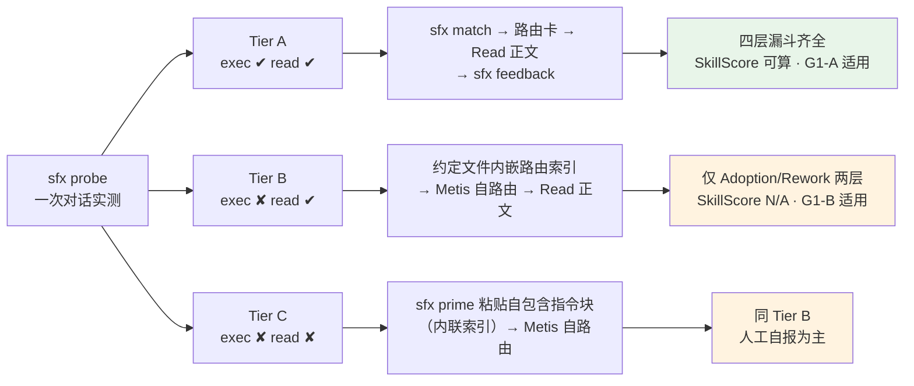
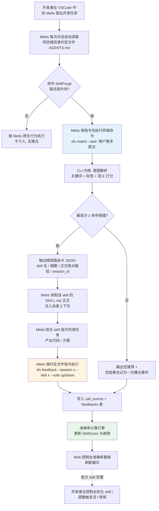
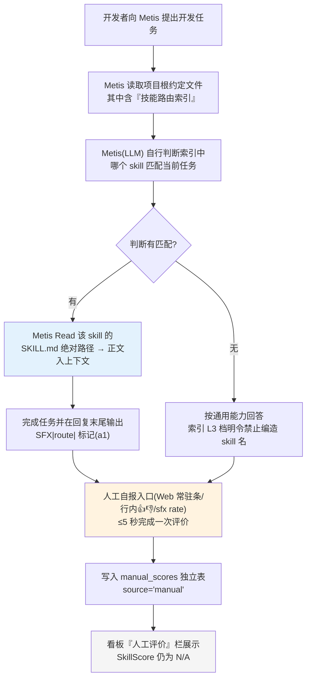
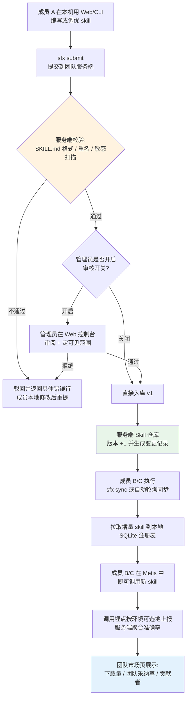

# SkillForge PRD（产品需求文档）

| 项目 | 内容 |
| --- | --- |
| 文档语言 | 简体中文 |
| 项目代号 | `skillforge`（CLI 命令建议名：`sfx`） |
| 文档版本 | **v0.5**（v0.1 初稿 → v0.2 宿主能力分级 → v0.3 外泄风险 → v0.4 人工门禁与复核 → v0.5 实测数据与交互定稿，待评审） |
| 作者 | 许清楚（Xu）· 产品经理 |
| 环境约束 | 企业内网，**全程离线**，无公网依赖；Windows 10+ 开发机 / Linux 服务端 |
| 交付节奏 | 分阶段：先设计后实现，本 PRD 与架构设计需经用户确认后才进入编码 |

### 修订记录

| 版本 | 变更 | 变更源 |
| --- | --- | --- |
| v0.1 | 初稿 | 用户原始需求 + 已确认决策 D1/D2/D3 |
| **v0.2** | ① 引入**宿主能力分级（Tier A/B/C）**，替换 v0.1 中"Metis 能否执行命令决定项目生死"的不严谨表述；② **G1 拆分为 G1-A / G1-B**，并按 Tier 分别定义口径；③ **SkillScore 在 Tier B/C 下明确不适用（显示 N/A）**，确立"数据分层、绝不混算"硬原则（M-1~M-6）；④ FR-12 在 Tier B/C 场景下**由 P2 升为 P0**；⑤ FR-10 升级为合并的 `sfx probe`；⑥ 新增 **FR-42 路由索引生成 / FR-43 人工自报入口 / FR-44 Tier C 粘贴通道 / FR-45 Tier 可追溯切换**；⑦ FR-20「待评价队列」改定义为「快速自报入口」；⑧ 交付阶段新增 **M0.5「Tier 定档验证」**；⑨ Q1 改写口径 | 架构师高见远《ARCH §12 宿主能力分级与降级设计》 |
| **v0.3** | ① 确立**「约定文件＝本地生成产物，不是源码资产」**的产品定性（与 `node_modules` / `dist` 同类）；② **新增 FR-46「约定文件版本控制隔离」为 P0**（安全默认项）；③ NFR-04 增补一款 + **新增 NFR-12「生成产物不得默认进入版本控制」**；④ 新增 FR-47「可提交共享变体」P2，用于合法地满足"随仓库分发规范"诉求；⑤ §8 UI 增加 Git 跟踪 CRITICAL 告警与设置页隔离状态；⑥ 新增 Q14 | 架构师高见远《ARCH §12.9 约定文件污染 Git 与信息外泄风险》 |
| **v0.4** | ① **M0.5 由"做精简探针"重定义为「人工验证门禁」（零代码、0 人日）**，自动化 `sfx probe` 移入 **M2**；② **FR-13 删除 `sfx find`**（该命令在 Tier B 下不可用且从未定义——实质性错误）；③ FR-08 模板由 4×3=12 套降为 **4×2=8 套源，Tier C 为 Tier B 的渲染变体**；④ FR-43 按 Tier 分档 + 默认折叠；⑤ **FR-45 拆为 FR-45a（P0，随骨架）/ FR-45b（P1，M3）**；⑥ NFR-10 补 golden 单测与耗时范围限定；⑦ **修正 G3 在 Tier B/C 下的计量说明**（不可度量，非"以自报条数计量"）；⑧ NFR-01 补 Python 方案依赖计量口径，NFR-05 标注 Python 冷启动风险；⑨ §8.7/§8.8 编号归位；⑩ **§8 UI 三处交互细化**；⑪ **新增 FR-48「存量约定文件接管」为 P0**（补上 FR-46 缺失的一半路径）；⑫ **"是否有文件已被 push"由"最紧急止损项"降级为"常规前置确认"**（该场景当前不可能存在）；⑬ Q14 挂起 | 主理人指令（M0.5/Python/FR-48）＋ 架构师《ARCH §12.6.4》复核意见 |
| **v0.5** | ① **G3 改为条件化口径**（Tier A 恢复原计量、Tier B/C 才标记不可度量，防止验收方拿"不可度量"当挡箭牌）；② **NFR-05 由"待实测风险"改为"已实测通过"**（median 147.5 / p95 176.4 / max 222.3 ms），补技术澄清（zipapp 无"首次解压"）、硬前置 **Python ≥3.11**、**安装脚本严禁设 `PYTHONPATH`**；③ **新增 M-7 澄清 M-3 适用边界**（规则冲突裁决）；④ **§8.6 厘清「常驻自报条」与「待补全调用记录」的关系** + 视觉区分建议；⑤ **FR-48 交互形态定稿**（CLI 为主、Web 只读、TTY 交互式/非 TTY 报错、文案、设置页冲突展示）；⑥ **FR-48 出路重排**（默认 `abort` + `--use` / `--coexist` / `--takeover=move-aside`），**⛔ 否决架构侧的 `--takeover=append`**（写入已跟踪文件必然产生 Git diff，违反 FR-48 核心验收）；⑦ **NFR-12 第 ⑤ 款按最严口径收死**（CI 不得读仓库约定文件、`doctor` 只依据本地、Git 历史只用于反向告警）；⑧ **worktree/submodule 结论落地**（`git rev-parse --git-path`，非 Git 目录静默跳过，L2 降级场景收窄）；⑨ **FR-47 加写盘前自检闸门 S1~S4 + `E_SHARE_LEAK` 拒绝写盘**；⑩ **M1 第一批人日 3.5 → 4.1**（Go→Python 重估，**待用户确认**） | 主理人指令（G3/实测/UI 关系/FR-48 交互）＋ 架构师《ARCH §12.9》落地回执 ＋ 产品经理裁决（append 否决） |

---

## 0. 原始需求复述

用户在公司内网使用公司指定的 **Metis**（一个类似 GitHub Copilot 的 AI 编程插件，运行在 VSCode 等 IDE 中）进行 AI 辅助开发。该插件 **无法自动调度 Skill**。用户希望构建一个 Agent（下称 SkillForge），使其能够：

1. 管理本地电脑里的 skill（扫描、注册、分类、启停、版本）；
2. 在 Metis 中能通过 SkillForge 调用"应该调用"的 skill（按任务意图自动匹配）；
3. 提供页面平台，让用户知道 skill 的准确率；
4. 支持预设与优化 prompt（模板、版本管理、调优）；
5. 可部署到 Linux 服务器，让团队共用同一套 Agent，共同提交和管理 skill，提升团队开发效率。

### 已确认的关键决策（约束输入）

| # | 决策 | 对 PRD 的影响 |
| --- | --- | --- |
| D1 | Metis 接口细节不确定，要求"通过 `agent.md` 这类约定文件让他调用" | **约定文件（Convention File）驱动 = P0 唯一主链路**；MCP Server 降级为 P1/P2 可选增强 |
| D2 | 技术栈要求"最简单、方便在大部分电脑上部署" | 低部署成本作为**硬性非功能需求（NFR）**；具体选型由架构师论证，PRD 只给约束边界 |
| D3 | 分阶段交付，先设计后实现 | 需求池必须 P0/P1/P2 清晰分级，可裁剪 |

---

## 1. 产品目标

### 价值主张（一句话）

> **SkillForge 让不能调度 Skill 的 Metis，通过一份约定文件就拥有"自动选对 Skill"的能力，并把每一次调用变成可度量、可优化、可共享的团队资产。**

### 三条可度量目标

| ID | 目标 | 度量指标（验收口径） | 适用宿主 |
| --- | --- | --- | --- |
| **G1-A** | **路由准**：任务提出后，Top1 推荐的 skill 就是用户真正需要的 | Top1 采纳率 ≥ **70%**（上线后 **8 周**内、有效反馈样本 ≥ **100 条**时统计） | **Tier A** |
| **G1-B** | **路由准（降级口径）**：人工自报的调用中，好评占多数 | **有效人工评价中 👍 占比 ≥ 70%**（样本门槛 **30 条**，观察期 **12 周**） | **Tier B / Tier C** |
| G2 | **接入快**：新成员拿到机器后能立即使用团队沉淀的全部 skill | 新成员接入耗时 ≤ **10 分钟**（现状：手动拷贝 skill 目录 + 配置，约 40 分钟） | 全 Tier |
| G3 | **资产活**：skill 从"个人收藏"变成"团队可复用资产" | 注册 skill ≥ **30 个**，月调用 ≥ **200 次**，近 30 天被调用过的 skill 占比 ≥ **60%** | 见下方条件化口径 |

**G3 条件化口径（v0.5 精确化 —— 按 Tier 自动切换，不做一刀切）**

| Tier | 计量方式 | 考核项 |
| --- | --- | --- |
| **Tier A** | 月调用次数**按自动埋点事件计量**（完全可度量） | 注册 skill ≥30 个 · **月调用 ≥200 次** · 近 30 天被调用过的 skill 占比 ≥60% |
| **Tier B/C** | 「月调用次数」**不可度量**（人工自报有幸存者偏差，自报条数远低于真实调用量） | 仅考核：注册 skill ≥30 个 · 近 30 天被调用过的 skill 占比 ≥60%。**「月调用 ≥200 次」子项挂起，不参与验收** |

> **为什么必须条件化**：若定档为 Tier A，而 PRD 里躺着一句"月调用次数不可度量"，验收方会拿它当挡箭牌——**明明可度量却不考核**。定档为 Tier A 时本条自动恢复原计量，无需人工修订。

> **📌 v0.4 状态标注**：**G1-A / G1-B 与 G3 的最终口径，用户答复为「等 Tier 实测定档后再决定」。** 本节内容**保持 v0.2 形态，定档前不再变更**；定档后按 Tier 一次性锁定：Tier A → G1-A；Tier B/C → G1-B + G3 子项调整。
> （v0.4 仅修正了 G3 括号中一处**错误的计量说明**——原写"以人工自报条数计量"，但该计量会严重低估、导致目标形同虚设；此处改为"不可度量"。**目标值本身未改。**）

#### ⚠ 关于 G1-A 与 G1-B 的诚实说明（**必须让用户知情并确认**）

> **G1-B 是比 G1-A 更弱的指标，不是等价替代，不可换算。**
>
> 1. **为什么不得不拆**：G1-A 的分母是"有反馈的 session 数"，而 session 由 Metis 执行 `sfx match` 时的自动埋点产生。Tier B/C 宿主**不能执行终端命令**，拿不到曝光（Impression）事件 → **没有分母 → G1-A 在 Tier B/C 下不可计算**，不是我们不想算，是物理上算不出来。
> 2. **为什么 G1-B 更弱**：人工自报存在**幸存者偏差**——skill 不好用的时候，人更懒得去点 👎；好用时也未必记得点 👍。因此人工样本更主观、更偏乐观、分母更薄。
> 3. **因此我们同时做了三处下调**：样本门槛由 100 条下调到 **30 条**、观察期由 8 周延长到 **12 周**、且**不得与自动埋点数据混算**（见 §6.4 硬规则 M-1~M-6）。
> 4. **绝不允许**为凑到 70% 而把人工补录数据填进自动埋点的 SkillScore 公式。**宁可显示 N/A，也不拿人工数据补出一个漂亮数字。**
>
> 若用户不接受 G1-B 这一降级口径，可选路径只有一条：**换用支持执行命令的宿主**（在 Metis 之外评估），或投入成本做 Metis 侧插件改造。此为产品决策，非技术可实现范围。

> **术语预告**：Tier A/B/C 的含义见 §3「宿主能力分级」。若您尚未读到该节，只需先记住一句话——**Tier 由"Metis 能干什么"决定，不决定项目成败，只决定指标口径与降级形态。**

---

## 2. 目标用户与场景

| 角色 | 画像 | 核心痛点 | 典型场景 |
| --- | --- | --- | --- |
| **R1 内网开发者（本人）** | 日常在 VSCode + Metis 中写代码的工程师，公司内网隔离 | ① Metis 不知道团队的代码规范和专用 skill，每次都要手动把规范贴进对话；② 本地 skill 散落在 `~/.workbuddy/skills`、`~/.claude/skills`、`.cursor/rules` 等多个目录，找不到、记不住；③ 不知道哪个 skill 好用 | 写需求时希望 Metis 自动加载"内部 API 规范"skill；想停用某个老出错的 skill |
| **R2 团队成员** | 同组的其他开发者，共享一套 skill 资产 | ① 同事写的 skill 我拿不到，靠微信传文件夹；② 不知道别人写的 skill 质量如何，不敢用；③ 自己写的 skill 没有反馈，不知道要不要改 | 从团队市场一键安装"单元测试生成"skill；给它点个踩并附原因 |
| **R3 团队管理者 / 研发效能负责人** | 负责团队规范落地和研发提效 | ① 规范写在 Confluence 没人看，AI 生成的代码不合规；② 无法量化 AI 辅助开发的实际收益；③ 担心 skill 内含内部代码规范，被无管控地带走 | 看准确率看板判断哪个 skill 值得推广；审批新提交的 skill；给 skill 设置可见范围 |

---

## 3. 核心概念定义

本产品中所有关键术语在此统一定义，后续章节不再解释。

| 概念 | 定义（本产品口径） |
| --- | --- |
| **Skill** | 一个**最小的可复用指令单元**。物理形态为一个包含 `SKILL.md` 的文件夹（可附带脚本、模板、示例等资源文件）。`SKILL.md` 由 YAML front-matter（元数据）+ Markdown 正文（给 AI 的具体指令）组成。 |
| **Skill 调用契约（Call Contract）** | SkillForge 对外暴露的、**默认稳定不变**的三层接口约定。① **CLI 契约**：`sfx match / load / feedback / sync` 各子命令的参数与 JSON 输出 Schema；② **约定文件契约**：注入到 `AGENTS.md` 等文件的指令段落格式与版本锚点标记；③ **Skill 内容契约**：`SKILL.md` front-matter 的必填/选填字段规范。**这三层是与 Metis 解耦的关键，任何 Metis 侧的变更都不应穿透这三层。** |
| **约定文件（Convention File）** | 项目根目录下会被 AI 编程插件**自动读取并作为行为约束**的文件，如 `AGENTS.md`、`.cursorrules`、`CLAUDE.md`、`metis.md` 等。SkillForge 在其中写入一段带版本锚点的指令块，指导 Metis 在执行任务前调用 CLI。**这是零集成接入 Metis 的唯一 P0 通道。** |
| **注册表（Registry）** | SkillForge 维护的、关于"本机器上有哪些 skill、它们在哪、什么状态、历史表现如何"的**唯一事实来源**。默认落地为单个 SQLite 数据库文件（含 skill 表、prompt 模板表、调用事件表、反馈表）。 |
| **Accuracy / 准确率（SkillScore）** | 单一 skill 的综合质量评分，由四层漏斗加权得到，见 §6.4 定义。**不是模型自评分，而是基于真实调用与用户反馈的行为统计分。** |
| **Prompt 模板** | 一段可被复用的提示词文本，支持 `{{变量名}}` 占位符、有版本号、可独立进行 A/B 对比。Skill 可引用 0 或多个 Prompt 模板；Prompt 模板也可脱离 skill 独立使用（如"代码评审提示词"）。 |
| **调用会话（Session）** | 从 `sfx match` 被调用开始，到 `sfx feedback` 回收结束的一次完整交互。以 `session_id` 串联，是计算准确率的基本单位。 |
| **通道（Channel）** | SkillForge 与宿主 AI 工具之间的接入方式。P0 为 `convention-file`（约定文件）；P1/P2 预留 `mcp`（MCP Server）、`http`（本地 API）。多通道共存，同一套 CLI 内核。 |
| **宿主能力分级（Tier）** | **按宿主 AI 工具（Metis）实际具备的能力**划分的三档，决定主链路形态与指标口径。**Tier 由宿主能力决定，与 Metis 品牌无关**；将来换任何 IDE 插件复用同一套分级。<br>**Tier A**＝可执行终端命令 + 可读文件 → `sfx match` 闭环，四层漏斗齐全；<br>**Tier B**＝**仅可读文件**、不能执行命令 → 把「技能路由索引」写进约定文件，由 LLM 自行路由，**匹配能力不降反升**，但自动埋点缺失；<br>**Tier C**＝既不执行命令、也不自动读约定文件 → `sfx prime` 生成自包含指令块由人工粘贴。<br>**Tier 由 `sfx probe` 一次对话实测定档，可手动切换。**（详见 §6.0） |
| **路由索引（Route Index）** | Tier B/C 下写入约定文件（或 `prime` 粘贴块）的一份**精简 skill 清单**，字段为「skill 名 / 一句话摘要 / 触发关键词 / SKILL.md 绝对路径 / 版本号」，**不含 skill 正文**。宿主 AI 读索引后自行判断该用哪个 skill 并 Read 其正文。按 token 预算分 L0~L3 四档自动压缩。 |
| **人工自报（Manual Report）** | Tier B/C 下无法自动埋点时，由用户主动完成的一次评价（Web 首页常驻条 / 列表行内 👍👎 / `sfx rate`）。**生成独立记录并标记 `source='manual'`，不写入自动埋点的 Impression 指标**，与自动数据**分表、分栏、绝不混算**（§6.4 M-1~M-6）。 |

---

## 4. 用户故事

### R1 内网开发者（本人）

1. 作为**内网开发者**，我希望**一条命令扫描完本机所有 skill 来源并统一入库**，以便**不用再手动整理散落在多个目录里的 skill 文件夹**。
2. 作为**内网开发者**，我希望**Metis 在接到我的任务后自动加载应该用的 skill**，以便**不用每次开会/写代码前手动把内部规范贴进对话框**。
3. 作为**内网开发者**，我希望**当某个 skill 明显不好用时能一键停用**，以便**它不再污染我后续的 AI 对话结果**。
4. 作为**内网开发者**，我希望**在网页上看到每个 skill 被调用多少次、采纳率多少、最近趋势**，以便**决定保留、优化还是弃用它**。
5. 作为**内网开发者**，我希望**在同一个仓库里维护同一个 skill 的多个版本并能回滚**，以便**改坏了能立刻退回上一版**。
6. 作为**内网开发者**，我希望**把常用提示词存成带变量占位符的模板并管理版本**，以便**不同项目间复用同一套高质量 prompt**。

### R2 团队成员

7. 作为**团队成员**，我希望**从团队 skill 市场一键安装同事沉淀的 skill 到本机**，以便**不用再通过聊天工具传文件夹**。
8. 作为**团队成员**，我希望**在调用后一键给结果点 👍/👎 并可选填写原因**，以便**我的真实体感能被统计进去而不是石沉大海**。
9. 作为**团队成员**，我希望**提交自己写的 skill 到团队仓库并看到审核进度**，以便**知道它什么时候能被全组用上**。
10. 作为**团队成员**，我希望**看到 prompt 的两个版本在相同任务下的效果对比**，以便**有依据地选择更优版本而不是凭感觉**。

### R3 团队管理者 / 效能负责人

11. 作为**团队管理者**，我希望**在服务端看到全组 skill 的使用排行与准确率面板**，以便**识别值得全公司推广的高价值 skill**。
12. 作为**团队管理者**，我希望**给 skill 设置可见范围（私有 / 团队 / 全员）并在提交环节加一道审核**，以便**防止含内部代码规范的 skill 被不受控扩散**。
13. 作为**团队管理者**，我希望**在 Linux 服务器上一键部署整套服务并让成员用内网地址访问**，以便**不需要给每个人单独装环境**。
14. 作为**团队管理者**，我希望**看到每位成员的 skill 贡献与被调用次数排行**，以便**把 skill 沉淀纳入团队技术建设成果**。

---

## 5. 产品结构（给架构师的过渡视图，**非定案**）

为便于架构评审，此处给出产品侧的逻辑分层，**具体技术选型由架构师论证**：

```
L2 展示层  │ Web 控制台（Skill 总览 / 准确率详情 / Prompt 工作台 / 团队市场 / 设置）
────────────┼──────────────────────────────────────────────────────
L1 接入层  │ ① CLI 内核（sfx）  ② 约定文件生成器  ③ 本地 HTTP API  ④（可选）MCP Server
────────────┼──────────────────────────────────────────────────────
L0 内核层  │ 注册表（SQLite） · 扫描器 · 匹配引擎 · 埋点采集 · 准确率计算 · 同步协议
```

**分层原则**：L0 内核不依赖任何 L1 通道；L1 的四个通道共享同一套内核 API，避免"CLI 一套逻辑、Web 另一套逻辑"的双份实现。

---

## 6. 关键流程

### 6.0 宿主能力分级（Tier）与主链路映射 —— **先定档，再谈闭环**

> v0.1 曾把"Metis 能否执行终端命令"当作项目的生死线，**这个判断不严谨，此处更正**：
> 让 Metis 执行 `sfx match`，我们其实想拿**两件东西**，它们的降级成本完全不同，必须拆开看——

| 我们想拿到的东西 | 在"不能执行命令"的宿主上 | 降级成本 |
| --- | --- | --- |
| **① 匹配决策**（哪个 skill 该被用） | Metis 本身就是 LLM。只要它能**读文件**，我们就把「技能路由索引」写进约定文件，**让它自己做路由** | **能力不降反升**——省掉一次子进程调用，且 LLM 语义理解大概率优于本地关键词/BM25 |
| **② 埋点事件**（曝光/加载/采纳/返工） | 没有命令执行就拿不到自动曝光与加载事件，四层漏斗前两层（Impression→Load）塌掉 | **这一级真的会丢**——不是"不可用"，而是"可信度下降"，必须显式标注（§6.4） |



| Tier | 宿主能力 | 主链路 | 路由决策方 | 埋点能力 | 适用目标口径 |
| --- | --- | --- | --- | --- | --- |
| **A** | 可执行终端命令 + 可读文件 | `sfx match` → 路由卡 → Read 正文 → `sfx feedback` | CLI 打分（关键词/BM25/语义） | **四层漏斗齐全** | **G1-A** |
| **B** | **仅可读文件**，不能执行命令 | 约定文件内嵌「路由索引」→ Metis 自路由 → Read 正文 | **LLM 自路由** | 仅 Adoption / Rework（人工自报） | **G1-B** |
| **C** | 既不执行命令、也不自动读约定文件 | `sfx prime` 粘贴自包含指令块（内联索引） | LLM 自路由（prime 内联索引） | 同 Tier B（人工自报） | **G1-B** |

> **一句话结论**：即使实测为 Tier B/C，**项目不成立的风险仅为 v0.1 估计的约 1/3**——匹配能力不降反升，真正需要处理的只是埋点缺口与指标可信度。Tier B 是 v0.1 遗漏的一级，本次补上。

### 6.1 调用闭环（Tier A）：Metis → 约定文件 → SkillForge → 反馈



**闭环要点说明（重要）**

| 环节 | 机制 | 风险与兜底 |
| --- | --- | --- |
| **① 感知** | 不由 SkillForge 主动感知。Metis 自身会在每次对话加载约定文件，等于天然把"任务原文"送到了 SkillForge 面前。 | 若 Metis 不读 `AGENTS.md`，需在项目初始化时一次性试多种文件名（`AGENTS.md` / `.cursorrules` / `CLAUDE.md` / `metis.md`）并让用户确认哪一种生效 → 落为 FR-07 的"通道探测"。 |
| **② 决策** | `sfx match` 在本地完成全部打分，不联网。 | skill 数量超过阈值（如 200）时，纯关键词召回可能退化 → P1 引入本地可选语义向量。 |
| **③ 注入** | **两级注入**：先给"精简路由卡"（几十 token），再由 Metis 按需 Read 正文文件。**不把所有 skill 全文塞进约定文件**，否则上下文爆炸。 | 若约定文件膨胀，提供 `sfx conv --check` 检测 token 预算。 |
| **④ 回收** | 约定文件以"软约束"方式指令 Metis 在收尾调用 `sfx feedback`。 | **这是软约束，存在漏报**。因此采用三级采集（见 §6.3）：CLI 自动埋点（100% 可靠）+ 约定文件回报（可能漏）+ Web 人工补录（兜底）。 |

### 6.1b 调用闭环（Tier B / Tier C）：LLM 自路由 + 人工自报

Tier B/C 下 `sfx match` 不可用，闭环形态改变，但**仍然闭环**：



**Tier B/C 闭环的三个要点**

| 要点 | 说明 |
| --- | --- |
| **① 为什么匹配能力不降反升** | 路由决策从"本地关键词/BM25 打分"换成"LLM 读索引自路由"。LLM 对自然语言任务的理解（同义、缩写、上下文）优于纯规则打分；同时省掉一次子进程调用，响应更快。**代价**是决策方从 SkillForge 转移到宿主，我们不再掌握"为什么选它"的可解释性。 |
| **② 索引必须防幻觉** | 索引只给**绝对路径**，不给正文。L3 极档必须附带一句「若与上述各项均不相关，**直接按你的通用能力回答**，不要猜测路径、不要编造 skill 名」——**宁可少列，也不能让 Metis 编造一个不存在的 skill**。 |
| **③ 埋点缺口只能靠人工补，且不得混算** | Impression / Load 两层**结构性缺失**。人工自报只补 Adoption / Rework 两层，且**不写入 Impression**（否则制造出假分子、算出假漏斗）。自报生成 `sessions(channel='manual')` + `feedbacks(source='manual')`，独立成表、独立成栏展示。 |

**Tier C 附加说明**：`sfx prime` 输出为一次性粘贴块，索引会过期。缓解：① 索引顶部标注生成时间与 skill 数，过期提示重新生成；② 路径用稳定的绝对路径，即使索引略旧，路径仍有效。Tier C 默认 token 预算更激进（**1200**），整个人类粘贴块 ≤ 120 行 / 3KB。

### 6.2 团队共享流程（Linux 服务端）



### 6.3 反馈数据采集的三个层级（设计决策）

| 层级 | 采集方式 | 可靠性 | 能拿到什么 | 适用 Tier | 优先级 |
| --- | --- | --- | --- | --- | --- |
| **L1 客观埋点** | CLI 被调用时自动写库（`match` / `load`） | ★★★ 100% | 调用次数、候选列表、耗时、session_id | **仅 Tier A** | P0 |
| **L2 约定回报** | 约定文件指令 Metis 收尾调用 `sfx feedback` | ★☆ 依赖模型遵从 | 是否实际加载、是否返工 | **仅 Tier A** | P0（尽力而为） |
| **L3 人工自报** | Web 首页常驻自报条 / 列表行内 👍👎 / `sfx rate` | ★★★ 100% 可控但需用户主动 | 采纳与否、原因标签 | **全 Tier（Tier B/C 下的主力）** | P0 |
| **L4 日志补偿（可选）** | 约定文件指令 Metis 回复前追加一行到 `.sfx/pending-log/`，由 `sfx log-consume` 消费 | ★★ 依赖模型遵从 + 需 edit 能力 | Adoption/Rework 的**素材**，仍需人工确认才可入指标 | Tier B（**需探测确认 edit 能力且用户同意后可选开启**） | P2 |

> **产品判断一（全 Tier）**：Metis 未开放 telemetry 接口，因此 **SkillScore 必须容忍反馈缺失**。所有指标均展示"有效样本数"，样本不足时展示 `数据不足` 而非 0 分，避免误判。
>
> **产品判断二（Tier B/C 补充）**：L4 日志补偿**默认不开启**。理由是性价比不划算——它拿到的是"模型自称用了哪个 skill"，仍依赖软约束且漏报率只会更高；而代价是**在用户仓库里落文件**（Git 脏工作区、IDE 文件监听刷屏、公司代码扫描误报）。**默认走 L3 人工自报**：摩擦高一些，但 100% 可信、来源清晰。
>
> **L3 的三个入口与摩擦预算**（低摩擦是这一层能不能跑起来的关键）：
>
> | 入口 | 形态 | 目标耗时 |
> | --- | --- | --- |
> | Web 首页常驻条 | 「刚用了哪个 skill？」+ 搜索型选择器 + 👍/👎 + 可选原因标签；支持键盘（`/` 聚焦、`↑↓` 选、`1`=👍 `2`=👎、`Enter` 提交） | ≤ **5 秒** |
> | Skill 列表行内 | 每行右侧常驻 👍👎，点一下完成 | ≤ **2 秒** |
> | CLI | `sfx rate <skill名> --vote up\|down` | ≤ **3 秒** |

### 6.4 SkillScore（准确率）定义

单一 skill 的四层漏斗与综合评分：

| 层 | 指标 | 计算式 | 来源层级 |
| --- | --- | --- | --- |
| L1 | **曝光量 Impression** | `match` 结果中包含该 skill 的次数 | L1 自动 |
| L2 | **加载率 LoadRate** | 实际被 Read 进上下文的次数 ÷ 曝光量 | L2 约定回报 |
| L3 | **采纳率 AdoptionRate** | 👍 数 ÷ (👍 + 👎 数)，仅统计有反馈的 session | L3 人工 + L2 |
| L4 | **返工率 ReworkRate** | 同 session 内出现"重试 / 不对 / 换个方法"信号的次数 ÷ 加载次数 | L2 + L3 |

```
SkillScore = 0.3 × LoadRate + 0.4 × AdoptionRate + 0.3 × (1 − ReworkRate)
有效样本数 N = 有 L2 或 L3 反馈的 session 数
当 N < 5 时，控制台显示「数据不足」，不参与排行与推荐加权
```

> `SkillScore` 同时**反向作用于匹配排序**：分高的 skill 在打分中获得加权，形成"越用越准"的正反馈（FR-13 的一部分）。

#### ⚠ SkillScore 的适用边界（**硬规则，违反即打回**）

> **核心问题**：Tier B/C 下只有 Adoption / Rework 两层（且为人工自报）。若把人工数据填进上面的四层公式，**缺失的两层会被隐含当成 0 或 1，算出一个看起来很美但完全不可信的分数**。这是本项目最容易踩的坑。

| # | 硬规则 |
| --- | --- |
| **M-1** | **`SkillScore` 只在 Tier A 下计算与更新。** Tier B/C 下不计算，看板显示 `N/A · Tier B（无自动埋点）` |
| **M-2** | 人工自报与约定回报数据进入**独立表 `manual_scores`**，与自动埋点数据物理分离 |
| **M-3** | **人工数据绝不允许**参与：① `SkillScore` 公式；② 趋势图；③ 排行榜排序；④ 匹配器的 `history` 权重信号。Tier B/C 下 `history` 权重**强制置 0**，按权重比例摊还到 keyword / tag |
| **M-4** | 每个指标卡右上角必须显示**来源徽标**：🤖 自动埋点 / ✍️ 人工自报 / 💬 约定回报。多来源时**分组并列展示，不合并成一个数** |
| **M-5** | 样本阈值分级：Tier A 自动样本 `N < 5` 显示「数据不足」；**Tier B 人工样本 `N < 8` 显示「数据不足」**（人工样本更主观、更易有偏差，门槛应**更高**而非更低） |
| **M-6** | Tier B/C 下若有排行榜，排序依据只能是「人工自报次数 + 人工好评率」，且列表标题必须带「**人工评价，非自动采集**」字样 |
| **M-7（v0.5 新增 · 澄清 M-3 的适用边界）** | **M-3 的适用范围明确限定为 Tier B/C。** Tier A 下人工反馈的两种来源必须区别对待：<br>① **关联了 session 的人工回填**（来自 FR-20 待评价队列）→ **是 SkillScore 的合法输入**（AdoptionRate 的定义本就包含 L3 人工，见 §6.4 表格）；<br>② **无 session 的主动自报**（来自 FR-43 自报条）→ **永不进入 SkillScore**，仅在「人工评价」栏独立展示 |

> **⚠ 为什么必须新增 M-7（这是规则冲突，不是补充）**：M-3 字面上写的是"人工数据**绝不允许**参与 SkillScore 公式"，但 §6.4 的 AdoptionRate 来源标注为「L3 人工 + L2」——**两者直接冲突**。若按 M-3 字面执行，Tier A 下 SkillScore 将只剩 L2（约定回报，可靠性仅 ★☆、漏报率高），**四层公式几乎算不出数**，FR-22 看板在 Tier A 下也会大面积空转。
>
> **裁决依据**：M-3 要防的是"**拿人工数据去补缺失的 Impression / LoadRate 两层**"（见 M-3 上方的问题陈述）。Tier A 下这两层齐全，人工回填只是为 Adoption 层补充样本，不存在"补出假分数"的问题。因此 M-3 的射程应限定在 Tier B/C。
>
> **一句话区分**：**有 session 的人工反馈 = 补样本（合法入公式）；无 session 的人工自报 = 独立观察值（永不入公式）。**

> **一句话原则（写进产品与工程的共同底线）**：**宁可显示「N/A」让用户知道这里没数据，也不允许用人工数据补出一个漂亮数字。数据可信度 > 数据好看。**
> 若后续有人提出"想办法把分数算出来"，以此条驳回。

**看板呈现（Tier B 视图示意）**

```
┌ Skill 详情 · 准确率 ─────────────────────────────┐
│ ⚠️ 当前宿主为 Tier B（不可执行命令）              │
│    四层漏斗中的「曝光量 / 加载率」无法自动采集     │
├──────────────────────────────────────────────────┤
│ 🤖 自动埋点   曝光量 N/A ｜ 加载率 N/A ｜ SkillScore N/A  │
│ ✍️ 人工自报   👍 12  👎 3  ｜ 好评率 80% ｜ 样本 15 ✅     │
│ 💬 约定回报   未启用                              │
└──────────────────────────────────────────────────┘
```

---

## 7. 功能需求池

> 优先级口径：**P0 = 本期必做（MVP）**；**P1 = 应当做（第二迭代）**；**P2 = 锦上添花**。
> 用户可据此直接裁剪；架构师可据此排期。
>
> **⚠ v0.2 重要补充——"条件必做"**：宿主 Tier 决定部分需求的必要性。凡标注 **「Tier B/C 场景必做」** 的需求，在 `sfx probe` 定档前**按"待定"处理**；一旦定档为 Tier B/C，该需求**自动升为 P0 并进入 M1**；若定档为 Tier A，则可按其原优先级（通常 P1/P2）延后。当前共 3 条：**FR-12、FR-42、FR-43**，外加 Tier C 专属的 **FR-44**。

### 7.1 A 组：Skill 扫描与注册

| 需求ID | 需求名称 | 描述 | 优先级 | 验收标准 |
| --- | --- | --- | --- | --- |
| FR-01 | 多来源扫描 | 扫描本机多个约定的 skill 来源目录，自动发现含 `SKILL.md` 的文件夹。默认至少覆盖 `~/.workbuddy/skills`、`~/.claude/skills`、`.cursor/rules`、`.github/`、以及用户在配置文件中声明的任意自定义目录 | **P0** | 执行一次 `sfx scan`，能发现上述默认来源下全部含 `SKILL.md` 的目录；未安装某目录时跳过且不报错；重复扫描不产生重复记录 |
| FR-02 | Skill 格式解析 | 解析 `SKILL.md` 的 YAML front-matter（name / description / **summary** / triggers / tags / version / author）+ Markdown 正文；front-matter 缺失时以目录名兜底生成元数据并标记 `元数据待补全` | **P0** | 对合法文件正确抽取全部字段；对非法 YAML 输出明确行号错误并跳过该文件、不影响整体扫描。**`summary`（一句话摘要）为必填**：缺失时用 `description` 前 40 字兜底并标记 `元数据待补全`（Tier B/C 下摘要要进路由索引，两处复用同一份，故升格为必填） |
| FR-03 | 注册表持久化 | 将扫描结果写入单文件数据库；记录来源路径、内容 hash、发现时间、状态 | **P0** | 数据库为单个文件，可直接拷贝迁移；二次扫描按 content hash 识别"内容变更"并提示 |
| FR-04 | 元数据编辑与补全 | 支持在 Web 控制台编辑名称、描述、触发关键词、标签、作者；编辑结果回写到 `SKILL.md` front-matter，保持文件与注册表一致 | **P0** | Web 修改保存后，用文本编辑器打开 `SKILL.md` 可见对应字段已同步写入 |
| FR-05 | 启停控制 | 单个 skill 可 `启用 / 停用`；被停用的 skill 不参与匹配，但保留历史数据 | **P0** | 停用后立即从 `match` 结果中消失；重新启用后恢复，历史调用数据不丢失 |
| FR-06 | 本地版本管理 | 记录 skill 每次内容变更的版本快照，支持查看 diff 与一键回滚 | **P1** | 修改 → 提交新版本 → 回滚，三步可完成；回滚后 `SKILL.md` 内容与历史版本字节一致 |
| FR-07 | Skill 分类与标签体系 | 支持多标签、可选分类树；列表可按标签/分类筛选 | **P1** | 一个 skill 可打多标签；按标签筛选结果正确 |

### 7.2 B 组：约定文件生成与同步（**P0 主链路**）

| 需求ID | 需求名称 | 描述 | 优先级 | 验收标准 |
| --- | --- | --- | --- | --- |
| FR-08 | 约定文件模板管理 | 内置多种目标格式模板：`AGENTS.md`、`.cursorrules`、`CLAUDE.md`、`metis.md` 通用 md；每个目标格式提供 **A / B 两套模板源**（4 × 2 = 8 个文件）。**Tier C 不是独立模板，而是 Tier B 模板的渲染变体**（通过 `mode=file\|paste` 变量切换称呼口吻与索引内联方式，共用同一份内容骨架） | **P0** | ① 至少提供 2 种目标格式 × 2 套模板源；② 切换 Tier 后 `sfx conv sync` 用对应模板整体重写锚点块；③ **修改 Tier B 模板后，Tier C 输出同步生效，无需手工维护第二份**（防 12 套模板之间的内容漂移） |
| FR-09 | 约定文件生成与幂等同步 | 在目标文件中写入带版本锚点的指令块，形如 `<!-- SKILLFORGE:BEGIN v1 -->` … `<!-- SKILLFORGE:END -->`；重复执行为幂等操作，**不覆盖用户手写的其余内容** | **P0** | 连续执行两次 `sfx conv sync`，文件除锚点块外无任何 diff；用户在块外的手写内容 100% 保留。**切换 Tier 后重写时同样满足此条**（旧 Tier 指令随锚点块整体替换，无残留） |
| FR-10 | **宿主能力 + 通道探测（`sfx probe`）** | **一次对话同时测出两项**：① 能力位（能否执行终端命令 / 能否读文件 / 能否编辑文件）；② 通道位（哪个约定文件名被 Metis 实际读取）。向全部候选文件名写入同一份探测块，块内含三条自测指令 | **P1（M2）**<br>*v0.4：由 P0 降为 P1 并移入 M2*<br>**MVP 阶段由 M0.5 人工门禁替代** | 一次 Metis 对话 + 一次终端交互即可定档（Tier A/B/C + 生效文件名），**总耗时 ≤ 10 分钟**；结果写入配置并可由 `sfx doctor` 追溯；支持 `sfx config set host.tier=A` 随时手动改档；`sfx conv probe` 保留为 `sfx probe --channel-only` 别名。<br>**降级理由（v0.4）**：**确定 Tier 不需要写代码**——用户手工 10 分钟即得真机真结果；且在 Tier 未定时投入自动化探测，一旦结论为 Tier C（连约定文件通道都不存在）则投入作废。其真实价值在**团队推广阶段（M2）**：让每个新成员自助定档 |
| FR-11 | 漂移检测 | 检测约定文件是否被删除、被覆盖、版本过期；Web 首页对异常项目给出提示 | **P1** | 手动删除指令块后，`sfx conv check` 能检出并给出一键修复 |
| FR-12 | **Token 预算控制** | 估算注入指令块（**Tier B/C 下含路由索引**）的 token 占用，超预算自动降档压缩，超硬上限告警并建议收敛 | **P0**<br>（Tier B/C 场景必做）<br>*v0.1 原为 P2* | ① 超出预算自动降档（L0→L1→L2→L3）并输出含档位与丢弃数的告警；② 降档后仍超硬上限（默认 3000）输出告警并在 Web 首页提示"建议停用冷门 skill 或按标签分组"；③ 估算保守取上限（宁可估多） |
| FR-42 | **技能路由索引生成（`sfx index-gen`）** | 生成 Tier B/C 用的精简 skill 清单（名 / 一句话摘要 / 触发关键词 / 绝对路径 / 版本），按 token 预算自动分档压缩（L0 全量→L1 精简→L2 极简→L3 自包含兜底）；被 `sfx conv sync` 与 `sfx prime` 内部调用 | **P0**<br>（Tier B/C 场景必做）<br>*v0.2 新增* | ① 输出确定性排序（以 slug 字典序 tie-break），**两次生成 diff 为空**（否则每次 sync 都污染用户 Git）；② L3 档必须含"若均不相关则按通用能力回答、不要编造 skill 名"的防幻觉约束；③ 索引**不含** skill 正文、不含高频变化的统计数字 |
| FR-43 | **人工自报入口** | 提供三个低摩擦评价入口：Web 自报条（键盘可达）、Skill 列表行内 👍👎、CLI `sfx rate <名> --vote up\|down`。**按 Tier 分档**：Tier B/C 下自报条**全站常驻**（唯一数据来源）；**Tier A 下仅出现在首页与快速自报页**（已有自动埋点，自报为补充）。**默认折叠为单行**，不占主内容区高度 | **P0**<br>*v0.2 新增*<br>*v0.4 修订* | ① 单次自报耗时 ≤ **5 秒**；② 自报生成 `feedbacks(source='manual')` + `sessions(channel='manual')`，**不写 Impression**（不得污染自动埋点分子）；③ 全 Tier 可用；④ **Tier B/C 全站常驻且默认单行折叠，Tier A 仅首页与快速自报页**；⑤ **不弹 modal、不打断、不自动聚焦**；⑥ 同一 skill 短时间重复自报**覆盖而非新增**（upsert），防误连点噪声 |
| FR-44 | **Tier C 粘贴通道（`sfx prime`）** | 生成一次性自包含指令块供人工粘贴进对话，**内联路由索引**（否则 Tier C 下 Metis 无从知道有哪些 skill）；体积 ≤ 120 行 / 3KB | **P1**<br>（Tier C 场景升 P0）<br>*v0.2 新增* | ① 粘贴块自包含，不含任何需要执行命令才能完成的步骤；② 顶部标注生成时间与 skill 数，过期提示重新生成；③ 路径为绝对稳定路径，索引略旧时路径仍有效 |
| FR-45a | **Tier 判定可追溯（最小三项）** | `sfx doctor` 展示 `tier`、`capabilities`、`channel_files` 三项，使定档结论事后可核对 | **P0**<br>*v0.4 由 FR-45 拆出* | `sfx doctor` 输出中含这三项且与实际配置一致。**排期上必须随骨架（Walking Skeleton）落地**，不得等到 M3——定档结论没有可核对处就等于白定档 |
| FR-45b | **Tier 手动切换与探测残留清理** | 展示 `probed_at` 与探测方式；支持 `sfx config set host.tier=A` 手动改档与重跑探测；探测残留物自动清理 | **P1（M3）**<br>*v0.4 由 FR-45 拆出* | ① `sfx doctor` 五项信息齐全；② 手动改档后 `sfx conv sync` 即用新模板重写；③ 向导结束自动清除 `SKILLFORGE:PROBE` 块与 `.sfx/probe/`；异常中断由 `sfx probe --cleanup` 兜底 |
| FR-46 | **约定文件版本控制隔离（安全默认项）** | 生成约定文件时**自动将其加入本地 Git 忽略列表**（优先 `.git/info/exclude`，**不改动用户自己的 `.gitignore`**）；`sfx doctor` 持续检测其是否已被 Git 跟踪（含历史提交），已跟踪则 **CRITICAL 级告警**并给出一键移出命令；覆盖全部落盘产物（约定文件 / `prime` 落盘输出 / `.sfx/` 运行时目录）；**若检出已存在于历史提交，额外给出补救指引**；允许显式关闭但必须风险告知 | **P0**<br>*v0.3 新增* | ① 在 Git 仓库中执行 `sync` 后，约定文件**不被 `git status` 显示为待提交**；② 手动 `git add` 该文件后，`sfx doctor` 能检出并输出 CRITICAL 告警 + 一键移出命令；③ 关闭开关后行为符合预期，且关闭时**必须弹风险告知**；④ 用户的 `.gitignore` 文件**字节不变**；⑤ 文档写明"约定文件无需提交，每台机器执行 `sfx conv sync` 重新生成即可"；⑥ 检出历史提交中含该文件时，给出补救指引（含从历史清除的建议与其风险说明） |
| FR-47 | **可提交共享变体（知情豁免）** | 面向"团队就是想把通用编码规范随仓库分发"这一**合法诉求**：提供一个刻意可提交的变体——**不含本机绝对路径**（改为仓库内相对路径）、**仅含 `visibility ∈ {team, public}` 的 skill**、不含任何个人私有 skill | **P2**<br>*v0.3 新增* | ① 生成的变体中**不含任何绝对路径**；② 不含任何 `private` 可见性的 skill（含其名称与目录名）；③ 用户开启时明确提示"该变体将进入版本库，仅应包含团队级规范"；④ 该变体与本地完整索引互不覆盖（不同文件名）；**⑤（v0.5）写盘前自检闸门 S1~S4**：命中「home 目录串 / 盘符绝对路径 / `private` slug / `.sfx/` 内部路径」任一规则 → **拒绝写盘**并返回 `E_SHARE_LEAK`，且**不回显命中内容**（只给行号与规则名）；⑥ 独立配置键 `index.share_variant`，与 FR-46 的 `conv.git_exclude` **互不联动** |

> **为什么必须加第 ⑤ 条闸门（v0.5）**：**脱敏必须由生成器保证，不能靠用户自觉。** 用户勾选"我要共享"之后，我们无法假设他会逐行检查输出。这道闸门同时是**"为什么不能简单地把 FR-46 关掉、然后提交原文件"**的技术证据——原文件里必然含 home 目录绝对路径，一定会被 S1 拦下。
| FR-48 | **存量约定文件接管（与 FR-46 同级，必做）** | **FR-46 只覆盖了"sfx 新建文件"一条路径，本条覆盖另一条："sfx 接管存量文件"。** 写入前先用 `git ls-files` 检查目标文件**是否已被 Git 跟踪**；若已跟踪则**默认拒绝写入**并返回明确错误码，同时给出三条可选路径供用户选择 | **P0**<br>*v0.4 新增* | ① **在已存在被提交的 `.cursorrules` 的仓库里执行 `sfx conv sync`，不得产生任何 Git diff**（可自动化断言的核心验收）；② 拒绝写入时给出三条路径（见下方决策表）且默认项为 a；③ 路径 c 必须**二次确认**并明确告知后果；④ `sfx doctor` 哨兵增加"候选文件名冲突检测"，列出所有已被跟踪的候选文件；⑤ 拒绝写入时**不得静默改写、不得部分写入** |

#### FR-48 出路（检测到目标文件已被 Git 跟踪时）

**默认行为：`abort` —— 不写任何文件。** 返回 JSON 错误信封 `E_CONV_TRACKED_BY_GIT`，`data.options[]` 列出全部出路（stdout 仍为**一行 JSON**，不破坏 CLI 契约）。

| 出路 | 命令 | 行为 | 风险 / 推荐度 |
| --- | --- | --- | --- |
| **0) 中止** | `sfx conv sync`（无参数） | **不写任何文件**，返回错误信封与出路列表 | 零风险 · **默认** |
| **a) 换名** | `--use <其他候选文件名>` | 改用另一个**未被占用**的候选文件名（`.cursorrules` 被占 → `AGENTS.md`）。**原文件完全不动** | 零风险 · ★★★ **推荐** |
| **b) 共存** | `--coexist` | 原文件不动，SkillForge 块写入**另一个新文件**（如 `AGENTS.sfx.md`），该新文件再走 FR-46 隔离 | 零风险 · ★★ |
| **c) 接管** | `--takeover=move-aside` | 原文件重命名为 `<name>.sfx-orig` + `git rm --cached`，我们写回原名 | ⚠ 团队其他成员下次 pull 时会丢失该文件 · ★ **必须二次确认** |
| ~~d) 追加~~ | ~~`--takeover=append`~~ | ⛔ **已否决**，理由见下 | — |

> **⛔ 为什么否决 `--takeover=append`（v0.5 裁决）**
>
> 架构侧曾提出「完全保留原内容，只在末尾插入锚点块」这一出路。**但它与 FR-48 的核心验收直接冲突**：
>
> 原文件**已被 Git 跟踪** → 往里插入锚点块 → **文件内容变化 → 必然产生 Git diff** → 用户提交时把锚点块内的**本机绝对路径与完整 skill 索引**推进远程——**这正是 FR-48 要防的那起事故本身**。
>
> 若确实需要"保留原规范 + 追加 SkillForge 块"的形态，**必须先执行 `git rm --cached` 让该文件退出版本控制**；此时它等价于路径 c（move-aside 的变体），不应作为独立出路存在。
>
> **判定规则**：**凡是"写入已被 Git 跟踪的文件"的出路，一律不得提供**——无论写入方式是覆盖、追加还是插入。这是 FR-48 的唯一红线。

#### FR-48 交互形态（v0.5 确定）

**① 通道归属：CLI 为主，Web 只读展示与指引**

| 通道 | 职责 | 不做 |
| --- | --- | --- |
| **CLI** | **唯一执行写入决策的地方**：检测、拒绝、三选一、执行 | — |
| **Web** | **只读**：展示冲突状态、说明后果、给出对应的 CLI 命令（可复制） | **不做写入弹窗** |

> **为什么不在 Web 里做写入弹窗**：`sfx conv sync` 可能由 CLI、脚本或 CI 触发，**Web 弹窗无法拦截**；若两处都能写，会产生状态不一致与竞态。**写入决策只在一处发生**是这里的原则。

**② 交互形式：TTY 交互式 / 非 TTY 报错退出**

| 场景 | 行为 |
| --- | --- |
| **有 TTY**（用户手敲） | **交互式列出全部出路，默认项为 `0) 中止`**（不写任何文件），并在列表下方提示"输入 `a` 直接采用推荐方案（零风险）" |
| **无 TTY**（脚本 / CI / 被 Metis 调用） | **直接报错退出**并打印全部出路，绝不阻塞等待输入 |

> **为什么 TTY 下默认项是"中止"而不是"换名"**：出路 c 不可逆（`git rm --cached`）。若默认项是可执行动作，用户连续回车就会越过一次本应谨慎的决策。**默认停在"什么都不做"，把决定权显式交回用户**——这与 FR-47「知情豁免」是同一条原则：**我们可以推荐，但不替用户决定。**

**③ CLI 文案（TTY 场景）**

```
✗ 无法写入：AGENTS.md 已被 Git 跟踪（团队共享文件）

  SkillForge 不会改写已被版本控制的文件 —— 因为写入后会
  把你本机的绝对路径和完整 skill 清单带进提交记录。

  请选择一种方式：

    0) 中止，不写任何文件（默认）
       → 你可以先看清楚再决定

    a) 换一个文件名（推荐，零风险）
       sfx conv sync --use CLAUDE.md
       → 原 AGENTS.md 完全不动

    b) 共存：SkillForge 块写入另一个新文件
       sfx conv sync --coexist
       → 保留 AGENTS.md，另建 AGENTS.sfx.md

    c) 接管该文件（⚠ 不可逆）
       sfx conv sync --takeover=move-aside
       → 原文件重命名为 AGENTS.md.sfx-orig 并移出版本控制，
         我们再写 AGENTS.md
       ⚠ 团队其他成员下次 pull 时会丢失这个文件
       ⚠ 若这是团队唯一的规范副本，请先备份或转成 skill
         （见《存量规约迁移指南》§6.2）

  ? 请选择 [0/a/b/c]（默认 0）: _
  💡 输入 a 可直接采用推荐方案（零风险）
```

> **第二条 ⚠ 的来源**：来自《存量规约迁移指南》§6.2 —— `--takeover` 可能摧毁一份**没有第二份副本**的团队资产。原二次确认只说了"其他人会丢失文件"，没说"这份内容可能就此消失"。

**④ Web 设置页「版本控制隔离」区的冲突展示**

```
版本控制隔离                                       [已开启 ▼]
约定文件：AGENTS.md                          ✅ 未被 Git 跟踪

⚠️ 候选文件名冲突（2 个已被 Git 跟踪）
─────────────────────────────────────────────────────
  .cursorrules                    已被跟踪   [查看] [处理]
  .github/copilot-instructions.md 已被跟踪   [查看] [处理]
─────────────────────────────────────────────────────
说明：SkillForge 不会写入已被版本控制的文件。
      「处理」会给出对应的 CLI 命令（建议优先换名）。
```

- **「查看」**：展开该文件的前若干行 + 最近提交者与时间（帮助用户判断"这是不是团队资产"）
- **「处理」**：展开三条路径的说明 + 可复制的 CLI 命令（**不在 Web 执行写入**）
- **无冲突时**：该区块折叠为一行 `✅ 无文件名冲突`

> **为什么必须单列这一条**：`.git/info/exclude` **只对 untracked 文件生效**，对**已跟踪文件完全无效**。因此 FR-46 的隔离机制在"存量文件"场景下会**静默失效**——用户以为被保护了，实际上每次 sync 都会产生 Git diff，最终把本机绝对路径与完整索引推进远程。
> **触发路径不是"新建文件被 add"，而是"接管存量文件被 diff"。**

#### 关于"是否已有文件被 push"——本条的状态澄清

> **这不是一个已经发生的损失，而是一个尚未采集的输入。**
>
> 事实链条：`sfx` 目前**一行代码未写**（M0 设计评审完、等待 Tier 定档）→ 约定文件由 `sfx conv sync` 生成 → **`sfx` 尚不存在 → 不存在任何由本产品生成的约定文件 → 也就无所谓被 push**。
>
> 因此本条**不是"最紧急止损项"**，降级为**常规前置确认**：在项目正式使用前，确认团队现有仓库中**是否已存在 AI 规则文件**（`AGENTS.md` / `.cursorrules` / `CLAUDE.md` / `.github/copilot-instructions.md` 等）。
>
> **真正的风险不在于此**，而在于下一节所述的场景——**团队既然在推 Metis，大概率已经有人在提交并共享 AI 规则文件**。这不是"我们的产物外泄"，而是"**我们接管了一个团队共享资产，然后把它变成了包含本机路径的个人产物**"。后者不需要任何"已经发生"的前提，只要用户一开始用就会触发。

> **⚠ 产品定性（v0.3 确立，务必理解后再读 B 组其余需求）**
>
> **约定文件与路由索引是「本地生成产物（artifact）」，与 `node_modules` / `dist` 同类——它不是源码资产，也不是团队分发物。**
>
> 这个定性有三个直接推论：
> 1. **它不该进 Git**（FR-46）。它不是配置，是机器相关的派生文件：Tier B 下内联的索引含**提交者本机绝对路径**（`C:\Users\alice\...`），同事 pull 后全部失效。
> 2. **不进 Git 不影响团队共享**。每台机器跑一次 `sfx conv sync` 即可重新生成；团队共享走的是 **FR-31 服务端同步**，不是 Git。
> 3. **它含敏感信息**。索引里的 skill 名与目录名本身就在泄露内部资产清单（例如 `our-payment-gateway-review-standard`）——**公司内部的规范资产清单被推到远程，而用户完全无感知**。
>
> **我们曾在 NFR-04 立了一面防外泄的墙，然后自己在这面墙上开了一扇窗。FR-46 就是把这扇窗关上。**

> **※ 架构注意一**：FR-08~FR-10 是 Metis 接入的**唯一 P0 通道**。任何依赖 Metis 开放 API / MCP 的方案（见 FR-39）均不得作为 MVP 的前置条件。
>
> **※ 架构注意二（v0.2 新增）**：**FR-12 由 P2 升为 P0，并新增 FR-42**。理由：Tier B/C 下路由索引**常驻在约定文件里长期占用上下文**，token 膨胀会直接损害 Metis 表现——这与 Tier A 下"只在调用时临时占用"性质完全不同。在 Tier A 下它是锦上添花，在 Tier B/C 下是隐患，故必须前移。FR-42 是 FR-12 的供给方，两者必须配套交付。

### 7.3 C 组：意图匹配与调用

| 需求ID | 需求名称 | 描述 | 优先级 | 验收标准 |
| --- | --- | --- | --- | --- |
| FR-13 | 任务意图→Skill 匹配 | 对输入的自然语言任务描述进行意图识别，**策略层**为多信号加权：① 触发关键词精确/模糊命中；② 标签匹配；③ SkillScore 历史加权；④（可选）语义相似度。输出 Top-N 排序列表。**仅在 Tier A 下承担路由职责**；Tier B/C 下路由决策由宿主 LLM 读索引完成（FR-42），**本项不承担路由职责**，仅用于 Web 端排序与 Tier A 下的 `sfx match` | **P0** | 对 ≥ 20 条人工构造的典型任务描述，Top1 命中人工标注的期望 skill 的比例 ≥ 70%。**Tier B/C 下 `history` 权重信号强制置 0 并摊还到 keyword/tag**（遵守 §6.4 M-3） |
| FR-14 | 匹配输出契约 | `sfx match` 以稳定 JSON Schema 输出：`session_id`、`matched[]`（skill_id / name / summary / path / score / reason）、`elapsed_ms`、`engine_version` | **P0** | Schema 有版本字段；任何后续内核升级不破坏既有字段名 |
| FR-15 | 命中阈值与兜底策略 | 最高分低于阈值时输出"无推荐"，并同时给出"最接近但未达阈值"的候选，交由用户/模型判断 | **P0** | 构造明显无关的查询，`matched` 为空但仍返回 `session_id` 与一次曝光事件 |
| FR-16 | 语义匹配（可选） | 引入本地轻量向量/相似度算法增强召回，**完全离线**，可通过配置项关闭，不安装也能跑 P0 | **P1** | 关闭该项时 `match` 仍正常工作；启用后对同义表述（如"单测"/"单元测试"）召回提升可被人工验证 |
| FR-17 | 加载记录 | 提供 `sfx load --skill <id> --session <id>`，用于记录"该 skill 正文确实被读入了上下文" | **P0** | 调用后 `LoadRate` 分子 +1 |

### 7.4 D 组：埋点、反馈与准确率看板

| 需求ID | 需求名称 | 描述 | 优先级 | 验收标准 |
| --- | --- | --- | --- | --- |
| FR-18 | 调用事件埋点 | 每次 `match` / `load` 自动写入 `call_events` 表：时间、session_id、skill_id、事件类型、耗时、引擎版本、成效渠道 | **P0** | 无需任何额外配置，调用即在库中有记录；SQLite 单表可支撑 ≥ 10 万条事件 |
| FR-19 | 反馈回收 | 支持 CLI（`sfx feedback --vote up/down --reason ...`）与 Web 控制台两种渠道；可选原因标签：答非所问 / 过时 / 太啰嗦 / 有帮助 / 其他 | **P0** | 两种渠道写入同一张表并在同一处展示；同一 session 重复投票以最后一条为准并记录变更历史 |
| FR-20 | **快速自报入口**（v0.1 称"待评价队列"，**已改定义**） | **Tier A**：列出"有曝光但无反馈"的 session 供批量补评；**Tier B/C**：此队列无从生成（无 impression），改为「**最近 7 天被人工自报过、或近期有内容变更的 skill**」的快捷打分列表——本质是**快捷入口**而非"待办队列" | **P1**<br>（Tier B/C 下与 FR-43 合并为 P0） | **提供 ≤ 5 秒完成的自报入口**（不要求"队列完整性"）；补评后即时反映到人工评价栏 |
| FR-21 | 准确率计算任务 | 按 §6.4 公式离线/定时重算每个 skill 的 SkillScore、四层子指标与样本数。**Tier B/C 下不计算 SkillScore，只维护 `manual_scores`** | **P0** | 新增 1 条反馈后触发重算，结果在 ≤ 5 秒内反映到控制台；Tier B/C 下看板 SkillScore 位显示 `N/A · Tier B（无自动埋点）` |
| FR-22 | 准确率看板 | Web 页面展示：全量/筛选后的 skill 列表 × 调用次数 / 加载率 / 采纳率 / 返工率 / SkillScore / 近 30 天趋势折线；支持按 SkillScore 与调用量排序。**必须按数据来源分组展示并带来源徽标**（🤖 自动埋点 / ✍️ 人工自报 / 💬 约定回报），多来源不合并成一个数 | **P0** | 页面一次加载 ≤ 2 秒（本地 SQLite，100 个 skill、1 万条事件量级）；样本 < 5（Tier A）/ < 8（Tier B 人工）显示"数据不足"；**Tier B/C 下排行榜标题必须带「人工评价，非自动采集」字样** |
| FR-23 | Skill 详情-准确率详情页 | 单个 skill 的详情页：元数据、正文预览、四层漏斗可视化、趋势图、近期反馈原文列表、版本历史。**Tier B/C 下展示降级视图**：顶部标注宿主 Tier 与"曝光量/加载率无法自动采集"，三栏分组（🤖 自动埋点 N/A / ✍️ 人工自报 / 💬 约定回报） | **P0** | 详情页能定位到任意一条反馈对应的 session 与原始任务描述；Tier B/C 下能一眼看出哪些数字是自动采集、哪些是人工自报 |

### 7.5 E 组：Prompt 预设与优化

| 需求ID | 需求名称 | 描述 | 优先级 | 验收标准 |
| --- | --- | --- | --- | --- |
| FR-24 | Prompt 模板 CRUD | 创建/读取/更新/删除 prompt 模板，含名称、适用场景、标签、正文 | **P0** | Web 与 CLI 均可完成；删除为软删除可恢复 |
| FR-25 | 变量占位符 | 支持 `{{variable}}` 语法，渲染时传入键值；渲染前校验必填变量缺失并给出明确报错 | **P0** | 缺失必填变量时报错并列出缺失变量名；正常渲染输出正确文本 |
| FR-26 | Prompt 版本管理 | 每次保存生成新版本，支持版本列表、diff 对比、回滚、另存为分支 | **P1** | 可回滚到任意历史版本；两个版本之间可查看逐行 diff |
| FR-27 | A/B 对比 | 对同一任务描述，并排渲染两个 prompt 版本，记录各自被采纳情况并统计对比结论 | **P1** | 界面并排展示；每个版本可独立投票；累计样本 ≥ 5 时给出"推荐版本"提示 |
| FR-28 | Prompt 与 Skill 互引 | 一个 skill 可引用 0~N 个 prompt 模板；prompt 亦可独立调用 | **P2** | 引用关系在详情页双向可见；删除被引用的模板时给出阻断提示 |

### 7.6 F 组：团队服务端

| 需求ID | 需求名称 | 描述 | 优先级 | 验收标准 |
| --- | --- | --- | --- | --- |
| FR-29 | 服务端部署形态 | 在 Linux 服务器以单进程方式运行，提供 Web 控制台 + 同步 API；数据落地为服务端 SQLite（或可选外部库） | **P0（阶段二）** | 一条命令在纯净 Linux 上完成启动；客户端可通过内网 HTTP 地址访问 |
| FR-30 | 成员账号与角色 | 支持成员账号、角色区分（普通成员 / 审核者 / 管理员），支持内网简易登录方式 | **P1** | 不同角色可见菜单与可执行操作不同；未登录不可调用写接口 |
| FR-31 | 共享 Skill 仓库与增量同步 | 服务端集中存储 skill；客户端 `sfx sync` 拉取**增量**变更并合并本地注册表 | **P0（阶段二）** | 服务端新增 1 个 skill 后，客户端一次 `sfx sync` 即可获取；重复 sync 无副作用（幂等） |
| FR-32 | 提交与审核流程 | 成员 `sfx submit` 提交 skill；服务端做格式/重名校验；可按开关决定是否需人工审核；全流程状态可见（待审核/已通过/已驳回+原因） | **P1** | 走通"提交→驳回→修改→重提→通过→同步到全员"完整链路 |
| FR-33 | 可见范围与权限分级 | skill 可设 `私有 / 团队 / 全员` 三级可见性；无权限者不可见、不可拉取 | **P1** | 私有 skill 在其他成员 `sync` 结果中不出现，API 直接请求也返回无权限 |
| FR-34 | 团队 Skill 市场 | Web 页面按分类/标签/热度浏览可安装 skill，展示作者、版本、下载/安装量、采纳率、最近更新 | **P1** | 一键安装后本地可直接被 `match` 命中 |
| FR-35 | 贡献榜 | 统计成员提交数、通过数、其 skill 被调用次数与平均采纳率，形成排行 | **P2** | 排行数据与实际调用明细一致，可按时间范围切换 |
| FR-36 | 埋点上报策略 | 客户端埋点是否上报服务端**可配置且默认关闭或脱敏**，由管理员决定是否聚合 | **P1** | 关闭上报时客户端功能完全不受影响；开启时上报内容不含 skill 正文与用户源码 |

### 7.7 G 组：部署形态与可选增强

| 需求ID | 需求名称 | 描述 | 优先级 | 验收标准 |
| --- | --- | --- | --- | --- |
| FR-37 | 单机 CLI 模式 | 零服务端：仅安装 CLI + 本地 SQLite + 可选本地 Web 控制台，离线可跑全部 P0 中的单机能力 | **P0** | 单台 Windows 机器上一条命令完成安装并跑通调用闭环 |
| FR-38 | 本地服务模式 | 单机启动本地 Web 服务（127.0.0.1 或局域网），供个人/临时共享使用 | **P1** | 一台命令启动 Web 控制台，浏览器可访问 |
| FR-39 | **MCP Server（可选增强）** | 若 Metis 后续支持 MCP，提供一层 MCP Server 复用同一内核，作为约定文件通道的增强而非替代 | **P2** | MCP 未启用时，约定文件通道功能完整不受任何影响 |
| FR-40 | 导入 / 导出 / 备份 | 注册表与 skill 内容可导出为单个归档文件用于备份或离线搬运；支持导入恢复 | **P1** | 在一台机器导出、另一台纯净机器导入后，两者 skill 列表完全一致 |
| FR-41 | 初始化引导（Wizard） | 首次运行交互式引导：**选择来源目录 → 扫描 → 定 Tier → 生成对应模板（含索引）→ 自检**。**最终形态是 `sfx init` 一条命令跑完**。<br>*v0.4：MVP 阶段的"定 Tier"步骤由 **M0.5 人工门禁**完成（用户手工测完把结果填进向导），自动化 `sfx probe`（FR-10）移至 M2 后再内嵌 | **P0** | 新用户按引导 **10 分钟内**完成到"Metis 能调用 skill"（预算：`init` 2min + 定档 1.5min + `conv sync` 0.5min + 新对话验证 3min + `doctor` 0.5min ≈ **7.5 min**） |

---

## 8. UI 设计稿描述（Web 控制台）

> 仅描述页面构成与信息元素，**不涉及具体技术实现**。风格建议：内网工具类后台，信息密度优先，浅色为主 + 支持深色，左侧固定导航。

### 8.1 页面总览

```
┌─────────────┬──────────────────────────────────────────────────┐
│  Logo       │ 顶部：⚠️宿主Tier徽标 │ 全局搜索 │ 环境 │ 用户 │
│  ─────────  ├──────────────────────────────────────────────────┤
│ ▸ 首页 ★默认│ ┌────────────────────────────────────────────┐   │
│ ▸ Skill 总览│ │ 刚用了哪个 skill？ [选择器]  👍   👎        │   │
│ ▸ 准确率看板│ └────────────────────────────────────────────┘   │
│ ▸ Prompt台  │                                                  │
│ ▸ 快速自报  │                    主内容区                      │
│ ▸ 团队市场  │                                                  │
│ ▸ 贡献榜    │                                                  │
│ ▸ 设置      │                                                  │
└─────────────┴──────────────────────────────────────────────────┘
```

#### 8.1.1 全站框架组件（v0.2 新增，v0.4 细化）

**① 顶部宿主 Tier 徽标**（导航栏右侧、用户头像左侧）

| Tier | 样式 | 徽标文案 |
| --- | --- | --- |
| A | 🟢 绿色实心 | `Tier A · 闭环完整` |
| B | 🟡 黄色实心 | `Tier B · 无自动埋点` |
| C | 🟠 橙色实心 | `Tier C · 粘贴通道` |

- **hover 展开 tooltip**：三项能力位（终端执行 ✔/✘ · 文件读取 ✔/✘ · 文件编辑 ✔/✘）+ 生效约定文件名 + 定档时间
- **点击**：跳转设置页「宿主 Tier」区（可重新探测 / 手动改档）
- **Tier B/C 时徽标右侧常驻一个 ⓘ 图标**，hover 提示「当前宿主不可执行命令，所有准确率指标来自人工自报，非自动采集」——**此提示必须常驻**，它是指标可信度的唯一显性提醒

**② 全站常驻自报条**（详细交互见 §8.7.1）
- 位于导航栏下沿，全站 sticky。自报机会转瞬即逝，用户不会为点个 👍 专门切页面
- **出现范围按 Tier 分档**：Tier B/C 全站；Tier A 仅首页 + 快速自报页

**③ 指标来源徽标**（见 §6.4 M-4）
- 🤖 自动埋点 / ✍️ 人工自报 / 💬 约定回报
- 出现在**每一个**指标卡、数字、趋势图右上角；多来源时分组并列，不合并成一个数

### 8.2 P1 Skill 总览列表

- **筛选区**：关键词搜索框、标签多选、来源目录下拉、状态（启用/停用/元数据待补全）、排序（最近使用 / 调用量 / SkillScore）
- **主体**：卡片/表格切换。**表格列**：Skill 名称（可点击进详情）｜一句话摘要｜标签 chips｜版本｜来源路径｜状态开关（启/停）｜近 30 天调用次数｜SkillScore（带样本数角标，"数据不足"时显示灰色徽标）
- **批量操作**：批量启用/停用、批量打标签、导出所选
- **顶部告警条**：若存在"约定文件漂移"或"扫描到新 skill 未注册"，在此显示可一键处理的提示卡

### 8.3 P2 Skill 详情 / 准确率详情

- **头部**：名称、版本选择器（版本历史下拉 + "回滚到此版本"按钮）、启用开关、编辑按钮
- **Tab 1 概览**：元数据全字段、可见范围、作者、最近更新时间、被引用的 prompt 模板
- **Tab 2 正文**：`SKILL.md` 只读渲染预览 + "在编辑器中打开"按钮
- **Tab 3 准确率**：
  - 顶部四个大数字卡：曝光量 / 加载率 / 采纳率 / 返工率（**每个卡右上角带来源徽标**：🤖 自动埋点 / ✍️ 人工自报 / 💬 约定回报）
  - 四层漏斗图（曝光 → 加载 → 采纳 → 无返工）
  - 近 30 天 SkillScore 趋势折线图（可按 7/30/90 天切换）
  - 明细表：近 50 条调用记录（时间、session_id、命中分、是否加载、👍/👎、原始任务描述截断）——点击行可展开查看该次调用的**完整任务原文**与候选列表
  - **⚠ Tier B/C 降级视图**（当 `host.tier ∈ {B, C}` 时**整块替换** Tab 3 布局，而不是"隐藏部分数据"）：
    ```
    ┌ Skill 详情 · 准确率 ─────────────────────────────┐
    │ ⚠️ 当前宿主为 Tier B（不可执行命令）      [什么是 Tier B?] │
    │    四层漏斗中的「曝光量 / 加载率」无法自动采集     │
    ├──────────────────────────────────────────────────┤
    │ 🤖 自动埋点  曝光量 N/A ｜ 加载率 N/A ｜ SkillScore N/A │
    │ ✍️ 人工自报  👍 12  👎 3  ｜ 好评率 80% ｜ 样本 15 ✅   │
    │ 💬 约定回报  未启用                              │
    └──────────────────────────────────────────────────┘
    ```
    **交互细则**：
    - **视觉权重**：三栏中「🤖 自动埋点」栏**整体降为灰底**（不可用信息不该抢注意力），「✍️ 人工自报」栏为白底主视觉
    - **N/A 不是空白**：每个 N/A 右侧带 `?` 图标，hover 解释「需要宿主能执行终端命令才能自动采集，当前 Tier B 不支持」——**让用户知道"这里为什么没数"，而不是以为系统坏了**
    - **趋势图位**：Tier B/C 下**不画 SkillScore 趋势**（遵守 M-3，人工数据不得参与趋势）。替换为「人工自报记录的时间分布」柱状图，标题明确标注「**仅反映自报活跃度，非准确率趋势**」
    - **空状态**：若该 skill 尚无任何人工自报 → 显示「暂无评价」+ 一个直达的「去评价」按钮（跳转 §8.7.1 自报条并预填该 skill）
    - **[什么是 Tier B?] 展开**：一段 3~5 行白话解释（宿主不能执行命令 → 无法自动记录 → 只能靠人工自报），避免用户对着 N/A 困惑
    - 人工样本 < 8 时显示「数据不足」，**不显示好评率数字**（避免小样本被当成结论）
- **Tab 4 反馈**：用户填写的原因标签分布饼图 + 反馈原文列表（**按来源分组**，人工自报与自动埋点分开列表）

### 8.4 P3 Prompt 工作台

- **左栏**：模板树（按标签/场景分组）+ 搜索 + 新建按钮
- **中栏**：编辑器。顶部为元信息（名称、场景、标签）、正文编辑区、**变量面板**（自动识别 `{{var}}` 并列出，可填测试值）
- **右栏/底部**：实时渲染预览；按钮组「保存为新版本」「另存为分支」「版本历史」「发起 A/B」
- **A/B 对比视图**：左右并排两个版本，中间显示"共同输入的变量"，底部各一个"本次更优"投票按钮；上方显示累计对比结论（版本 A 👍 8 / 版本 B 👍 12，样本不足时不给结论）

### 8.5 P4 团队 Skill 市场

- **顶部**：环境切换（本机 / 团队服务端）、搜索框、分类标签导航
- **卡片列表**：每卡片含 名称｜作者头像与姓名｜一句话摘要｜标签｜版本号｜安装量｜团队采纳率星级/分数｜最近更新时间｜「安装」/「已安装✓」/「更新可用」按钮
- **排序/筛选**：热度 / 最新 / 采纳率；按作者、按标签、仅看未安装
- **卡片点击**：抽屉式弹出预览 —— 正文节选 + 准确率摘要 + 最近 3 条他人评价 + 「安装」按钮
- **我的提交页**（同区域子 Tab）：我提交的 skill 及其状态流转（草稿/待审核/已通过/已驳回），驳回项显示驳回原因与「修改后重提」

### 8.6 P5 待补全的调用记录（原「快速自报（反馈回收）」，v0.5 更名）

#### 8.6.1 ⚠ 先厘清：本页与「全站常驻自报条」是两个不同的东西

Tier A 下**两个入口并存**，若不区分清楚，用户会困惑"我到底该点哪个"。定义如下：

| | **① 全站常驻自报条**（§8.7.1） | **② 待补全的调用记录**（本页） |
| --- | --- | --- |
| **性质** | **主动入口** | **被动待办** |
| **触发** | 用户想起就报，**无对应 session** | 系统已有 impression 但缺 feedback，**有 session** |
| **打分对象** | 对 **skill 整体**打分 | 对**那一次具体调用**打分 |
| **有无上下文** | **无**（用户自己想"刚用了哪个"） | **有**（显示原始任务原文、当时推荐的 skill、时间） |
| **适用 Tier** | 全 Tier（**Tier B/C 的主要数据源**） | **仅 Tier A** |
| **是否进 SkillScore** | ❌ **永不进入**（M-7 ②，无 session 的独立观察值） | ✅ **合法输入**（M-7 ①，为 AdoptionRate 补样本） |
| **呈现位置** | 全站顶部 sticky 单行（Tier B/C）／首页+本页（Tier A） | 独立页面，卡片流 |

> **一句话给用户**：**"想起某个 skill 好不好用 → 用顶部那条；看到某次具体的调用记录 → 在本页补。"**

#### 8.6.2 页面构成

- **Tier A（主形态）**：卡片流，每卡片 = 一次未完成评价的 session：显示**原始任务描述原文**、当时推荐的 skill（可多个 chips）、调用时间、命中分、"**这次推荐有用吗？** 👍 / 👎"两个大按钮
- **页面顶部一句说明**（Tier A 必带）：「这些是系统记录了调用、但还没收到你评价的记录。补完后会计入该 skill 的准确率。」
- **Tier B/C**：无 impression ⇒ 无"待办队列"概念，本页降级为「**最近 7 天被人工自报过、或近期有内容变更的 skill**」的快捷打分列表，本质是**快捷入口**而非待办；页顶说明改为「当前宿主无自动埋点，这里无法生成待补全记录」
- 点 👎 后展开原因标签选择 + 可选文字输入
- 支持"跳过"与键盘快捷键连续评价（`J`/`K` 切换、`1`/`2` 投票），降低补评成本
- **列表行内快捷打分**：Skill 总览列表每行右侧常驻 👍👎，点一下即完成（≤ 2 秒）——**这属于自报条体系（无 session），不进 SkillScore**

#### 8.6.3 视觉区分建议（给视觉设计）

| 维度 | 自报条 | 待补全记录页 |
| --- | --- | --- |
| **位置** | 顶部 sticky，紧贴导航栏 | 独立页面，主内容区 |
| **高度** | 折叠 40px / 展开 96px | 全页卡片流 |
| **主色** | 中性灰（工具感，不抢注意力） | 卡片带**待办黄边**，暗示"这里有事没做完" |
| **图标** | 自报条用「✍️」 | 本页用「🤖」（强调这是系统记录的自动调用） |
| **导航命名** | 不单独进导航（它是框架组件） | 导航项名：**「待补全」** + **未读数红点角标** |

> **角标很重要**：本页是"待办"，必须有未读计数，否则用户不知道有东西要补——而**自报条不能有角标**（它是可选的主动行为，有角标会变成心理负担）。

### 8.7 P6 首页（含全站常驻自报条 —— **默认落地页**）

> v0.2 新增、v0.4 细化。低摩擦自报是 Tier B/C 下**唯一的数据来源入口**，必须放在用户每天必到的位置。
> 本节描述的**自报条与 Tier 徽标是全站框架组件**，不限于首页（见 §8.1）。

#### 8.7.1 全站常驻自报条（核心交互）

| 项 | 设计 |
| --- | --- |
| **位置** | 紧贴顶部导航栏下沿，**全站 sticky 常驻**（折叠态高 40px） |
| **出现范围（按 Tier 分档）** | **Tier B/C：全站所有页面**（唯一数据来源）；**Tier A：仅首页与「快速自报」页**（已有自动埋点，自报为补充，常驻边际收益低而打扰成本高） |
| **折叠态（默认）** | 单行 40px：`刚用了哪个 skill？` + 置灰输入框占位 + 置灰的 `👍` `👎` 图标按钮 + 右侧灰字提示 `按 / 快速自报`。**不占主内容区高度** |
| **展开态** | 高度约 96px：搜索型 skill 选择器（输入即过滤，下拉最多 8 条）+ 激活的 `👍` `👎` 按钮 + 第二行原因标签 chips（答非所问 / 过时 / 太啰嗦 / 有帮助 / 其他）+ 可选文字输入 |
| **键盘全流程** | `/` 聚焦并展开 → 输入过滤 → `↑↓` 选 skill → `1`=👍 `2`=👎 → `Enter` 提交 → `Esc` 收起。**全程不离开键盘，目标 ≤5 秒** |
| **不做什么（硬性）** | **不弹 modal、不打断当前操作、页面加载后不自动聚焦**。自报是"顺手"行为，一旦变成强制交互，用户会想办法把它关掉 |
| **提交反馈** | 行内微提示 `已记录 👍 · 单元测试生成`，1.5 秒后自动收起回折叠态。**不刷新、不跳转** |
| **重复投票** | 同一 skill 短时间内重复自报 → **upsert 覆盖而非新增**，防误连点产生噪声 |
| **空状态** | 未选 skill 时 👍👎 置灰不可点；无匹配时下拉显示「未找到，请直接输入 skill 名称」 |

#### 8.7.2 页面主体

- **健康三项卡片**：约定文件状态（正常 / 漂移 / 未生成 + **当前 Tier**）/ 最近同步时间 / 上次扫描时间
- **告警条**（按严重度排序，同级按时间倒序）：
  - 🔴 **约定文件已被 Git 跟踪（CRITICAL）** + 「一键移出版本控制」按钮 → 文案须说清后果：「该文件含本机绝对路径与内部 skill 清单，若已 push 到远程将造成信息外泄，且同事 pull 后会持续冲突」
  - 🟠 约定文件漂移
  - 🟡 扫描到新 skill 未注册 / 索引超预算
- **本周概览**：自报条数（活跃度）、被自报 skill 数（覆盖面）、Top5 skill 卡片（**Tier A 显示 SkillScore，Tier B/C 显示人工好评率**）
- **本周概览**：自报条数（活跃度）、被自报 skill 数（覆盖面）、Top5 skill 卡片

### 8.8 P7 设置

- **来源目录管理**：列表 + 新增/删除 + 立即扫描按钮
- **约定文件**：目标文件选择（可多选）、当前生效状态（正常/漂移/未生成）、"重新生成"、"查看生成内容"、Token 用量显示
- **版本控制隔离**（FR-46，v0.3 新增）：隔离开关（**默认开**）+ 当前状态徽标（✅ 已隔离 / 🔴 已被 Git 跟踪）+ 「一键移出版本控制」按钮 + 说明文字"约定文件为本地生成产物，无需提交；团队共享走服务端同步"。**关闭开关时必须弹出风险告知二次确认**（文案含：外泄风险 + 同事 pull 后持续冲突）
- **宿主 Tier**：当前 Tier 显示 + 「重新探测（`sfx probe`）」+ 手动切换下拉 + `probed_at` 与探测方式展示（配合 FR-45）
- **索引与预算**（Tier B/C）：Token 预算滑杆（默认 1500 / 硬上限 3000）、当前档位（L0~L3）与丢弃数显示、`sfx index-gen --preview` 预览入口
- **匹配引擎**：命中阈值滑杆、各信号权重调节、语义匹配开关（**Tier B/C 下 `history` 权重显示为锁定 0 并注明已摊还**）
- **团队连接**：服务端地址、账号、埋点上报开关（默认关）
- **数据**：导出 / 导入 / 清理历史埋点

---

## 9. 非功能需求（NFR）

> 用户明确要求"**最简单，方便在大部分电脑上部署**"。以下为**硬约束**，技术选型由架构师在约束内论证。

| ID | 类别 | 约束要求 |
| --- | --- | --- |
| **NFR-01** | **部署简易性（最重要）** | ① 干净机器上**一条命令完成安装**，另一条命令跑通闭环，总耗时 ≤ 10 分钟；② **外部运行时依赖数量 ≤ 2 个**（例如"运行时 + SQLite"级别），禁止出现需要编译工具链、GPU、容器编排才能启动的 P0 路径；③ 优先单二进制 / 单包分发，反对"npm install + build 前端 + migrate 数据库"三段式；④ 提供明确的一键卸载与数据目录位置说明；**⑤（v0.4）依赖计量口径**：此处"依赖"指**运行时环境**，不含第三方库。**Python 方案下运行时依赖 = 1 个（Python 3.x 解释器）**，满足本条。若实现能进一步做到**零第三方库**（标准库已含 `sqlite3` / `argparse` / `string.Template` / `http.server` / `hashlib`），分发物可为 `zipapp` 单文件，**连 pip install 都不需要** —— 这是本条的最优解；**⑥（v0.5）硬前置：目标机需 Python ≥ 3.11**，安装脚本**严禁设置 `PYTHONPATH`**（实测会把冷启动从 64.3 ms 放大到 423 ms，见 NFR-05） |
| **NFR-02** | **跨平台** | 必须支持 **Windows 10+** 与 **Linux x86_64**（含服务端）；arm64 Linux 尽力支持；macOS 不作为阻塞项但不得因架构设计而永久排除 |
| **NFR-03** | **内网离线可用** | 全部 P0 功能在**完全断网**下可用。任何涉及模型调用的能力（语义匹配、 prompt 自动优化建议）必须是**可选、可关闭、且关闭后主链路不降级为不可用**；禁止启动时的强制联网鉴权/遥测 |
| **NFR-04** | **数据安全** | skill 内容可能包含内部代码规范。要求：① Web 控制台必须具备鉴权，禁止无鉴权监听 0.0.0.0；② skill 可见范围分级（私有/团队/全员）；③ 埋点上报默认关闭且不得包含 skill 正文、源码、任务原文（仅含 session_id、skill_id、指标数值）；④ 关键操作（删除 skill、变更可见范围、审核）记录审计日志；⑤ 服务端到客户端传输支持内网 HTTPS 或明确的风险告知；**⑥（v0.3）约定文件与路由索引同样属于需防外泄资产——产品必须默认阻止其进入版本控制，并在其已被 Git 跟踪时给出醒目告警**（详见 NFR-12、FR-46） |
| **NFR-05** | **性能** | ① `sfx match` 纯规则模式 P95 ≤ **300 ms**（本地 200 个 skill 量级），含可选语义模式 P95 ≤ **3 s**；② `sfx scan` 扫描 500 个候选目录 ≤ **10 s**；③ Web 控制台首屏 ≤ **2 s**，看板查询（10 万条事件）≤ **3 s**；④ **CLI 冷启动 ≤ 500 ms**（直接影响 Metis 调用体感）<br>**✅（v0.5）已实测通过**：zipapp 形态、200 skill、n=21 的端到端 `sfx match` 实测 **median 147.5 ms / p95 176.4 ms / max 222.3 ms**，同时满足 ① 的 ≤300 ms（余量约 40%）与 ④ 的 ≤500 ms。<br>分解：进程内工作 **23.4 ms**；解释器启动 + zip 加载 **约 124 ms（占 84%）** —— **瓶颈在解释器与 zip 加载，不在业务代码**，后续若需优化应从启动路径而非匹配算法入手。<br>**⚠ 硬前置：目标机需 Python ≥ 3.11**。<br>**⚠ 安装脚本严禁设置 `PYTHONPATH`**：实测本机 `PYTHONPATH` 会把裸启动从 64.3 ms 放大到 **423 ms（约 6.6 倍）**，直接击穿本条。<br>**📌 技术澄清（避免评审时被反复质疑）**：`zipapp` **不是"首次运行解压落盘"**——它走 `zipimport` 按需从 zip 内读取模块，**不存在一次性解压开销，也不存在"首次"这个特殊时点**，每次运行开销是同一量级。"首次特别慢"是 PyInstaller onefile 的行为模式，而该方案已因不支持交叉编译被否决 |
| **NFR-06** | **数据可移植** | 主存储为单文件数据库，支持整库拷贝迁移与外部 SQLite 兼容库切换；不得使用仅 Windows 可用的存储方案 |
| **NFR-07** | **可靠性** | CLI 发生内部异常时必须以 JSON 输出错误信息并**返回非零但不阻塞 Metis**，绝不能让宿主 AI 因 SkillForge 崩溃而中断任务 |
| **NFR-08** | **可观测性** | 提供本地日志（轮转）与 `--verbose`；Web 首页展示"约定文件状态/最近同步时间/上次扫描时间"三项健康指标；**`sfx doctor` 需展示 `tier / capabilities / probed_at / channel_files / 探测方式` 五项**（FR-45），使 Tier 判定事后可追溯 |
| **NFR-09** | **可维护性** | 内核与各接入通道解耦（见 §5），新增一个宿主 AI 通道（如将来支持 MCP 的另一款插件）不得改动内核 |
| **NFR-10（v0.2 新增，v0.4 修订）** | **索引生成确定性** | **Tier B/C 下**路由索引会随每次 `sfx conv sync` 写入用户仓库，因此必须满足：① **排序完全确定**（同分时以 slug 字典序收尾），**内容不变的两次生成 diff 为空**，不得污染用户 Git —— **验收方式为 golden 单测断言**（固定输入 → 固定输出），**不接受人工目测**（此类 bug 表现为"偶发污染 Git diff"，靠人工不可能稳定发现）；② **索引排序 + 渲染 ≤ 200 ms**（**不含 DB 读取与磁盘 IO**——否则在大数据量下会变成假指标而被迫放宽）；③ 索引默认**不含**高频变化的统计数字（如近 30 天调用次数）；④ **索引内容 hash 写入 `convention_files.block_hash`**，作为"是否需要重写"与漂移检测的依据（与锚点块 hash 比对跳过写盘是同一套机制） |
| **NFR-11（v0.2 新增）** | **指标可信度底线** | 遵守 §6.4 硬规则 M-1~M-6。**宁可显示 N/A，也不允许用人工数据补出自动埋点分数**。此条为产品与工程共同底线，代码评审与验收时的**一票否决项** |
| **NFR-12（v0.3 新增）** | **生成产物不得默认进入版本控制** | **产品定性：约定文件与路由索引是「本地生成产物（artifact）」，与 `node_modules` / `dist` 同类，不是源码资产、不是团队分发物。** 因此必须：<br>① **默认隔离**：生成时自动加入本地 Git 忽略列表（优先 `.git/info/exclude`，不修改用户 `.gitignore`）；<br>② **持续哨兵**：`sfx doctor` 检测其是否已被 Git 跟踪（含历史提交），已跟踪则 **CRITICAL 级告警**并给出一键移出命令；<br>③ **覆盖全部落盘产物**：约定文件、`prime` 落盘输出、L4 日志补偿目录 `.sfx/pending-log/` 均在隔离范围内；<br>④ **知情豁免**：允许显式关闭（FR-47），但必须弹出风险告知并写入文档；<br>⑤ **不得反向依赖（v0.5 按最严口径收死，此款约束后续所有功能设计）**：<br>· 产品任何功能**不得假设约定文件存在于版本库中**——它必须能在任意机器上由 `sfx conv sync` 重新生成；<br>· **CI 中不得存在"从仓库读取 AGENTS.md"的逻辑**（不得把仓库里的约定文件当作配置源或事实来源）；<br>· `sfx doctor` 的健康度判定**只依据本地文件与数据库**；<br>· **查 Git 历史只允许用于反向告警**（如"该文件已被跟踪"），**不得作为任何功能的正向依据** |

> **✅ 实现结论（v0.5 · 架构侧已真机实测，本条不再是开放问题）**
>
> **解法**：代码中**禁止出现 `.git/info/exclude` 字面量拼接**，一律用 `git rev-parse --git-path info/exclude` 解析路径。
>
> | 场景 | `.git` 形态 | 实测输出 |
> | --- | --- | --- |
> | 普通仓库 | 目录 | `<repo>/.git/info/exclude` ✅ |
> | **worktree** | **文件** | `<repo>/.git/info/exclude`（解析到 common dir）✅ |
> | **submodule** | **文件** | `<repo>/.git/modules/sub/info/exclude` ✅ |
> | **非 Git 目录** | 不存在 | rc=128 → **静默跳过** ✅ |
>
> 三条推论：① **worktree / submodule 自动正确，无需任何特判、无需退到写 `.gitignore`**；② **非 Git 目录的正确行为是"无事发生"**（不写 `.gitignore`、不告警）——没有 Git 就不存在这条外泄通道；③ **降级写 `.gitignore` 的场景收窄为唯一一种**：确实在 Git 工作区内，但 exclude 路径不可写/无法创建（权限异常等）。

---

## 10. 交付范围建议（对应"先设计后实现"）

| 阶段 | 内容 | 是否需用户确认 |
| --- | --- | --- |
| **M0 设计** | 本 PRD + 架构设计文档 | ✅ **当前阶段** |
| **M0.5 Tier 定档：人工验证门禁（v0.4 重定义 —— 零代码）** | **不是工具，是一份 ≤10 分钟的人工操作清单**（见下方"门禁操作卡"）。**产物是一张卡，不是一行代码。** 位于 M0 之后、M1 之前，作为**开工前置门禁** | ✅ **必须前置**<br>**0 人日** |
| **M1 MVP（单机闭环）** | FR-01~FR-05、FR-08、FR-09、FR-11、FR-13~FR-19、FR-21~FR-25、**FR-45a**、**FR-46**、**FR-48**、FR-37、FR-41 + 最小 Web 控制台（P1/P2/P3/P5/P6）。**若为 Tier B/C，额外必做 FR-12（P0）+ FR-42 + FR-43 + FR-44**<br>*v0.4：FR-10（自动化 probe）已移出 M1，MVP 阶段由 M0.5 人工门禁替代* | ✅ 确认后开工 |
| **M2 团队化** | FR-29、FR-31 + FR-30/FR-32/FR-33/FR-34（服务端与权限）+ **FR-10（自动化 `sfx probe`，团队推广阶段让新成员自助定档）** | ✅ 确认后开工 |
| **M3 增强** | FR-06、FR-16、FR-20、FR-26、FR-27、FR-35、FR-38、FR-40、**FR-45b** | 视反馈决定是否做 |
| **M4 可选** | FR-39（MCP Server）、FR-28、**FR-47（可提交共享变体）**、L4 日志补偿（§6.3） | 视 Metis 能力演进与团队诉求决定 |

> **为什么必须插一个 M0.5**：**Tier 未定 = 指标口径未定、页面结构未定**。若在 Tier 未定时就投入完整 Web 控制台与评分体系，一旦实测结果是 Tier B/C，指标口径（§6.4）与页面结构（§8.3 降级视图）都要返工。M0.5 的本质是**先买一个"确定 Tier"的信息**，避免 5 人日级别的返工。

#### 📋 M0.5 门禁操作卡（给用户，≤10 分钟，零代码）

| 步骤 | 动作 | 判读 |
| --- | --- | --- |
| 1 | 在**任意项目根目录**新建 `AGENTS.md`，内容为一句：「**每次回复前先执行终端命令 `echo SFX_PROBE_OK`，并把输出放在回复第一行**」 | — |
| 2 | 打开 Metis，**随便问一句话**（如"这个文件是干嘛的"） | — |
| 3 | **看回复第一行** | 出现 `SFX_PROBE_OK` → **Tier A**（能执行命令） |
| 4 | 若没有命令输出，但**复述/提到了这条规则** | → **Tier B**（读了文件，但不能执行命令） |
| 5 | 若**毫无反应** | → 换文件名（`.cursorrules` / `CLAUDE.md` / `metis.md`）重试；全部无反应 → **Tier C** |
| 6 | 记录结论：Tier + **生效的文件名** | 两项都要记，缺一不可 |

> **为什么手工测比写探针强**：① 零代码、零等待（今天就能做）；② **真机真结果**，不是代理指标；③ 一次动作同时测出"能力位"与"读哪个文件名"两件事。
> **反面理由**：在 Tier 未定时投入自动化探测，一旦结论是 Tier C（连约定文件通道都不存在），探针自动化本身也无从谈起——这钱大概率白花。

#### M0.5 之后：与工程并行，不必空等

| 段 | 内容 | 人日 | 是否依赖定档 |
| --- | --- | --- | --- |
| **M0.5a** | 用户手工定档（上表操作卡） | **0** | — |
| **M1 第一批 · Tier 无关部分** | Walking Skeleton 中的**骨架 + 内核** | **4.1**<br>*v0.5 由 3.5 上调* | ❌ **不依赖，可与 M0.5a 并行启动** |
| **M1 第一批 · Tier 相关部分** | 约定文件通道 + 真机验证 | 2.0 | ✅ 待定档后启动 |

> 这样安排是为了**不浪费等待窗口**：用户做那 10 分钟手工测试的同时，工程侧可以先推进与 Tier 无关的骨架与内核。

> **⚠ v0.5 排期变更（需用户确认，非团队可自行决定）**
>
> 技术选型由 Go 改为 Python 后，架构侧重估排期：**项目总量 22.5 → 23.1 人日（+0.6）**，增量全部落在 WS 阶段（**WS 总计 5.5 → 6.2**），其中本段由 **3.5 → 4.1 人日（+0.6）**。
>
> 增量出处（非拍脑袋，逐项可追溯）：手写 YAML 双向解析 +0.6 · 资源层与 zipapp 构建冒烟 +0.3 · Windows 编码与看门狗适配 +0.2，扣除 Go 特有的部分构建/打包成本。
>
> **用户最初批准的额度是「WS-1 + WS-2 共 3.5 人日」，现为 4.1 —— 这属于批准范围内的变化，需由用户确认。**
>
> 架构侧给出的**唯一可压缩做法**：WS-2 里先只做 YAML 解析、不做回写。**但不建议**——回写一旦后补，解析器的行级 patch 设计要重写，反而更贵。

**M0.5 明确不做**：Web 控制台、`sfx feedback` 与评分体系、SkillScore、`index-gen` 与 Tier B/C 模板、`prime`、prompt 模块、版本管理、完整 init 向导、语义 BM25、任何团队服务端能力、**以及 `sfx probe` 自动化本身**（已移至 M2）。

---

## 11. 待确认问题（Open Questions）

> 以下需用户拍板，答案将直接影响架构设计与排期。

| # | 问题 | 选项（建议项加粗） | 影响 |
| --- | --- | --- | --- |
| **Q1（v0.2 改写口径）** | **Metis 的能力位与通道位是什么？**（不再是"项目生死问题"，而是**Tier 定档问题**） | 由 `sfx probe` 一次对话实测三个能力位（能否执行命令 / 能否读文件 / 能否编辑文件）+ 哪个文件名被读；**建议按 M0.5 前置实测** | 决定走 Tier A/B/C 哪条主链路、决定 G1 用 G1-A 还是 G1-B 口径、决定 FR-12/FR-42/FR-43/FR-44 是否进入 M1。**仍是最优先问题，但即使最差结果（Tier C）项目依然成立**，只是降级为粘贴通道 + 人工自报 |
| **Q2（v0.2 改写口径）** | **准确率口径**：Tier A 下接受"自动埋点 + 人工补评"混合口径；**Tier B/C 下是否接受降级为 G1-B（人工自报好评率 ≥70%，样本 30 条，观察期 12 周）？** | **A. 接受（并接受"SkillScore 在 Tier B/C 显示 N/A、人工数据不混算"）**；B. 不接受，要求无论 Tier 如何都必须有自动采集的客观准确率 | 若选 B 而实测为 Tier B/C，则**技术上无解**（无命令执行即无 impression），需改为换宿主或做 Metis 侧插件改造。**此项必须用户明确知情后拍板** |
| **Q3** | **是否需要 skill 提交审核流程（FR-32）？** | **A. 需要，但做成可开关，默认开**；B. 不需要，提交即入库（团队 < 10 人） | 影响服务端工作量与 FR-30 角色体系的复杂度 |
| **Q4** | **是否需要 skill 可见范围分级（FR-33）？** 涉及内部代码规范外泄风险 | **A. 需要三级（私有/团队/全员），默认团队可见**；B. 不需要，全部全员可见 | 若含敏感内部规范，建议选 A |
| **Q5** | **是否允许（可选的）公网/内网大模型调用用于语义匹配与 prompt 优化建议？** | A. 完全禁止，纯本地规则；**B. 允许配置企业内网已提供的模型端点，且可关闭**；C. 允许任意端点 | 影响 FR-16 实现路径与 NFR-03 的落地方式 |
| **Q6** | **团队规模与并发量级？** （多少人、日调用多少次） | 请给出量级：< 20 人 / 20~100 人 / > 100 人 | 决定服务端是否可用单进程 SQLite，或是否必须引入外部数据库 |
| **Q7** | **是否需要与现有 Git 仓库联动？** 例如把 skill 仓库本身放在内网 GitLab 上做版本管理，而非自建存储 | **A. 自建服务端存储即可**；B. 必须 Git-backed | 若选 B，FR-31 同步协议可直接基于 Git，大幅简化实现但增加 Git 依赖（与 NFR-01 冲突，需权衡） |
| **Q8** | **是否需要 SSO / 对接公司统一账号？** | A. 先用独立账号体系；B. 必须对接 LDAP/SSO | 影响 FR-30 工作量；建议 MVP 先 A |
| **Q9** | **Web 控制台的浏览器兼容底线？** 内网是否仍在用 IE 或老版本 Edge？ | **A. 只需支持现代 Chromium/Edge ≥ 100**；B. 需兼容老旧浏览器 | 影响前端技术选型 |
| **Q10** | **skill 的来源目录清单是否需要支持网络共享盘 / Windows UNC 路径？** | A. 仅本机路径；B. 需支持 UNC / 挂载盘 | 影响扫描器实现与权限处理 |
| **Q11（架构已定案）** | **约定文件作用域：项目级还是全局级？** | **已定案：默认按项目一份 + 全局兜底。** 但有一个必须说清的**物理限制**：Metis 只会自动读**当前工作区/项目根**下的约定文件，"全局约定文件"物理上**不可能**被自动读取——全局兜底只对**配置、skill 匹配作用域、prime 输出**有意义，对约定文件写入位置无意义。这是默认必须是项目级的原因 | 已落为架构 §12.5；影响 `projects` 表与项目定位算法 |
| **Q12（架构已重新定性）** | **Metis 能否执行终端命令？** | **不再是"项目失效风险"，而是 Tier 定档问题。** 通过 `sfx probe` 一次对话（≤10 分钟）即可测出：exec=✔→Tier A；exec=✘ 且 read=✔→Tier B；两者皆✘→Tier C。**任一结果项目都成立** | 见 §6.0；已按此缓和 PRD 中所有相关风险表述 |
| **Q13（v0.2 新增，需用户拍板）** | **Tier B/C 下，是否接受"日志补偿方案"（让 Metis 在回复前追加一行到 `.sfx/pending-log/`）来降低人工自报的摩擦？** | **A. 默认不开启**（性价比不划算：仍依赖软约束、漏报率更高，代价是在用户仓库里落文件 → Git 脏工作区 / IDE 监听刷屏 / 公司代码扫描误报）；B. 探测确认 edit 能力后开启 | 影响 §6.3 的 L4 层是否实现；**默认按 A 执行，除非用户明确要求** |
| **Q14（v0.3 新增 · **已挂起**）** | **团队是否希望把约定文件提交进仓库共享？**（例如随仓库分发通用编码规范） | **A. 不提交（默认）**：约定文件是本地生成产物，团队共享走 FR-31 服务端同步；<br>B. 需要提交 → 则必须走 **FR-47「可提交共享变体」**（不含绝对路径、仅含 team/public 级 skill），**不得直接提交完整索引** | 决定 FR-47 是否从 P2 前移。**⏸ 已按 team-lead 指令挂起，排在 Q1 之后**——用户连 Tier 都未定，此时无法判断共享方式，过早询问会得到无效答案。注意：即使用户选 B，也**不得**放宽 FR-46/FR-48 的默认值 |

---

## 12. 附：术语与缩写

| 缩写 | 全称 / 说明 |
| --- | --- |
| Metis | 公司指定的内网 AI 编程插件（VSCode 等 IDE 中运行） |
| **Tier A / B / C** | **宿主能力分级**（§6.0）：A＝可执行命令+可读文件；B＝仅可读文件；C＝两者皆无。决定主链路形态与指标口径 |
| 约定文件 / Convention File | `AGENTS.md`、`.cursorrules`、`CLAUDE.md` 等被 AI 插件自动读取的行为约束文件 |
| **路由索引 / Route Index** | Tier B/C 下写入约定文件的精简 skill 清单（名/摘要/触发词/绝对路径/版本），不含正文（§3、FR-42） |
| **人工自报 / Manual Report** | Tier B/C 下用户主动完成的评价，独立成表 `manual_scores`，不与自动埋点混算（§3、FR-43） |
| CLI | 命令行工具，本产品建议命令名 `sfx` |
| SkillScore | 单一 skill 的综合准确率评分（§6.4）。**仅 Tier A 下可计算，Tier B/C 显示 N/A** |
| Session | 一次 `match` → `feedback` 的完整调用会话 |
| Registry | skill 注册表（SQLite 单文件） |
| MCP | Model Context Protocol（可选增强通道，P2） |
| **来源徽标** | 🤖 自动埋点 / ✍️ 人工自报 / 💬 约定回报——所有指标卡右上角必须标明数据来源（§6.4 M-4） |

---

**文档状态**：v0.4 待评审 ｜ **当前卡点：整个项目在等用户完成 M0.5 那 10 分钟手工探测。**

**当前优先级排序：Q1（Tier 实测）> FR-48 设计补齐 > 其余。**

| # | 下一步 | 状态 |
| --- | --- | --- |
| 1 | **用户完成 M0.5 门禁操作卡**（§10，10 分钟，零代码）→ 得到 Tier + 生效文件名。**整个项目卡在这一步** | 🔴 **阻塞中 · 最高优先级** |
| 2 | ~~FR-48 设计补齐 + worktree/submodule 退化行为~~ | ✅ **已完成**：`git rev-parse --git-path` 实测通过（worktree/submodule 自动正确、非 Git 目录静默跳过），见 NFR-12 下方实现结论。**但见下方 ⚠ 我否决了一条出路** |
| 2b | **⚠ PRD 已否决架构侧的 `--takeover=append` 出路**（写入已跟踪文件必然产生 Git diff，违反 FR-48 核心验收），需架构侧同步修改 §12.9.9 | ⏳ **待架构侧确认** |
| 3 | **常规前置确认（非紧急）**：在项目正式使用前，确认团队现有仓库中**是否已存在 AI 规则文件**（`AGENTS.md` / `.cursorrules` / `CLAUDE.md` / `.github/copilot-instructions.md` 等）。**这是 FR-48 的输入，不是止损项** | ⏳ 待确认 |
| 4 | 定档后一次性锁定：**① M1 最终需求清单；② 若 B/C 则带入 FR-12/42/43/44；③ G1 与 G3 口径**（用户已答复"等定档再定"，**不再重复催**） | 🔴 依赖 1 |
| 5 | ~~Python 冷启动实测~~ | ✅ **已完成**：zipapp 端到端 median 147.5 / p95 176.4 / max 222.3 ms，满足 NFR-05。硬前置 Python ≥3.11；**安装脚本严禁设 `PYTHONPATH`**（会放大 6.6 倍） |
| 6 | Q14（是否随仓库分发） | ⏸ **已挂起**，排在 Q1 之后 |
| 7 | 交付《存量规约迁移指南》（`docs/skillforge-migration-guide.md`，M2 团队推广刚需） | ✅ 骨架已交付（158 行） |
| 8 | **M-7 需架构侧确认**（v0.5 新增）：M-3「人工数据不得参与 SkillScore」的字面表述与 §6.4 AdoptionRate 来源「L3 人工」冲突，我裁决 M-3 射程限定为 Tier B/C | ⏳ 待架构侧 |
| 9 | **⚠ 人日变更需用户确认**：M1 第一批 Tier 无关部分由 **3.5 → 4.1 人日**（+0.6，Go→Python 重估）。用户原批准额度为 3.5，属批准范围内的变化，**团队不能自行决定** | 🔴 **待用户确认** |

> **v0.4 说明**：G1-A / G1-B 拆分**保持 v0.2 形态，定档前不再变更**（遵循用户"等定档再定"的答复）。v0.4 仅修正了 G3 括号中一处**错误的计量说明**（原写"以人工自报条数计量"会严重低估、使目标形同虚设），**G1 与 G3 的目标值本身均未改**。
